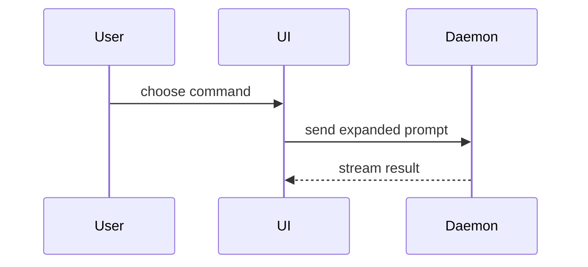

Use este modelo para escrever o corpo do PR:

```markdown
## Resumo

<diagrama, esboço de diff ou árvore>

## Evidências

- **Antes:** <captura de tela/saída/teste falhando>
  **Depois:** <captura de tela/saída/teste passando>

## Perigo do merge

**Porta:** <mão única ou mão dupla>

<opcional: descrição>

**Raio de impacto:** <descrição em uma palavra>

<opcional: possíveis consequências do merge>
```

## Seções

Pule qualquer preâmbulo e mantenha a prosa curta. Use a linguagem de domínio do usuário que está no `GLOSSARY.md`.

### Resumo

Escolha a menor visualização que deixe claro o ponto principal.

- Mostre lógica ou um algoritmo como pseudocódigo:

```text
on(save)
  if content is unchanged
    return cached result
  write new content
  return fresh result
```

- Mostre o fluxo de controle em tempo de execução como uma árvore de chamadas:

```text
submitForm
  createSession
    persistPrompt
    launchAgent
  navigateToSession
```

- Mostre a estrutura da UI como uma árvore de componentes, incluindo o estado e as fronteiras de módulo que importam:

```text
<SessionPage> (apps/example/src/routes/session.tsx)
  useSessionEvents()
  <SessionToolbar>
    <RunSkillButton> (packages/ui)
```

- Mostre a responsabilidade dos arquivos ou uma refatoração ampla como uma árvore de arquivos rasa:

```text
src/
├── commands/       # parses user actions
├── sessions/       # owns session state
└── transport/      # sends API requests
```

- Mostre interação entre componentes, fluxo de controle ou fluxo de dados com Mermaid:



- Use `diff` quando o ponto é o que muda e o formato ao redor já existe. Adapte o formato do diff ao assunto.

Para uma mudança de componente:

```diff
 <SessionPage>
   useSessionEvents()
   <SessionToolbar>
+    <RunSkillButton />
   <SessionTimeline>
+    <SkillResultCard />
```

Para uma mudança na organização dos arquivos:

```diff
 src/
 ├── commands/
+│   └── show-me.ts       # expands the slash command
 ├── sessions/
-└── transport.ts
+└── transport/
+    ├── client.ts
+    └── stream.ts
```

Para uma mudança na árvore de chamadas ou na pilha de chamadas:

```diff
 submitForm
   createSession
     persistPrompt
+    expandSkillMention
     launchAgent
-  navigateToSession
+  navigateToSession
+    subscribeToEvents
```

Para uma mudança de estado ou de fluxo de controle:

```diff
 on(save)
-  write content
+  if content is unchanged
+    return cached result
+  write new content
+  invalidate cache
```

- Mostre o bloco inteiro quando a maior parte dele for nova, quando omitir o contexto esconderia a quem pertence algo ou a ordem das coisas, ou quando o usuário precisar de um formato final que possa copiar:

```ts
function expandSkill(command: string): string {
  const skillName = command.slice(1);
  return `use the ${skillName} skill`;
}
```

#### Orientação

Coloque cada visual ao lado do texto curto que ele apoia. Mantenha só as chamadas, arquivos, props, estados e fronteiras necessários para responder à pergunta atual do usuário ou às opções para resolver o ponto em discussão.

Você pode usar um destes, pode usar vários, mas é pouco provável que use todos. Use seu bom senso e não sobrecarregue o usuário.

### Evidências

Evidência concreta de que a mudança funciona. Mostre um antes e depois.

Capturas de tela são nível S - quando o ambiente está preparado para isso e a mudança é visual.

Evidência baseada em execução é nível A. Resultados de testes, saída do console. Mostre o teste exato que agora falha e passa, usando pseudocódigo.

### Perigo do merge

Descreva se é uma porta de mão única (one-way) ou de mão dupla (two-way). Dá para voltar por portas de mão dupla, mas não por portas de mão única. Um PR barato de reverter tem risco menor. Mudanças que envolvem ações destrutivas ou decisões difíceis de reverter são portas de mão única.

O raio de impacto (blast radius) é o impacto potencial ou o alcance das mudanças introduzidas por este PR. Considere todas as possibilidades. Exemplos: deslocamento de layout, quebras para quem consome o código, responsividade no celular etc.
