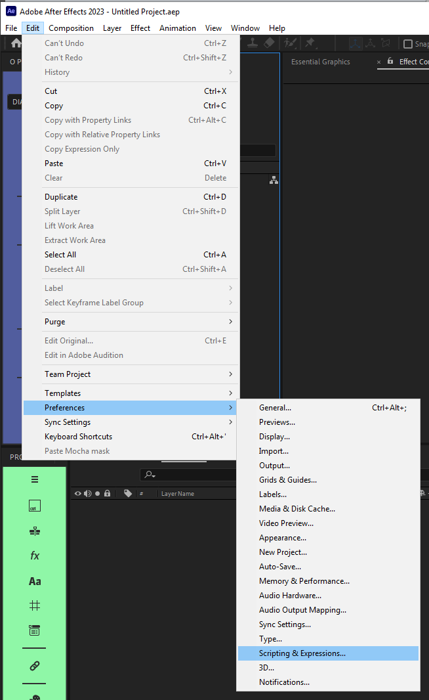

# 🥖 O PADEIRO

🗨️ **pt-BR** ⚡ preenchimento em massa de templates e outras utilidades para o After Effects ⚡

o padeiro duplica comps, preenche os textos e cria a fila de render a partir de um projeto template. ideal para volumes grandes de "*artes iguais*" e caminhos de rede longos e confusos.

o fluxo é simples, em 3 etapas:\
`1 buscar` > `2 selecionar` > `3 preencher`


o padeiro é uma **extensão** do After Effects: um conjunto de painéis que podem ser acoplados em qualquer lugar da interface, como os painéis nativos.

| painel | para que serve |
| --- | --- |
| **O PADEIRO** | a barra principal: produção, ferramentas e atalhos para os outros painéis |
| **O PADEIRO templates** | buscar, selecionar e preencher templates, e criar a fila de render |
| **O PADEIRO criar template** | transformar a comp aberta em um novo template |
| **O PADEIRO produções** | editar a lista de produções da equipe |
| **O ACESSORISTA** | buscar caminhos de atrações e textos nos layers do projeto |
| **O PADEIRO conversor** | converter caminhos entre Windows e macOS |

<br>

## 📍 sumário

- [instalação](#-instalação)
- [a barra principal](#-a-barra-principal)
- [produções](#-produções)
- [preenchendo templates](#-preenchendo-templates)
- [criando um novo template](#-criando-um-novo-template)
- [O ACESSORISTA](#-o-acessorista)
- [conversor de caminhos](#-conversor-de-caminhos)
- [outras ferramentas da barra](#-outras-ferramentas-da-barra)
- [teclado e atalhos](#-teclado-e-atalhos)
- [🚨 atenção!](#-atenção)
- [✨ dicas](#-dicas)
- [manutenção](#-manutenção)

<br>

---

<br>

## 📍 instalação

requer After Effects **2022 (22.0)** ou mais novo, no macOS ou no Windows.

1. habilite o acesso à rede nas preferências do After Effects (veja [abaixo](#habilitando-o-acesso-à-rede)).
2. no After Effects, acesse `File` > `Scripts` > `Run Script File...` e escolha o arquivo **`INSTALAR O PADEIRO.jsx`**, direto da **pasta do padeiro na rede** (a que tem a pasta `extension/` e o arquivo `O_PADEIRO_config.json`).
3. clique em '*Instalar*' (ou '*Atualizar*', se já estiver instalado).
4. **reinicie** o After Effects.
5. abra os painéis pelo menu `Window` > `Extensions` e acople onde preferir. comece pelo **O PADEIRO** (a barra): os outros abrem pelos botões dela.

> 🚩 *obs:*\
> • instale sempre **a partir da pasta do padeiro na rede**: o instalador grava onde está a lista de produções compartilhada, e é ela que mantém todo mundo com a lista mais atual.\
> • o **código do padeiro fica na rede**: o computador recebe só um carregador, que abre os painéis direto da pasta do padeiro. por isso, **para atualizar, basta fechar e abrir o painel de novo** depois que os arquivos da rede forem trocados.\
> • o instalador só precisa rodar de novo quando a lista de painéis mudar (um painel novo, por exemplo). o mesmo instalador também **remove** a extensão.\
> • sem acesso à pasta do padeiro na rede, os painéis avisam e tentam de novo sozinhos.\
> • o instalador roda dentro do After Effects, então o macOS não bloqueia (como acontece com scripts abertos pelo Finder).\
> • o instalador também remove a versão antiga do padeiro (o script `O PADEIRO.jsx` da pasta `Scripts/ScriptUI Panels`), que deixou de existir.

### habilitando o acesso à rede

o padeiro lê e grava arquivos na rede (templates, lista de produções, fontes). para isso, acesse:\
`Edit` > `Preferences` > `Scripting & Expressions...`\
e habilite a opção '**Allow Scripts to Write Files and Access Network**'.

> 📋 *exemplo:*\
> 
> 

<br>

---

<br>

## 📍 a barra principal

a barra se adapta ao tamanho do painel: horizontal, com os nomes embaixo dos ícones, ou vertical, com os nomes ao lado.

> 


cada botão tem **duas ações**: `◖ clique esquerdo` e `◗ clique direito`. a dica de cada botão (passe o mouse) lista as duas.

- **pãozinho** (na ponta direita; na vertical, embaixo) → abre esta documentação.
- **produção** → escolhe a produção atual (a pasta de templates usada pelo painel de templates).\
  `◖ clique DUPLO` no ícone da produção → abre o editor de produções.
- **corrente** → abre a planilha de apontamento de projetos.
- **templates**\
  `◖` → abre o painel de templates.\
  `◗` → abre o criador de templates (com a comp principal aberta).
- **fontes**\
  `◖` → instala as fontes do template que preencheu o projeto.\
  `◗` → faz o collect das fontes usadas no projeto.
- **pastas**\
  `◖` → abre a pasta de output do último item da fila de render.\
  `◗` → abre o conversor de caminhos Windows / macOS.
- **renomear**\
  `◖` → renomeia as comps selecionadas.\
  `◗` → renomeia todas as saídas da fila de render.
- **organizar**\
  `◖` → organiza o projeto.\
  `◗` → cria só a estrutura de pastas do projeto.
- **buscar**\
  `◖` → abre **O ACESSORISTA** na busca de caminhos.\
  `◗` → abre **O ACESSORISTA** na busca de textos.

<br clear="right">

> 🚩 *obs:*\
> • a versão do padeiro aparece embaixo do pãozinho.\
> • a produção escolhida vale para todos os painéis, que acompanham a troca na hora.

<br>

---

<br>

## 📍 produções

uma **produção** é uma pasta que contém (ou vai conter) templates do padeiro, organizados em subpastas como a equipe preferir.

a lista de produções é **uma só para a equipe**: o arquivo `O_PADEIRO_config.json`, na pasta do padeiro na rede. quando alguém muda a lista, a barra e os painéis de todo mundo atualizam sozinhos.

> 📟 *editor de produções* (`◖ clique DUPLO` no ícone da produção, na barra):
>
> 

1. clique em '*+ nova produção*'.
2. escolha um ícone (opcional), digite o nome e escolha a pasta de templates (o ponto ao lado do caminho fica verde quando a pasta existe).
3. clique em '*Salvar lista*' (ou `Ctrl/Cmd+S`).

- **filtrar** → mostra só as produções com o termo no nome ou no caminho.
- **importar / exportar** → lê ou grava uma lista completa, com os ícones.
- **recarregar** → lê a lista de novo, descartando o que não foi salvo.

> 🚩 *obs:*\
> • a lista é sempre gravada em ordem alfabética: use caracteres especiais ou números no início do nome para colocar uma produção no topo.\
> • o ícone tem **24 x 24 pixels**: imagens maiores são cortadas no centro e reduzidas.\
> • se outra pessoa salvou a lista depois que você abriu o editor, o padeiro **não** sobrescreve o trabalho dela: recarregue e refaça as alterações. uma cópia da lista anterior fica em `O_PADEIRO_config.bak.json`.\
> • sem acesso ao arquivo compartilhado (rede fora), não há lista: os painéis avisam e voltam a ler sozinhos quando a rede voltar.

<br>

---

<br>

## 📍 preenchendo templates

o painel de templates mostra os templates da produção escolhida na barra. ele começa só com a busca e se abre em duas colunas quando você escolhe um template.

> 📟 *lista de templates:*
>
> 

1. `◖ clique esquerdo` em **templates**, na barra.
2. busque ou navegue pelas pastas.
3. selecione o template.
4. preencha o **input** seguindo as **dicas**.
5. clique em '*Preencher*' (ou `Ctrl/Cmd+Enter`).
6. escolha o template de output e clique em '*Criar fila de render*'.

> 📟 *template selecionado:*
>
> 

### a lista

- **busca** → filtra enquanto você digita, sem diferenciar maiúsculas e acentos. `Enter` seleciona o primeiro template encontrado.
- **★ fixados** → passe o mouse em um template e clique na estrela para fixá-lo no topo da lista.
- **recentes** → os últimos 5 templates preenchidos ou importados.
- **atualizar** → lê a pasta de templates de novo.
- **abrir pasta** → abre a pasta do template selecionado (sem seleção, a pasta de templates da produção).
- `◖ clique` no template selecionado (ou no fundo da lista, ou `Esc`) → desmarca o template.
- `◖ clique DUPLO` no template → importa o template para o projeto, sem preencher.

>  

> 🚩 *obs:*\
> • a lista mostra só os arquivos `.aep` / `.aet` e as pastas que têm templates. uma pasta com uma única subpasta aparece como `PASTA / SUBPASTA`.\
> • pastas de rede podem demorar: enquanto a lista é lida, o forninho mostra quantas pastas já foram lidas.\
> • fixados e recentes são de cada computador e de cada produção.

### o template

- **preview** → a imagem `_preview.png` do template (transparências aparecem sobre um fundo xadrez). se existir um vídeo `_preview.webm` (ou `.mp4`), ele toca em loop e o mouse passa pelos quadros, como o thumbnail do Premiere.
- **input** → o texto que preenche o template. cada bloco separado por uma **linha vazia** vira uma comp (o contador mostra quantos itens o texto tem).
- **dicas** → como preencher esse template.
- **abrir output** → abre as pastas de output do template.
- **importar template** → importa o template para o projeto, sem preencher.
- **✎ editar config** → abre o editor do arquivo de configuração (veja [editor de config](#editor-de-config)).

### fontes do template

ao selecionar um template, o padeiro confere se as fontes da pasta `FONTS` dele estão instaladas. se faltar alguma, um aviso aparece acima do input.

> 

- **instalar** (no aviso) → instala as fontes que faltam, ali mesmo. o resultado aparece no próprio aviso, que se fecha no ×.
- **preencher** (ou importar) com fontes faltando → segue normalmente, sem a janela '*Resolve Fonts*' do After Effects (as fontes que faltam são trocadas pela padrão).

> 🚩 *obs:*\
> • no macOS as fontes são copiadas para `~/Library/Fonts`; no Windows, instaladas por um script de PowerShell.\
> • se o After Effects ainda não mostrar uma fonte recém-instalada, reinicie-o.

### fila de render

> 

depois de preencher, o padeiro mostra cada comp criada e pede o **template de output** (os presets do After Effects). as saídas vão para as pastas de output do template.

- **criar fila de render** → adiciona as comps à fila com o output certo. com tudo certo, o painel de templates **fecha sozinho**.
- **concluir sem fila** → termina sem criar a fila.

para criar um novo preset de output, acesse:\
`Edit` > `Templates` > `Output Module...`

> 

o padeiro executa as seguintes tarefas, em ordem:

1. importar o projeto do template.
2. duplicar a comp principal para cada item do input.
3. preencher os textos.
4. renomear as comps a partir do conteúdo.
5. organizar o projeto no padrão da PROMO.
6. adicionar as comps à fila de render.
7. definir os caminhos de output.
8. rodar o script do template (`_script.js`), se existir.

### editor de config

> 

o lápis ao lado do nome do template abre um formulário para o `_config.json`: nome, comp principal, prefixo, tempo de referência, caixa de texto, separador, exemplo, dicas, layers editáveis (com a ordem), variações de layout (`inputFx`) e pastas de import e output. em um template sem config, o mesmo botão cria o arquivo.

> 🚩 *obs:*\
> • o formulário mostra o nome final da comp com o exemplo e confere tudo antes de salvar.\
> • chaves do arquivo que o formulário não conhece são preservadas.

<br>

---

<br>

## 📍 criando um novo template

um template do padeiro é um conjunto de arquivos:

- o **projeto** do After Effects com a comp principal (de preferência salvo como `.aet`);
- `<nome>_config.json` → como preencher o template;
- `<nome>_preview.png` → a imagem de preview;
- a pasta `FONTS` → os arquivos das fontes usadas no projeto.

> 📟 *criador de templates:*
>
> 

1. limpe o projeto: remova tudo o que não for necessário para a comp principal.
2. abra a comp principal e `◗ clique direito` em **templates**, na barra.
3. preencha o '*nome da configuração*', o '*exemplo de preenchimento*' e as '*dicas*'.
4. posicione a agulha da timeline em um frame de referência e clique em '*Capturar preview*'.
5. escolha a '*caixa de texto*', o '*prefixo*' e o '*separador*'.
6. selecione os layers editáveis na comp, na ordem de preenchimento, e clique em '*+ layers*' (os que já estavam selecionados ao abrir entram sozinhos).
7. escolha a '*pasta de mídias*' (opcional) e as '*pastas de output*'.
8. use '*Testar agora*' para conferir o preenchimento com o exemplo.
9. clique em '*Salvar template*' (ou `Ctrl/Cmd+S`).

> 📟 *o que falta para salvar:*
>
> 

a barra de salvar mostra o que falta: **preview**, **nome**, **layers**, **exemplo** e **output**. clique em um item para ir até ele. o item **exemplo** avisa quando o número de informações do exemplo não bate com o número de layers.

ao salvar, o padeiro:

1. marca a comp principal com o comentário `TEMPLATE`.
2. abre a janela de salvar do After Effects (cancelar não muda nada).
3. grava o `_config.json` e o `_preview.png` ao lado do projeto.
4. copia as fontes usadas para a pasta `FONTS`.
5. abre a pasta do template.

### formulário e nomenclatura

- **nome da configuração** → identifica o template no log.
- **exemplo de preenchimento** → idealmente, o texto usado no preview. '*puxar dos layers*' monta o exemplo com o texto atual dos layers editáveis.
- **dicas** → cada linha vira um item da lista de dicas. seja claro: inclua instruções para footages, controles de expressão e tudo o que for preciso.
- **prefixo** → começo do nome de todas as comps criadas.
- **caixa de texto** → `CAIXA ALTA`, `caixa baixa`, `Título` ou `livre` (sem conversão).
- **separador** → o texto que separa informações diferentes no input. use `\n` para uma informação por linha.

### layers editáveis

> 

- **+ layers** → adiciona os layers selecionados na comp principal.
- **método** → '*conteúdo do texto*' preenche um layer de texto; '*nome do layer*' renomeia o layer.
- **↑ ↓ ×** → reordenam ou removem o layer.
- clique no nome do layer → seleciona o layer na comp.
- **testar agora** → preenche os layers com o primeiro bloco do exemplo e captura um novo preview (o texto do exemplo não muda).

> 🚩 *obs:*\
> • a 1ª informação do input vai para o 1º layer da lista, a 2ª para o 2º, e assim por diante.\
> • o separador só é usado com mais de um layer editável.\
> • todo template pode ter várias pastas de output: o render é copiado em todas. sem nenhuma, vale o output padrão.

### arquivo de configuração

> 📋 *exemplo:* `RODAPE CONVIDADO_config.json`
>
> ```jsonc
> // "\n" representa uma quebra de linha.
> {
>   "configName": "CONVERSA COM BIAL TARJA RODAPÉ CONVIDADO", // → nome da configuração.
>   "exemple": "CÁSSIO\nGABUS MENDES\n---\nATOR",             // → texto de exemplo do input.
>   "tip": "digite o texto em 1, 2 ou 3 linhas para nome e informação.\n\nuse 1 linha com '---' para separar nome e informação.", // → dicas.
>
>   "compName": "RDP - CONVIDADO TEMPLATE", // → nome da comp principal.
>   "prefix": "RDP",                        // → prefixo do nome das comps criadas.
>   "refTime": 2,                           // → tempo (s) em que todas as informações estão visíveis.
>   "separator": "---",                     // → texto que separa as informações.
>   "textCase": "upperCase",                // → "upperCase", "lowerCase", "titleCase" ou "freeCase".
>
>   "inputLayers": [                             // → layers editáveis, na ordem de preenchimento.
>     {"layerIndex": 4, "method": "textContent"}, // → índice do layer: 1, 2, 3...
>     {"layerIndex": 5, "method": "textContent"}  // → "textContent" preenche o texto, "layerName" renomeia o layer.
>   ],
>
>   "inputFx": {"layerIndex": 1, "fxName": "layout", "optionIndex": 1, "options": ["E", "D"]}, // → variações de layout (opcional).
>
>   "importPath": "~/Downloads", // → pasta padrão para importar footages.
>   "outputPath": [              // → pastas de output.
>     "//10.228.183.146/edit_in_place/PROMO/cdesign_output/C# ABERTA & INTER/ARTE SP/CONVERSA COM BIAL/CONVIDADOS"
>   ]
> }
> ```

> 📋 *variações de layout* (`inputFx`):\
> o primeiro layer da comp principal tem um controlador de expressão chamado '**layout**' com **2 opções** de alinhamento, esquerda e direita, e os sufixos '**E**' e '**D**'.\
> cada preenchimento desse template gera **2 comps**: uma alinhada à esquerda, com sufixo '**E**', e outra à direita, com sufixo '**D**'. as variações são editadas no [editor de config](#editor-de-config).

<br>

---

<br>

## 📍 O ACESSORISTA

as buscas do padeiro, em um painel com duas abas.

### caminhos

> 

`◖ clique esquerdo` em **buscar**, na barra. pesquise por atração, projeto, output ou caminho (a partir de 2 caracteres) e abra as pastas direto no Finder / Explorer.

- **categorias** → TEAMS, TRELLO, SERVIDOR... cada uma tem um interruptor para entrar ou sair da busca.
- **⋯** → ajuda e recarregar o painel.
- **abrir projeto / abrir output** → abrem as pastas de projeto e de output da atração.
- **abrir: PASTA** → abre a pasta do caminho que contém o termo buscado.
- **caminho** → clique para abrir a pasta.
- **atualizar** → baixa os caminhos de novo.

> 🚩 *obs:*\
> • os caminhos vêm de um workflow e ficam em cache por 30 segundos, para trazer sempre os caminhos mais atuais do Teams. sem conexão, o último índice salvo é usado.\
> • no macOS, os volumes de rede necessários são montados ao abrir uma pasta.\
> • aparecem no máximo 12 atrações por busca: refine o termo para ver as demais.

### textos

> 

`◗ clique direito` em **buscar**, na barra. o painel lê os textos de todos os layers do projeto e filtra enquanto você digita.

- **APENAS VISÍVEIS** → só layers ligados.
- **IGNORAR ACENTOS** → '*amazonia*' também encontra '*Amazônia*' (ligado por padrão).
- **INVERTER** → layers que **não** contêm o termo.
- clique em um resultado → abre a comp com o layer selecionado, no tempo em que o texto aparece.
- **atualizar** → lê o projeto de novo (depois de alterar os textos).

> 🚩 *obs:*\
> • a busca ignora maiúsculas e minúsculas, e caracteres como `(`, `.` ou `?` não têm significado especial.

<br>

---

<br>

## 📍 conversor de caminhos

> 

`◗ clique direito` em **pastas**, na barra. o conversor abre com a pasta da última saída da fila de render.

- **cole um caminho em qualquer lugar do painel** → o padeiro reconhece se é macOS ou Windows, coloca no campo certo e converte o outro.
- **copiar** → copia o caminho.
- **abrir pasta** → abre o caminho no sistema atual (ou a pasta mais próxima que existe).
- **atualizar** (canto) → volta a usar a pasta da última saída da fila de render.
- `Esc` → limpa os dois campos.

> 🚩 *obs:*\
> • aceita caminhos com aspas ('*copiar como caminho*' do Windows), letras de drive mapeadas (ex: `L:\`) e endereços `smb://` do Finder.

<br>

---

<br>

## 📍 outras ferramentas da barra

### fontes

`◖ clique esquerdo` → instala as fontes da pasta `FONTS` do template que preencheu o projeto.

*ao preencher um template, o padeiro grava no campo '**Source**' dos metadados do projeto o caminho do template. por isso essa instalação funciona só em projetos preenchidos pelo padeiro.*

`◗ clique direito` → copia os arquivos das fontes usadas no projeto (incluindo as que aparecem só em keyframes de texto) para uma pasta escolhida.

> 🚩 *obs:*\
> • fontes sem arquivo local (ex: Adobe Fonts) não podem ser copiadas: o padeiro avisa quais ficaram de fora.

### pastas

`◖ clique esquerdo` → abre a pasta do primeiro arquivo de saída do último item da fila de render. se a pasta ainda não existir (antes do render), abre a mais próxima que existe.

`◗ clique direito` → abre o [conversor de caminhos](#-conversor-de-caminhos).

### renomear

`◖ clique esquerdo` → renomeia as comps selecionadas no painel de projeto: remove caracteres especiais, passa para MAIÚSCULAS e acrescenta o prefixo do tipo (rodapé, cartão, lettering...).

*o tipo vem do nome da pasta em que a comp está (ex: `RODAPES`, `LETTERING - JOGO`) ou de um prefixo / sufixo já presente no nome da comp. o nome da pasta tem prioridade.*

`◗ clique direito` → aplica a mesma regra aos arquivos de saída de **todos** os itens da fila de render (o nome das comps não muda).

> 🚩 *obs:*\
> • com uma pasta do projeto selecionada, a pasta e todas as comps dentro dela são renomeadas.\
> • cada saída continua na pasta em que estava; itens já renderizados não mudam e nomes repetidos na mesma pasta ganham um sufixo (`_2`, `_3`...).\
> • comps com o layer de texto `script_template_name` (último layer) recebem o nome definido nesse layer.

**prefixos e termos reconhecidos** (no singular ou plural, com ou sem acento, como palavras inteiras):

| prefixo | termos |
| --- | --- |
| **RDP** | RODAPE, RDP |
| **CRT** | CARTAO, CARTOES, CRT |
| **LETT** | LETTERING, LETT, LET |
| **CONFRONTO** | CONFRONTO |
| **TARJA** | TARJA, TRJ, TAR |
| **PASSAGEM** | PASSAGEM, TRANSICAO, TRANSICOES, LAPADA |
| **ASSINA** | ASSINATURA, ASSINA, ASS |
| **FOTO** | FOTO, IMG, IMAGEM, IMAGENS |
| **REF** | REFERENCIA, PREVIEW, REF, PREV |

### organizar

`◖ clique esquerdo` → organiza o projeto no modelo da PROMO.

> 🚩 *obs:*\
> • **selecione antes as comps principais** (as que serão renderizadas): elas recebem o comentário 'EXPORTAR' e vão para '01 COMPS'.\
> • comps com comentário 'EXPORTAR', 'TEMPLATE' ou 'LOGO GLOBO' também vão para '01 COMPS'; as com o comentário de um tipo reconhecido (ex: 'RODAPE', dado pelo renomear) vão para uma subpasta com esse nome.\
> • as demais comps vão para '02 PRECOMPS' (em subpastas pelo comentário, se houver).\
> • footages vão para '03 ARQUIVOS' (VIDEOS, IMAGENS, AUDIO, SOLIDOS, DADOS) e arquivos ausentes para 'MISSING'. o texto do comentário antes de ':' vira subpasta.\
> • pastas que ficarem vazias são removidas.

`◗ clique direito` → cria só a estrutura de pastas (as que já existem são reaproveitadas).

> 

<br>

---

<br>

## 📍 teclado e atalhos

o mesmo vocabulário em todos os painéis:

| tecla | o que faz |
| --- | --- |
| `↑` `↓` | andam nas listas. `↓` na busca vai para o primeiro item; `↑` no primeiro volta para a busca |
| `Enter` | abre / seleciona. nos templates, seleciona e leva para o input |
| `Esc` | limpa a busca ou volta um passo |
| `Ctrl/Cmd+F` | foca a busca do painel |
| `Ctrl/Cmd+S` | salva (produções, criador de templates) |
| `Ctrl/Cmd+Enter` | preenche (templates) |
| `Ctrl/Cmd+C` | copia o caminho ou o texto do resultado em foco (O ACESSORISTA) |

- **templates** → `←` `→` fecham e abrem as pastas; digitar com a lista em foco leva as letras para a busca.
- **barra** → `←` `→` andam pelos botões; `Enter` faz a ação do clique esquerdo e `Shift+Enter` a do direito.
- **listas suspensas** → com a lista aberta, digite para filtrar (útil com muitas produções).
- **produções** → `↑` `↓` em um campo vão para o mesmo campo da linha de cima / de baixo.

<br>

---

<br>

## 🚨 atenção!

`CONFIRA SEMPRE AS COMPOSIÇÕES CRIADAS, SEU CONTEÚDO E O CAMINHO DO OUTPUT!`

os layouts dos templates podem variar para exibir ou omitir informações, então o resultado final pode ficar diferente do preview.

> 📋 *exemplo:*\
> as comps criadas podem ter layers omitidos por falta de conteúdo ou elementos com cores diferentes das do preview.

cada template deve ter uma imagem com o **mesmo nome exato** do template seguido de '*_preview.png*' e um arquivo de configuração '*_config.json*'.

> 📋 *exemplo:*\
> um template *"FOTO_CONVIDADO.aet"* deve estar acompanhado de *"FOTO_CONVIDADO_preview.png"* e *"FOTO_CONVIDADO_config.json"*.

sem um caminho de output (ou se a pasta não existir) e sem separador, valem os padrões internos:

> • **output padrão** → '*~/Desktop*'.\
> • **separador padrão** → '*---*'.

a quebra de linha '*\n*' também pode ser o separador: útil para dividir a mesma informação em layers com formatações diferentes.

> 📋 *exemplo:*\
> o nome *"Lima\nDuarte"*, em duas linhas, com *"Lima"* em uma fonte light e *"Duarte"* em uma fonte bold.

<br>

---

<br>

## ✨ dicas

a menos que o template use a caixa de texto '**livre**', não se preocupe com **maiúsculas** e **minúsculas**: o padeiro converte o texto.

> 📋 *exemplo:*\
> "*cauã raymond*", "*CAUà RAYMOND*" ou "*cAuà raYMOnd*" viram "*Cauã Raymond*" em um template com '*titleCase*'.

um `◖ clique DUPLO` em qualquer template da lista importa o template na hora, para editar manualmente.

templates sem config (ou sem layers editáveis) não podem ser preenchidos pelo input, mas ainda podem ser **importados** e **preenchidos manualmente** no After Effects.

<br>

---

<br>

## 📍 manutenção

o código da extensão, a estrutura dos arquivos, como testar sem o After Effects e onde ficam as configurações mais comuns estão em [`extension/README.md`](extension/README.md).
