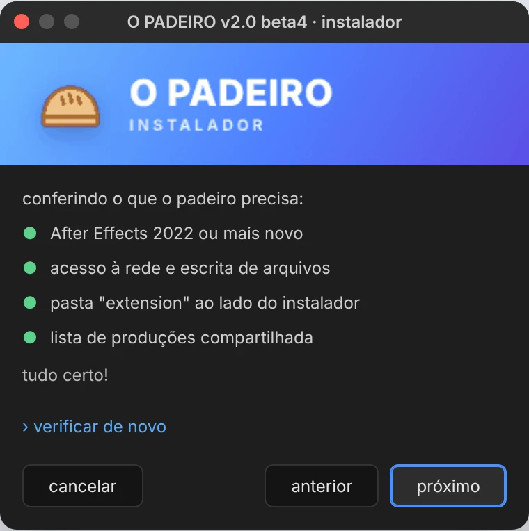
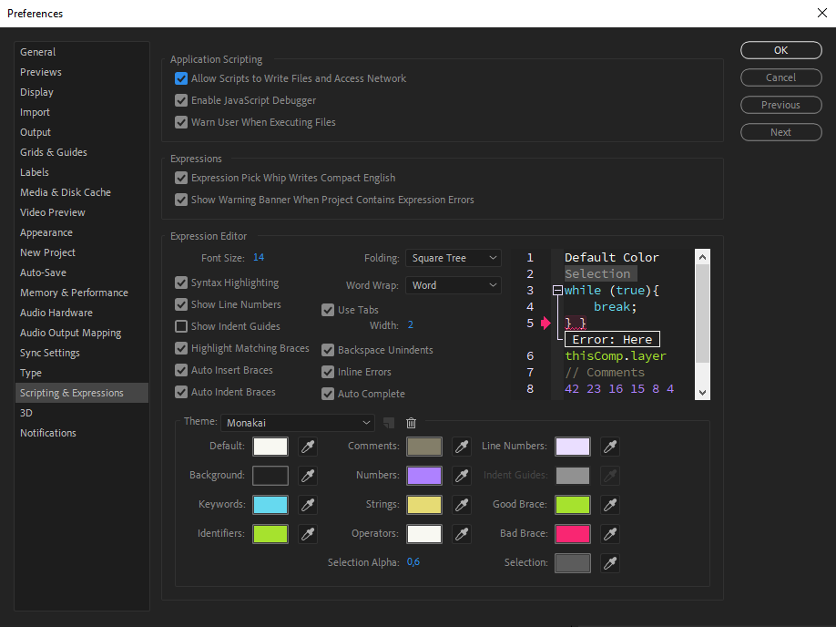
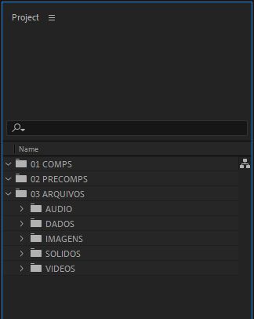

# 🥖 O PADEIRO · v2.0 beta4

🗨️ **pt-BR** ⚡ preenchimento em massa de templates e outras utilidades para o After Effects ⚡

o padeiro duplica comps, preenche os textos e cria a fila de render a partir de um projeto template. ideal para volumes grandes de "*artes iguais*" e caminhos de rede longos e confusos.

o fluxo é simples, em 3 etapas:\
`1 buscar` > `2 selecionar` > `3 preencher`

> 🚩 *a versão anterior (script ScriptUI, até a v1.97) continua disponível no branch [`LEGACY`](https://github.com/jmbillard/O-PADEIRO/tree/LEGACY).*

o padeiro é uma **extensão** do After Effects: a **barra** é um painel que pode ser acoplado em qualquer lugar da interface, como os painéis nativos, e as outras ferramentas abrem em **janelas** próprias, pelos botões da barra.

| painel | para que serve |
| --- | --- |
| **INSTALAR O PADEIRO.jsx** | instalar, atualizar ou remover o padeiro neste computador ([abaixo](#-instalação)) |
| **O PADEIRO** | a barra principal: produção, ferramentas e atalhos para os outros painéis ([abaixo](#-a-barra-principal)) |
| **O PADEIRO templates** | buscar, selecionar e preencher templates, e criar a fila de render → [documentação](docs/templates.md) |
| **O PADEIRO criar template** | transformar a comp aberta em um novo template → [documentação](docs/criador.md) |
| **O PADEIRO produções** | editar a lista de produções da equipe → [documentação](docs/producoes.md) |
| **O ACESSORISTA** | buscar caminhos de atrações e textos nos layers do projeto → [documentação](docs/acessorista.md) |
| **O PADEIRO conversor** | converter caminhos entre Windows e macOS → [documentação](docs/conversor.md) |

cada painel tem a sua documentação, também aberta pelo **⋯ > ajuda / documentação** do próprio painel.

 

 

## 📍 sumário

- [instalação](#-instalação)
- [a barra principal](#-a-barra-principal)
- [ferramentas da barra](#-ferramentas-da-barra)
- [painéis](#-painéis)
- [teclado e atalhos](#-teclado-e-atalhos)
- [códigos de erro](#-códigos-de-erro)
- [manutenção](#-manutenção)

 

---

 

## 📍 instalação

requer After Effects **2022 (22.0)** ou mais novo, no macOS ou no Windows.

1. no After Effects, acesse `File` > `Scripts` > `Run Script File...` e escolha o arquivo **`INSTALAR O PADEIRO.jsx`**, direto da **pasta do padeiro na rede** (a que tem a pasta `extension/` e o arquivo `O_PADEIRO_config.json`).
2. o instalador guia o passo a passo:
   - **checagem** → confere a versão do After Effects, o acesso à rede, a pasta `extension/` e a lista de produções compartilhada. o que faltar fica marcado em vermelho (ou amarelo, se for só um aviso), com a explicação de como resolver. sem o acesso à rede, o link '*› abrir preferências de scripts e expressões*' abre a tela certa: marque a opção (veja [abaixo](#habilitando-o-acesso-à-rede)) e clique em '*› verificar de novo*'.
   - **ação** → '*instalar*' (ou '*atualizar*', se já estiver instalado) ou '*remover*'.
   - **andamento** → a barra mostra cada etapa e, no fim, o resumo.

   > 📟 *instalador (checagem):*
   >
   > 
3. **reinicie** o After Effects. no macOS, se o padeiro não aparecer em `Window` > `Extensions`, reinicie o computador: a liberação de extensões sem assinatura às vezes só vale depois disso.
4. abra a barra pelo menu `Window` > `Extensions` > `O PADEIRO` e acople onde preferir. as outras ferramentas abrem em janelas, pelos botões da barra (ou pelo mesmo menu).

> 🚩 *obs:*\
> • instale sempre **a partir da pasta do padeiro na rede**: o instalador grava onde está a lista de produções compartilhada, e é ela que mantém todo mundo com a lista mais atual.\
> • o **código do padeiro fica na rede**: o computador recebe só um carregador, que abre os painéis direto da pasta do padeiro. por isso, **para atualizar, basta fechar e abrir o painel de novo** depois que os arquivos da rede forem trocados.\
> • o instalador só precisa rodar de novo quando a lista de painéis mudar (um painel novo, por exemplo). o mesmo instalador também **remove** a extensão.\
> • sem acesso à pasta do padeiro na rede, os painéis avisam e tentam de novo sozinhos.\
> • o instalador roda dentro do After Effects, então o macOS não bloqueia (como acontece com scripts abertos pelo Finder).\
> • **janelas pretas no After Effects 2025**: resolvido a partir desta versão. se ainda acontecer, rode o instalador de novo (o carregador antigo usava outro manifest).\
> • o instalador também remove a versão antiga do padeiro (o script `O PADEIRO.jsx` da pasta `Scripts/ScriptUI Panels`), que deixou de existir.

### habilitando o acesso à rede

o padeiro lê e grava arquivos na rede (templates, lista de produções, fontes). na checagem, o instalador abre sozinho a tela de preferências certa: marque '**Allow Scripts to Write Files and Access Network**' e clique em '*› verificar de novo*'.

> 📋 *a opção nas preferências de scripting:*\
> 

 

---

 

## 📍 a barra principal

a barra se adapta ao tamanho do painel: horizontal, com os nomes embaixo dos ícones, ou vertical, com os nomes ao lado.

> 

cada botão tem **duas ações**: `◖ clique esquerdo` e `◗ clique direito`. a dica de cada botão (passe o mouse) lista as duas.

- **pãozinho** (na ponta direita; na vertical, embaixo) → abre esta documentação.
- **produção** → escolhe a produção atual (a pasta de templates usada pelo painel de templates).\
  `◖ clique DUPLO` no ícone da produção → abre o editor de produções.
- **corrente** → abre a planilha de apontamento de projetos.
- **templates**\
  `◖` → abre o painel de templates.\
  `◗` → abre o criador de templates (com a comp principal aberta).
- **fontes**\
  `◖` → instala as fontes do template que preencheu o projeto.\
  `◗` → faz o collect das fontes usadas no projeto.
- **pastas**\
  `◖` → abre a pasta de output do último item da fila de render.\
  `◗` → abre o conversor de caminhos Windows / macOS.
- **renomear**\
  `◖` → renomeia as comps selecionadas.\
  `◗` → renomeia todas as saídas da fila de render.
- **organizar**\
  `◖` → organiza o projeto.\
  `◗` → cria só a estrutura de pastas do projeto.
- **buscar**\
  `◖` → abre **O ACESSORISTA** na busca de caminhos.\
  `◗` → abre **O ACESSORISTA** na busca de textos.

 

> 🚩 *obs:*\
> • a versão do padeiro aparece embaixo do pãozinho.\
> • a produção escolhida vale para todos os painéis, que acompanham a troca na hora.

 

---

 

## 📍 ferramentas da barra

### fontes

`◖ clique esquerdo` → instala as fontes da pasta `FONTS` do template que preencheu o projeto.

*ao preencher um template, o padeiro grava no campo '**Source**' dos metadados do projeto o caminho do template. por isso essa instalação funciona só em projetos preenchidos pelo padeiro.*

`◗ clique direito` → copia os arquivos das fontes usadas no projeto (incluindo as que aparecem só em keyframes de texto) para uma pasta escolhida.

> 🚩 *obs:*\
> • fontes sem arquivo local (ex: Adobe Fonts) não podem ser copiadas: o padeiro avisa quais ficaram de fora.

### pastas

`◖ clique esquerdo` → abre a pasta do primeiro arquivo de saída do último item da fila de render. se a pasta ainda não existir (antes do render), abre a mais próxima que existe.

`◗ clique direito` → abre o [conversor de caminhos](docs/conversor.md).

### renomear

`◖ clique esquerdo` → renomeia as comps selecionadas no painel de projeto: remove caracteres especiais, passa para MAIÚSCULAS e acrescenta o prefixo do tipo (rodapé, cartão, lettering...).

*o tipo vem do nome da pasta em que a comp está (ex: `RODAPES`, `LETTERING - JOGO`) ou de um prefixo / sufixo já presente no nome da comp. o nome da pasta tem prioridade.*

`◗ clique direito` → aplica a mesma regra aos arquivos de saída de **todos** os itens da fila de render (o nome das comps não muda).

> 🚩 *obs:*\
> • com uma pasta do projeto selecionada, a pasta e todas as comps dentro dela são renomeadas.\
> • cada saída continua na pasta em que estava; itens já renderizados não mudam e nomes repetidos na mesma pasta ganham um sufixo (`_2`, `_3`...).\
> • comps com o layer de texto `script_template_name` (último layer) recebem o nome definido nesse layer.

**prefixos e termos reconhecidos** (no singular ou plural, com ou sem acento, como palavras inteiras):

| prefixo | termos |
| --- | --- |
| **RDP** | RODAPE, RDP |
| **CRT** | CARTAO, CARTOES, CRT |
| **LETT** | LETTERING, LETT, LET |
| **CONFRONTO** | CONFRONTO |
| **TARJA** | TARJA, TRJ, TAR |
| **PASSAGEM** | PASSAGEM, TRANSICAO, TRANSICOES, LAPADA |
| **ASSINA** | ASSINATURA, ASSINA, ASS |
| **FOTO** | FOTO, IMG, IMAGEM, IMAGENS |
| **REF** | REFERENCIA, PREVIEW, REF, PREV |

### organizar

`◖ clique esquerdo` → organiza o projeto no modelo da PROMO.

> 🚩 *obs:*\
> • **selecione antes as comps principais** (as que serão renderizadas): elas recebem o comentário 'EXPORTAR' e vão para '01 COMPS'.\
> • comps com comentário 'EXPORTAR', 'TEMPLATE' ou 'LOGO GLOBO' também vão para '01 COMPS'; as com o comentário de um tipo reconhecido (ex: 'RODAPE', dado pelo renomear) vão para uma subpasta com esse nome.\
> • as demais comps vão para '02 PRECOMPS' (em subpastas pelo comentário, se houver).\
> • footages vão para '03 ARQUIVOS' (VIDEOS, IMAGENS, AUDIO, SOLIDOS, DADOS) e arquivos ausentes para 'MISSING'. o texto do comentário antes de ':' vira subpasta.\
> • pastas que ficarem vazias são removidas.

`◗ clique direito` → cria só a estrutura de pastas (as que já existem são reaproveitadas).

> 

 

---

 

## 📍 painéis

| | |
| --- | --- |
| [🧩 instalação](#-instalação) | o instalador: checagem, instalar / atualizar e remover |
| [📄 templates](docs/templates.md) | buscar, fixados e recentes, preview, fontes, input, fila de render e editor de config |
| [✨ criar template](docs/criador.md) | formulário, nomenclatura, layers editáveis e arquivo de configuração |
| [🗂️ produções](docs/producoes.md) | a lista de produções compartilhada |
| [🔎 O ACESSORISTA](docs/acessorista.md) | busca de caminhos e busca nos textos do projeto |
| [🔁 conversor](docs/conversor.md) | caminhos Windows / macOS |

 

---

 

## 📍 teclado e atalhos

o mesmo vocabulário em todos os painéis:

| tecla | o que faz |
| --- | --- |
| `↑` `↓` | andam nas listas. `↓` na busca vai para o primeiro item; `↑` no primeiro volta para a busca |
| `Enter` | abre / seleciona. nos templates, seleciona e leva para o input |
| `Esc` | limpa a busca ou volta um passo |
| `Ctrl/Cmd+F` | foca a busca do painel |
| `Ctrl/Cmd+S` | salva (produções, criador de templates) |
| `Ctrl/Cmd+Enter` | preenche (templates) |
| `Ctrl/Cmd+Z` / `Ctrl/Cmd+Shift+Z` | desfaz / refaz no texto do input (templates) |
| `Ctrl/Cmd+C` | copia o caminho ou o texto do resultado em foco (O ACESSORISTA) |

- **barra** → `←` `→` andam pelos botões; `Enter` faz a ação do clique esquerdo e `Shift+Enter` a do direito.
- **listas suspensas** → com a lista aberta, digite para filtrar (útil com muitas produções).

os atalhos de cada painel estão na documentação dele.

 

---

 

## 📍 códigos de erro

todo erro do padeiro começa com um código `#PAD_` (o aviso pode ser fechado no ×). use o código para achar a causa:

| código | o que aconteceu |
| --- | --- |
| `#PAD_003` `#PAD_004` `#PAD_007` `#PAD_012` `#PAD_PATH_003` | sem acesso à rede: habilite '*Allow Scripts to Write Files and Access Network*' |
| `#PAD_005` | o projeto não foi preenchido pelo padeiro (instalar fontes depende disso) |
| `#PAD_006` `#PAD_035` | a pasta `FONTS` do template não existe ou não tem `.ttf` / `.otf` |
| `#PAD_008` | a fila de render está vazia |
| `#PAD_009` `#PAD_019` `#PAD_062` | pasta de output (ou caminho) não encontrada |
| `#PAD_017` | o `_config.json` do template é inválido |
| `#PAD_018` `#PAD_022` | o arquivo do template não foi encontrado |
| `#PAD_021` | um layer editável da config não existe no template |
| `#PAD_023` `#PAD_025` `#PAD_026` `#PAD_028` `#PAD_031` `#PAD_063` | criador de templates: comp principal ou layers editáveis faltando |
| `#PAD_027` | criador de templates: o teste de preenchimento falhou |
| `#PAD_029` | criador de templates: falta o nome da configuração |
| `#PAD_032` `#PAD_033` | renomear: nada selecionado / saídas que não puderam ser renomeadas |
| `#PAD_034` | algumas fontes não puderam ser copiadas (ex: Adobe Fonts) |
| `#PAD_036` | organizar: erro ao organizar o projeto |
| `#PAD_043` | o painel pediu uma ação que o host não conhece (painel e host de versões diferentes: reabra o painel) |
| `#PAD_044` `#PAD_045` | editor de config: dado inválido / não foi possível gravar o arquivo |
| `#PAD_046` | o input está vazio |
| `#PAD_047` `#PAD_048` `#PAD_049` | preenchimento / fila de render fora de ordem (comece de novo) |
| `#PAD_050` | o projeto está vazio |
| `#PAD_051` a `#PAD_057` | lista de produções: dado inválido, falha ao gravar ou arquivo de importação inválido |
| `#PAD_058` | não foi possível baixar o índice de caminhos do acessorista |
| `#PAD_059` `#PAD_060` `#PAD_069` | busca de textos: a comp ou o layer não existe mais (atualize a busca) |
| `#PAD_061` | conversor: nenhum caminho informado |
| `#PAD_064` | a lista de produções compartilhada (na rede) não está acessível |
| `#PAD_065` | outra pessoa salvou a lista de produções depois que você abriu o editor |
| `#PAD_066` `#PAD_067` `#PAD_068` | o painel não conseguiu carregar o padeiro da rede |
| `#PAD_070` `#PAD_071` `#PAD_072` `#PAD_PATH_001` `#PAD_PATH_002` | caminho de rede inválido, volume não montado ou pasta inacessível |
| `#PAD_075` | criador: a fila de render já está renderizando (preview .mp4) |
| `#PAD_076` | criador: nenhum template de output H.264 para o preview .mp4 |
| `#PAD_077` | criador: o preview .mp4 não foi gerado |
| `#PAD_099` | erro inesperado: anote a mensagem e avise a equipe |

 

---

 

## 📍 manutenção

o código da extensão, a estrutura dos arquivos, como testar sem o After Effects e onde ficam as configurações mais comuns estão em [`extension/README.md`](extension/README.md).
