# 🥖 O PADEIRO · v2.0 beta9

🗨️ **pt-BR** ⚡ preenchimento em massa de templates e outras utilidades para o After Effects ⚡

o padeiro duplica comps, preenche os textos e cria a fila de render a partir de um projeto template. ideal para volumes grandes de "*artes iguais*" e caminhos de rede longos e confusos.

o fluxo é simples, em 3 etapas:\
`1 buscar` > `2 selecionar` > `3 preencher`

<p align="center">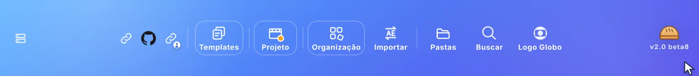</p>

> 🚩 *a versão anterior (script ScriptUI, até a v1.97) continua disponível no branch [`LEGACY`](https://github.com/jmbillard/O-PADEIRO/tree/LEGACY).*

o padeiro é uma **extensão** do After Effects: a **barra** é um painel que pode ser acoplado em qualquer lugar da interface, como os painéis nativos. cada ferramenta tem **dois cliques** (`◖` esquerdo e `◗` direito), algumas ficam juntas em **gavetas** e as tarefas maiores abrem em **janelas** próprias, cada uma com um nome de ofício (ou objeto) da padaria e dos bastidores da TV: **a turma**.

### 🧑‍🍳 a turma

| | ferramenta | `◖ clique esquerdo` | `◗ clique direito` |
| :---: | --- | --- | --- |
|  | **Preencher** (gaveta **Templates**) | abre **[A FORMA](docs/templates.md)**: preencher um template e criar a fila de render | |
|  | **Duplicar** (gaveta **Templates**) | abre **[A FORMINHA](docs/templates.md#a-forminha)**: duplicar a comp aberta e preencher os layers de texto selecionados, sem template | |
|  | **Criar** (gaveta **Templates**) | abre **[O CONFEITEIRO](docs/criador.md)**: criar um template a partir da comp aberta | |
|  | **Iniciar / Alterar** (gaveta **Projeto**) | abre **[O PROJETISTA](docs/projeto.md)**: **Iniciar** o projeto pela atração ou, quando o projeto já tem os dados do padeiro, **Alterar** | **O PROJETISTA** salva o projeto na pasta dele |
|  | **Fontes** (gaveta **Projeto**) | **[O TIPÓGRAFO](docs/fontes.md)** resolve as fontes (instala as que faltam) | abre **[O TIPÓGRAFO](docs/fontes.md#-fontes-do-projeto-janela)**: cada fonte, a troca e a cópia |
|  | **Coletar** (gaveta **Projeto**) | **[O CATADOR](#coletar)** coleta os arquivos na pasta do projeto | abre **[O CATADOR](#coletar)**: os arquivos e os que faltam |
|  | **Render** (gaveta **Projeto**) | **O FORNO** põe o render final das comps na fila, na pasta de output do projeto | põe um preview na fila, na pasta de previews (`COMP_prev_v01`, `_v02`…) |
|  | **Renomear** (gaveta **Organização**) | **O ETIQUETADOR** renomeia as comps selecionadas | **O ETIQUETADOR** renomeia todos os outputs da fila de render |
|  | **Organizar** (gaveta **Organização**) | **[O CONTRARREGRA](#organizar)** organiza o projeto | abre **[O CONTRARREGRA](#organizar)**: as etiquetas dos itens do projeto |
|  | **Arquivos** (gaveta **Organização**) | abre **[O ARQUIVISTA](#arquivos)**: renomear os arquivos e as pastas de uma pasta | |
|  | **Importar AEP** | **[O VERSIONADOR](docs/versionador.md)** importa um projeto do After de qualquer versão | abre **[O VERSIONADOR](docs/versionador.md)**: salvar o projeto em versões mais velhas do After |
|  | **Pastas** | **O ADAPTADOR** abre a pasta do último render | abre **[O ADAPTADOR](docs/conversor.md)**: caminhos Windows ⇄ macOS |
|  | **Buscar** | abre **[O ACESSORISTA](docs/acessorista.md)**: busca de caminhos | abre **O ACESSORISTA**: busca nos textos dos layers |
|  | **Logo Globo** | o logo da Globo animado na comp aberta (shape layer, a animação do PROMO) | o logo parado |

e mais: **[O PRODUTOR](docs/producoes.md)**, a configuração, e o **[instalador](#-instalação)**.

| janela | menu `Window` > `Extensions` | para que serve |
| --- | --- | --- |
| a barra | **O PADEIRO** | as ferramentas e os atalhos para as janelas ([abaixo](#-a-barra-principal)) |
| 📄 [A FORMA](docs/templates.md) | **A FORMA** | os templates: buscar, selecionar e preencher, e criar a fila de render |
| ✨ [O CONFEITEIRO](docs/criador.md) | **O CONFEITEIRO** | o criador de templates: transformar a comp aberta em um novo template |
| 🎬 [O PROJETISTA](docs/projeto.md) | **O PROJETISTA** | o projeto: acha a pasta da atração, cria a estrutura, salva o `.aep` e guarda quem criou e quem salvou |
| 🔤 [O TIPÓGRAFO](docs/fontes.md) | **O TIPÓGRAFO** | as fontes do projeto: o estado de cada uma, trocar por outra e copiar para uma pasta |
| 📦 [O CATADOR](#coletar) | **O CATADOR** | os arquivos do projeto: coletar e resolver os que faltam |
| 🔥 O FORNO | **O FORNO** | as comps selecionadas (ou a aberta) na fila de render, na pasta certa: o final no output, o preview nas saídas. só põe na fila; os presets são de cada um ([configuração > projeto](docs/producoes.md#-projeto)) |
| 🏷️ [O CONTRARREGRA](#organizar) | **O CONTRARREGRA** | as etiquetas nos itens do projeto que o organizar entende |
| 🗂️ [O ARQUIVISTA](#arquivos) | **O ARQUIVISTA** | renomear os arquivos e as pastas de um diretório com a regra do renomear das comps |
| 🔎 [O ACESSORISTA](docs/acessorista.md) | **O ACESSORISTA** | buscar caminhos de atrações e textos nos layers do projeto |
| 🔁 [O ADAPTADOR](docs/conversor.md) | **O ADAPTADOR** | converter caminhos entre Windows e macOS |
| 🕰️ [O VERSIONADOR](docs/versionador.md) | **O VERSIONADOR** | salvar o projeto aberto em versões mais velhas do After (até 3 para trás) |
| 🗂️ [O PRODUTOR](docs/producoes.md) | **O PRODUTOR** | a configuração: o que é da equipe e o que é só deste computador |

> 🔗 *os webhooks do n8n que o padeiro chama: a [busca](docs/acessorista.md), os [filmes recentes](docs/webhook-filmes.md), os [cards do Trello](docs/webhook-trello.md) e o [webhook do projeto](docs/webhook-projeto.md), que cadastra a atração nova no banco das atrações e põe o designer no card.*

**tamanhos das janelas** (do manifest). o tamanho padrão de cada janela é o recomendado para ela: o After abre com ele quando não há um tamanho guardado (a primeira vez depois de instalar; as janelas que mudaram de id, como O PROJETISTA e O CONFEITEIRO, voltam a ele depois do instalador). cada uma abre com o conteúdo inteiro à vista e não encolhe abaixo do ponto em que algo fica cortado; as que ajustam a própria altura ao conteúdo (buscar, caminhos, versões) têm o mínimo baixo. as checagens de interface (`extension/scripts/check-*.js`) olham cada janela neste tamanho padrão.

| janela | abre com (o padrão) | mínimo |
| --- | --- | --- |
| a barra | 800 × 84 | 86 × 56 (o After Effects não deixa um painel mais estreito que 86) |
| Templates (A FORMA) | 1100 × 1160 | 340 × 480 (uma coluna, com o rodapé preso) |
| Criar template (O CONFEITEIRO) | 1260 × 960 | 1150 × 820 |
| Projeto (O PROJETISTA) | 440 × 840 | 380 × 580 |
| Configuração (O PRODUTOR) | 940 × 880 | 940 × 700 |
| Fontes (O TIPÓGRAFO) | 460 × 520 | 380 × 420 |
| Coletar (O CATADOR) | 460 × 620 | 380 × 440 |
| Etiquetas (O CONTRARREGRA) | 520 × 680 | 440 × 640 |
| Arquivos (O ARQUIVISTA) | 720 × 720 | 480 × 420 |
| Duplicar (A FORMINHA) | 460 × 600 | 360 × 380 |
| Versões (O VERSIONADOR) | 560 × 580 | 420 × 300 |
| Buscar (O ACESSORISTA) | 720 × 280 | 420 × 150 |
| Caminhos (O ADAPTADOR) | 800 × 190 | 420 × 190 |

cada janela tem a sua documentação, também aberta pelo **⋯ > ajuda / documentação** da própria janela.

### 🎨 o visual

todas as janelas falam a mesma língua: o **degradê** à esquerda, com as listas, as abas e os campos direto nele (só um contorno fino, sem caixas nem brilhos em volta), e a **folha branca** à direita. o escolhido ganha um contorno; os cantos arredondados são concêntricos; o respiro é de 16 px em volta; e os botões do rodapé ficam na mesma linha em todas as janelas, lado a lado. claro, escuro e as cores da equipe ficam na aba **aparência** d'[O PRODUTOR](docs/producoes.md#-aparência).

<table><tr>
<td width="34%"><a href="docs/templates.md">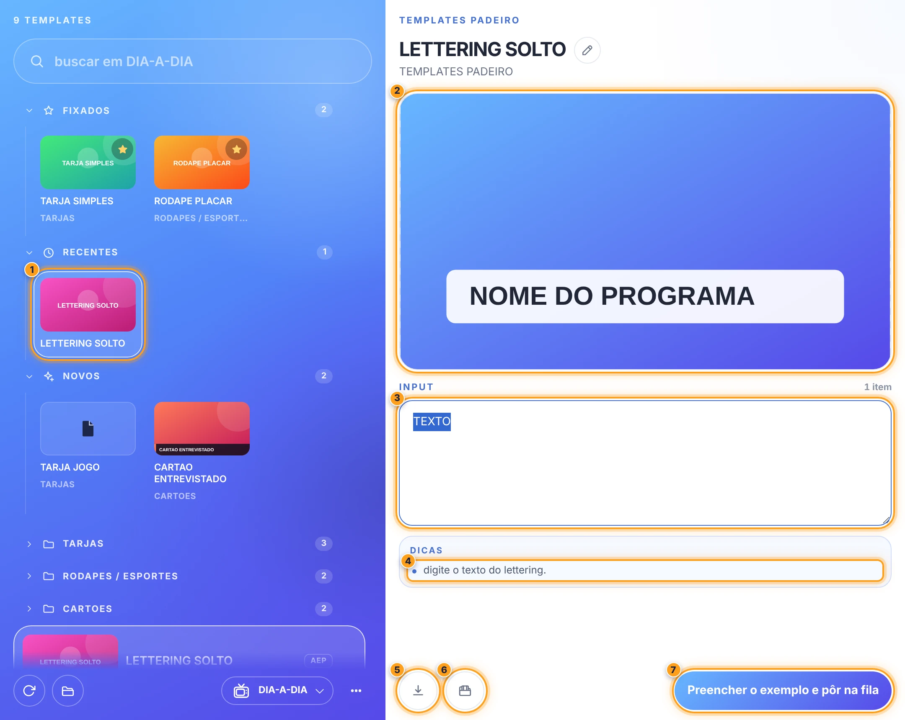</a><p align="center"><b>A FORMA</b></p></td>
<td width="33%"><a href="docs/criador.md">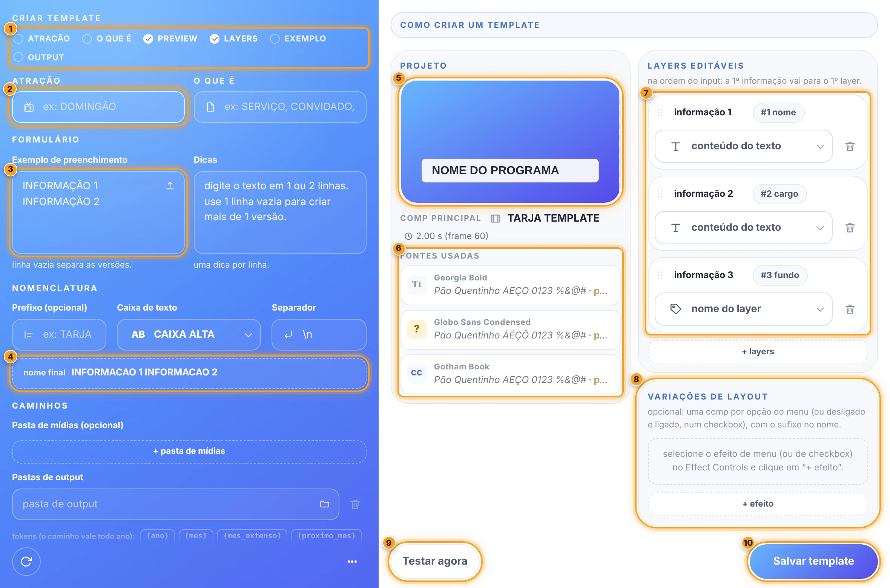</a><p align="center"><b>O CONFEITEIRO</b></p></td>
<td width="33%"><a href="docs/producoes.md">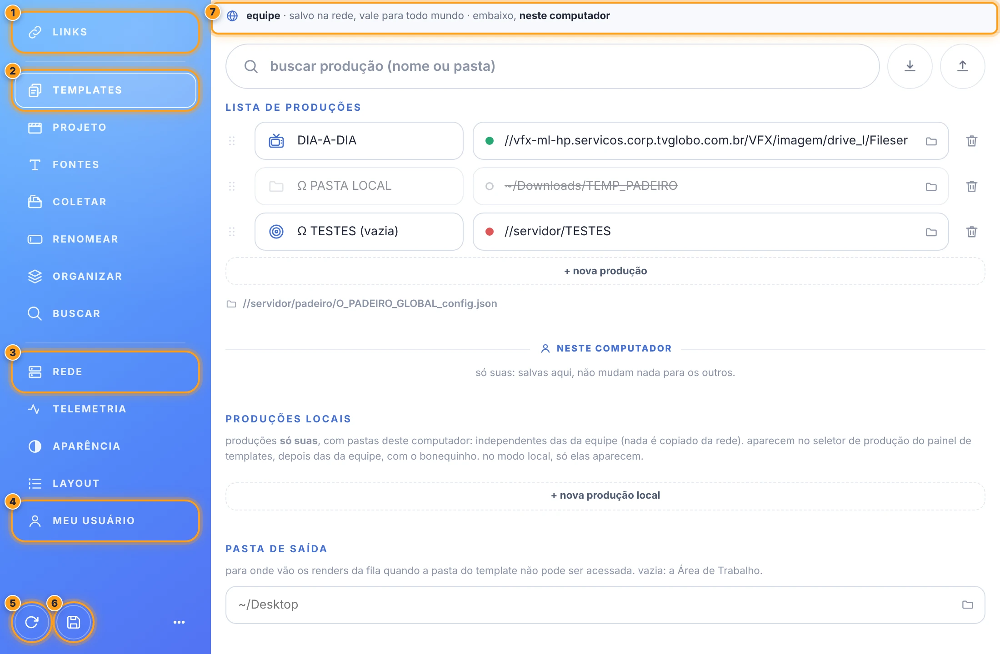</a><p align="center"><b>O PRODUTOR</b></p></td>
</tr></table>

> 🧭 *vai mexer nas telas? o [guia de UI](docs/guia-ui.md) tem as regras e as três checagens automáticas (cantos, rodapés e foco).*

<br>

## 📍 sumário

- [instalação](#-instalação)
- [a barra principal](#-a-barra-principal)
- [ferramentas da barra](#-ferramentas-da-barra)
- [painéis](#-painéis)
- [teclado e atalhos](#-teclado-e-atalhos)
- [códigos de erro](#-códigos-de-erro)
- [manutenção](#-manutenção)

<br>

---

<br>

## 📍 instalação

requer After Effects **2022 (22.0)** ou mais novo, no macOS ou no Windows.

1. no After Effects, acesse `File` > `Scripts` > `Run Script File...` e escolha o arquivo **`INSTALAR O PADEIRO.jsx`**, direto da **pasta do padeiro na rede** (a que tem a pasta `extension/` e o arquivo `O_PADEIRO_GLOBAL_config.json`).
2. o instalador guia o passo a passo. com tudo certo (os testes passam), ele abre direto na **ação**; '*anterior*' volta para a checagem:
   - **checagem** → confere a versão do After Effects, o acesso à rede, a pasta `extension/` e a lista de produções compartilhada. o que faltar fica marcado em vermelho (ou amarelo, se for só um aviso), com a explicação de como resolver. sem o acesso à rede, o link '*› abrir preferências de scripts e expressões*' abre a tela certa: marque a opção (veja [abaixo](#habilitando-o-acesso-à-rede)) e clique em '*› verificar de novo*'. se a pasta `extension/` não for achada, a explicação diz o motivo (o After não consegue ler a pasta do instalador, a pasta não está lá ou está incompleta) e o link '*› escolher a pasta "extension"*' deixa apontar a pasta à mão.
   - **ação** → '*instalar*' (ou '*atualizar*', se já estiver instalado) ou '*remover*'.
   - **andamento** → a barra mostra cada etapa e, no fim, o resumo.

   > 📟 *instalador (checagem):*
   >
   > 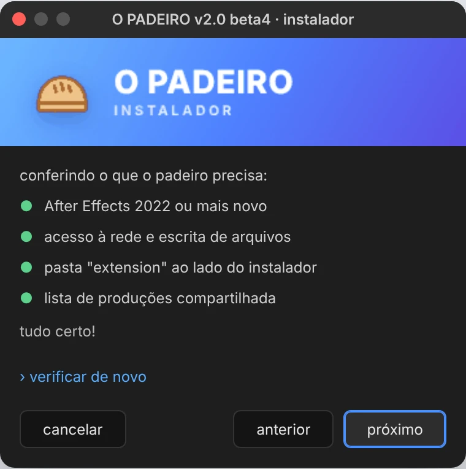
3. **reinicie** o After Effects. no macOS, se o padeiro não aparecer em `Window` > `Extensions`, reinicie o computador: a liberação de extensões sem assinatura às vezes só vale depois disso.
4. abra a barra pelo menu `Window` > `Extensions` > `O PADEIRO` e acople onde preferir. as outras ferramentas abrem em janelas, pelos botões da barra (ou pelo mesmo menu).

> 🚩 *obs:*\
> • **macOS, pasta em Documentos, Mesa ou Downloads** → o sistema protege essas pastas: o After abre o instalador que você escolheu, mas não enxerga a pasta `extension/` ao lado dele (a checagem falha mesmo com a pasta lá). libere em `Ajustes do Sistema` > `Privacidade e Segurança` > `Arquivos e Pastas` > `After Effects`, ou ponha a pasta do padeiro fora delas (na pasta do usuário, por exemplo). a mesma permissão vale para o padeiro rodar depois de instalado: o código é lido dessa pasta.\
> • instale sempre **a partir da pasta do padeiro na rede**: o instalador grava onde está a lista de produções compartilhada, e é ela que mantém todo mundo com a lista mais atual.\
> • o **código do padeiro fica na rede**: o computador recebe só um carregador, que abre os painéis direto da pasta do padeiro. por isso, **para atualizar, basta fechar e abrir o painel de novo** depois que os arquivos da rede forem trocados.\
> • o instalador só precisa rodar de novo quando a lista de painéis mudar (um painel novo, ou um id que mudou de nome). o mesmo instalador também **remove** a extensão. com o padeiro já instalado, `Shift` + `◗` no pãozinho da barra abre o instalador direto da pasta do padeiro na rede, sem passar pelo `Run Script File...`.\
> • **janelas que mudaram de nome** → a janela de projeto agora é **O PROJETISTA** e o criador de templates, **O CONFEITEIRO**; elas e O CATADOR (a janela do coletar) têm ids novos. rode o instalador de novo: ele tira as janelas com os ids antigos (o menu não fica com nenhuma delas) e apaga o que o After guardava delas; na primeira vez, cada janela abre no tamanho padrão ([os tamanhos](#-a-turma)). até rodar o instalador, os botões da barra que abrem essas janelas não abrem nada.\
> • **janelas antigas duplicadas** → a cada instalação, o instalador apaga e grava de novo a pasta da extensão e também remove **outras cópias do padeiro** que encontrar nas pastas de extensões (a do usuário e a do sistema): as das primeiras versões beta, uma pasta copiada à mão ou um link de teste. ele reconhece pelo manifest, não pelo nome da pasta. se uma delas não puder ser apagada (a pasta do sistema pede permissão de administrador), o caminho aparece no fim da instalação para apagar à mão.\
> • sem acesso à pasta do padeiro na rede, os painéis avisam e tentam de novo sozinhos.\
> • o instalador roda dentro do After Effects, então o macOS não bloqueia (como acontece com scripts abertos pelo Finder).\
> • **janelas pretas no After Effects 2025**: resolvido a partir desta versão. se ainda acontecer, rode o instalador de novo (o carregador antigo usava outro manifest).\
> • o instalador também remove a versão antiga do padeiro (o script `O PADEIRO.jsx` da pasta `Scripts/ScriptUI Panels`), que deixou de existir.

### habilitando o acesso à rede

o padeiro lê e grava arquivos na rede (templates, lista de produções, fontes). na checagem, o instalador abre sozinho a tela de preferências certa: marque '**Allow Scripts to Write Files and Access Network**' e clique em '*› verificar de novo*'.

> 📋 *a opção nas preferências de scripting:*\
> 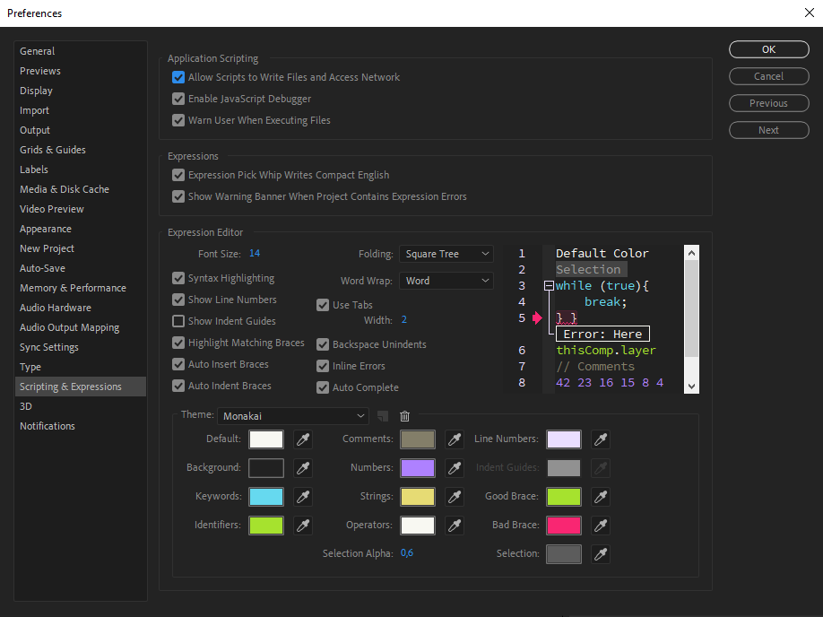

<br>

---

<br>

## 📍 a barra principal

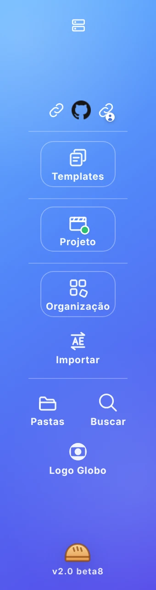

a barra se adapta ao tamanho do painel: horizontal, com os nomes embaixo dos ícones, ou vertical, com os nomes ao lado (bem estreita, só os ícones, com os links um embaixo do outro).

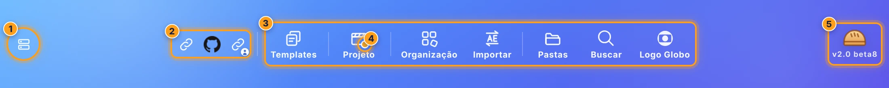

| | | |
| :---: | --- | --- |
| ❶ | **rede / modo local** | **servidor**: tudo vem da rede. **servidor com alerta amarelo**: a rede caiu e o padeiro usa as cópias deste computador (modo local, até a rede voltar). **notebook**: modo local, ligado por você. `◖` abre a [configuração > rede](docs/producoes.md#-rede) (no notebook, [deste computador](docs/producoes.md#-deste-computador)). |
| ❷ | **links** | os links da equipe e, com um bonequinho no canto, os seus (só neste computador), com o ícone de cada site ([configuração > links](docs/producoes.md#-links)). |
| ❸ | **a turma** | as ferramentas ([tabela acima](#-a-turma)), em grupos, e as **[gavetas](#as-gavetas)** (Templates, Projeto e Organização). a ordem, os grupos e quais aparecem ficam na aba **layout** da [configuração](docs/producoes.md#-layout): cada pessoa monta a sua barra a partir da barra da equipe. |
| ❹ | **bolinhas** | o estado de cada uma: no **Iniciar / Alterar**, 🟢 com a atração e salvo na pasta dele, 🟠 ainda sem atração ou salvo fora da pasta; nas **fontes**, 🟠 falta alguma, 🟢 tudo certo; no **coletar**, 🟠 arquivo fora das pastas de projetos, 🟢 tudo nelas. 🟠 é sempre "falta algo": a dica do botão diz o quê. o botão da gaveta **Projeto** mostra a pior das de dentro (🟠 na frente do 🟢), com a gaveta fechada. a bolinha fica por dentro do ícone, no canto de baixo à direita. |
| ❺ | **pãozinho** | `◖` abre esta documentação; `◗` refaz o tour da barra; `Shift` + `◗` roda o instalador (`INSTALAR O PADEIRO.jsx`, da pasta do padeiro na rede), para atualizar ou remover o padeiro sem procurar o arquivo. a versão do padeiro aparece embaixo dele, e a dica mostra a data do código em uso (`código de 17/11 15:42`). no fim do ano ele se enfeita sozinho, pela data do computador: **gorro de Papai Noel** de 1º a 25 de dezembro e **fogos de artifício** de 26 a 31 (com "reduzir movimento" ligado no sistema, sem animação; com a logo trocada na aparência, nada muda). a barra confere o código da rede ao entrar o mouse e a cada 5 minutos, e **se recarrega sozinha** quando ele muda (não é mais preciso reiniciar o After para ela pegar uma atualização). |

cada botão tem **duas ações**: `◖ clique esquerdo` e `◗ clique direito`. a dica de cada botão (pare o mouse em cima por 2 s) traz o nome da ferramenta e as ações, cada uma com um mousezinho que mostra o botão (esquerdo ou direito), e os **avisos** em laranja (ex: quais arquivos estão fora das pastas). ela abre **por cima da barra**, dentro do painel: na horizontal, ao lado do botão, em colunas (o nome · os cliques · os avisos); na vertical, embaixo do botão, empilhada. o texto é este:

```
O ETIQUETADOR

◖  →  renomear as comps selecionadas
◗  →  renomear todos os outputs da fila de render
```

### as gavetas

| 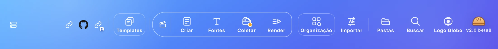 |
| :---: |
| 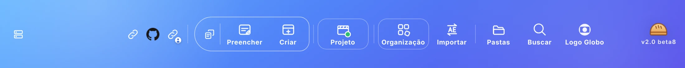 |
| 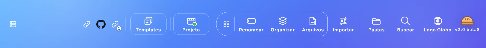 |

**Templates**, **Projeto** e **Organização** são gavetas, e por isso têm um **contorno fino** em volta do botão (as ferramentas soltas não têm): o `◖` abre, no lugar do botão, um contorno fino com as ferramentas dela (na barra vertical, abre para baixo). uma aberta por vez. o `◗` faz a **primeira ferramenta** da gaveta, sem abrir (o atalho de antes das gavetas); a dica marca qual é. a ordem de dentro e quais aparecem ficam na aba **layout**.

- **Templates** → **Preencher** ([A FORMA](docs/templates.md)), **Duplicar** ([A FORMINHA](docs/templates.md#a-forminha)) e **Criar** ([O CONFEITEIRO](docs/criador.md)), cada um num botão.
- **Projeto** → **Iniciar / Alterar** ([O PROJETISTA](docs/projeto.md)), **Fontes** ([O TIPÓGRAFO](docs/fontes.md)) **Coletar** ([O CATADOR](#coletar)) e **Render** (O FORNO), cada uma com os seus dois cliques. o nome **Criar** vira **Alterar** quando o projeto aberto já tem os dados do padeiro.
- **Organização** → **Renomear** (O ETIQUETADOR), **Organizar** (O CONTRARREGRA) e **Arquivos** ([O ARQUIVISTA](#arquivos)), cada uma com os seus dois cliques.
- **a gaveta lembrada** → a que você deixou aberta volta aberta ao reabrir o painel (neste computador). um duplo clique no botão só abre: o segundo clique, de reflexo, não recolhe.
- **o puxador** → no começo da gaveta, o ícone dela parado (a claquete aberta, as folhas dos templates separadas, os blocos encaixados); com o mouse em cima, vira a seta de recolher. a gaveta também fecha com um clique fora ou `Esc`.
- **com a gaveta fechada** → o botão mostra a bolinha (a pior das de dentro), a dica lista as ferramentas de dentro, com a bolinha laranja nas que têm pendência (o que falta fica na dica de cada uma) e o andamento do coletar e das fontes (a contagem e a linha) aparece nele também.

> 🚩 *na configuração, Iniciar / Alterar, Fontes e Coletar continuam como ferramentas separadas (a ordem e quais aparecem): na barra, as que aparecem vão juntas para a gaveta Projeto, no lugar da primeira delas. com só uma delas na barra, ela fica solta.*

### primeira vez (o tour)

<p align="center"></p>

sem a configuração da equipe (nem na rede, nem a cópia deste computador), a barra abre um tour num balão de vidro, e as ferramentas esperam:

1. **onde fica a configuração da equipe?** → **achar na rede** (escolha o `O_PADEIRO_GLOBAL_config.json`; o caminho fica gravado, como faz o instalador) · **criar uma nova** (numa pasta da rede, com os padrões; se já houver uma lá, vale ela) · **só aqui** (modo local, com os padrões).
2. **quem é você?** → a sigla do designer (a mesma de configuração > deste computador).
3. **a turma** → cada ferramenta acende, com o nome e o que fazem os dois cliques (as de dentro das gavetas também: a gaveta abre sozinha). experimente `◖` e `◗` na ferramenta acesa: durante o tour, os cliques só acendem a linha do clique, não rodam nada.

`◗` no pãozinho refaz o tour da turma a qualquer hora.

### trabalhando na barra

**o aviso** → o resultado de cada ação aparece num aviso flutuante, com uma bolinha (🟢 deu certo, 🟠 atenção, 🔴 erro) e o texto com a contagem (`3 itens renomeados · Cmd+Z desfaz`, ou `Ctrl+Z` no Windows); o × fecha, e ele some sozinho.

**organizar sem nada marcado** → sem nenhuma comp selecionada nem com etiqueta, O CONTRARREGRA avisa antes (nada iria para as comps de render) e oferece '*organizar assim mesmo*'.

<p align="center"></p>

**O CATADOR** (coletar) e **O TIPÓGRAFO** (fontes) mostram o andamento no próprio botão (e no da gaveta Projeto, quando ela está fechada): o nome vira a contagem (`5/12`), uma linha fina enche embaixo e o ícone repete a animação; no fim, um brilho verde. o coletar vai arquivo por arquivo (o After Effects fica livre entre um e outro); as fontes contam as etapas do resolver (projeto → banco → conferindo) e o envio ao banco em segundo plano.

<br clear="right">

> 🚩 *obs:*\
> • a versão do padeiro aparece embaixo do pãozinho.\
> • a produção é escolhida no rodapé do painel de templates e vale para todos os painéis, que acompanham a troca na hora.

<br>

---

<br>

## 📍 ferramentas da barra

### fontes

as fontes de cada projeto aberto vão sozinhas para o [banco de fontes](docs/fontes.md) na rede e para a pasta de fontes do projeto. a bolinha no botão: 🟠 laranja quando falta algo, 🟢 verde quando está tudo certo.

`◖ clique esquerdo` → resolver: com tudo instalado, só avisa que está ok; faltando alguma, instala primeiro da pasta de fontes do projeto e depois do banco; a que não for achada abre O TIPÓGRAFO.

`◗ clique direito` → **O TIPÓGRAFO**, a janela de [fontes do projeto](docs/fontes.md#-fontes-do-projeto-janela): o estado de cada fonte, a troca por outra (com busca e prévia) e copiar as fontes para uma pasta.

### coletar

a bolinha no botão: 🟠 laranja quando o projeto tem algum arquivo fora das pastas de projetos ([configuração > tipos de projeto](docs/producoes.md): o começo fixo do caminho de cada tipo, como `…/PROGRAMAS`; `VFX-1` … `VFX-5` valem como `VFX`; no Windows, `L:\…` vale como o caminho de rede da letra no [mapa de drives](docs/producoes.md), e o nome do servidor, curto ou completo, não importa), 🟢 verde quando está tudo nelas. sem tipos de projeto na configuração, vale estar na rede.

enquanto trabalha, o nome do botão vira a contagem (`5/12`), uma linha fina enche embaixo dele e o ícone repete a animação; no fim, um brilho verde. o mesmo vale para as **fontes**: ao resolver (projeto → banco → conferindo) e ao enviar as fontes ao banco em segundo plano.

`◖ clique esquerdo` → **O CATADOR** copia os arquivos usados no projeto para a estrutura do projeto, na árvore de pastas da [configuração > coletar](docs/producoes.md#-coletar) (padrão: `01_PROJETOS` com o `.aep`, `02_ARQUIVOS` com FONTS, IMAGENS, VIDEOS, AUDIOS e DADOS, `03_SAIDA` com PREVIEWS e `04_REFS`), e troca os caminhos no projeto para as cópias. a raiz é a pasta de cima da `01_PROJETOS` (ou a pasta do `.aep`, se ele não estiver nela). depois, salva o projeto, sempre.

- cada tipo (vídeos, sequências de imagens, imagens, áudio, dados e fontes) vai para a sua pasta; tipos fora da árvore não são coletados.
- **sequências de imagens** são copiadas inteiras (os quadros do trecho usado), cada uma numa subpasta com o nome dela; a interpretação (fps, alpha) é mantida.
- arquivos que já estão na pasta do projeto ficam como estão: coletar de novo só copia o que é novo.

`◗ clique direito` → **O CATADOR**, a janela do coletar: uma linha por arquivo do projeto, com a miniatura (a imagem ou o primeiro quadro; áudio e dados com o ícone do tipo), o tipo, em quantas comps aparece e a pasta. clicar numa linha mostra o item no painel Project.

<table><tr><td width="56%">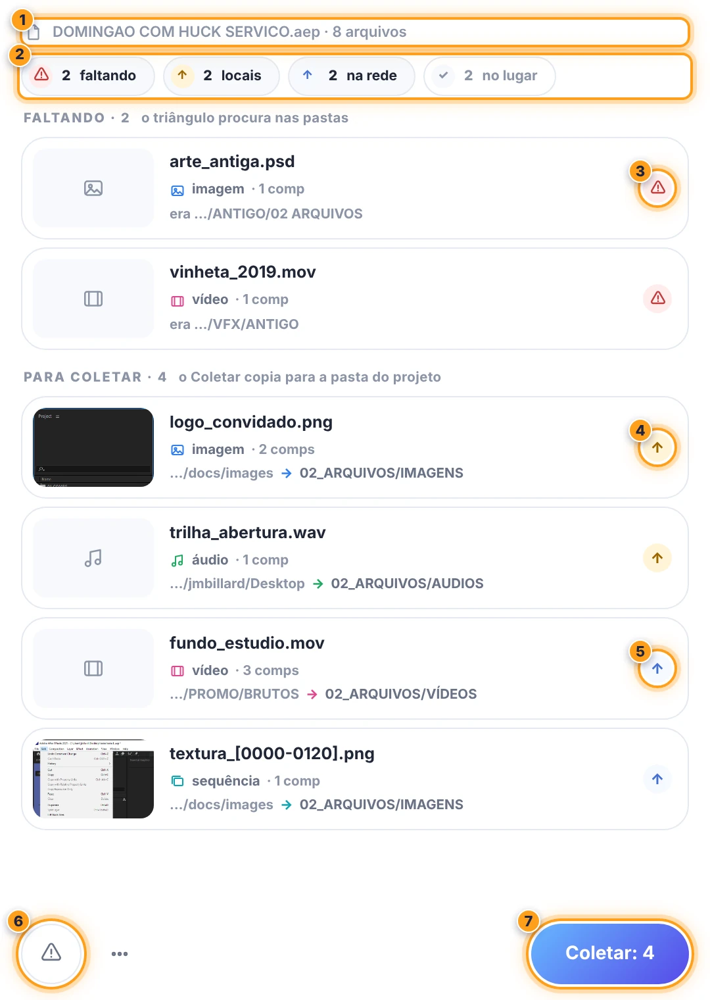</td><td>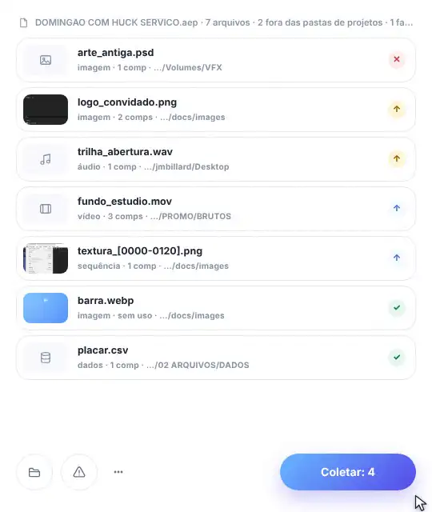</td></tr></table>

| | | |
| :---: | --- | --- |
| ❶ | **o projeto** | o `.aep` e quantos arquivos ele usa. |
| ❷ | **o filtro** | quantos arquivos em cada situação: '*faltando*', '*neste computador*' (fora das pastas de projetos), '*na rede*' e '*no lugar*'. cada etiqueta liga e desliga a situação na lista; mostra o sinal e o número, e o nome da situação só aparece na etiqueta ligada (nas outras, fica na dica). a janela abre mostrando só o que precisa de atenção (o que está no lugar fica escondido). **o filtro vale para as ações**: o Coletar só copia, e a busca só procura, o que está aparecendo. |
| ❸ | **✕ faltando** | o arquivo não existe (ou mudou de lugar, ou está num volume desmontado: o ❻ procura). depois da busca, o achado vira **→**, com a pasta onde ele está. |
| ❹ | **↑ amarela** | fora das pastas de projetos (ex: a Área de Trabalho): o coletar leva para a pasta do projeto. |
| ❺ | **↑ azul** | nas pastas de projetos, mas fora da pasta deste projeto: o coletar copia. (**✓**: já está na pasta do projeto; **–** cinza: tipo fora da árvore do coletar. os dois ficam em **no lugar**.) |
| ❻ | **procurar os que faltam** | procura cada arquivo faltando: no volume certo (`VFX`, `VFX-1` … `VFX-5`, montando o share se precisar) e, pelo nome, na pasta do projeto (5 níveis para dentro) e na pasta mais próxima do caminho antigo que ainda existe (3 níveis). com mais de um arquivo com o mesmo nome, fica o do caminho mais parecido com o antigo. nada muda ainda: cada achado aparece na lista com a pasta nova, e o botão principal vira **Religar** (desfaz com `Cmd+Z` / `Ctrl+Z`). as pastas de autosave, OLD e NÃO VALE ficam fora da busca. |
| ❼ | **Coletar** | copia o que aparece na lista para a estrutura do projeto; as setas sobem enquanto copia. o **⋯** abre a pasta do projeto e a [migração](#migrar-a-pasta-para-a-estrutura-nova). |

- **estrutura antiga ou com outra grafia** → o coletar usa as pastas que **já existem**, mesmo com o nome um pouco diferente do da configuração: outro número na frente (ou nenhum), com ou sem `_`, `-` e espaços, acento, caixa e plural (`01_PROJETOS` = `01PROJETO` = `PROJETOS`; `IMAGENS` = `03 imagem`). nada é criado ao lado de uma pasta equivalente. se houver **duas** candidatas na mesma pasta (ex: `02 ARQUIVOS` e `05 ARQUIVO`), vale a primeira na ordem alfabética (`02 ARQUIVOS`).
- **sem para onde coletar** → o botão **Coletar** da barra fica **apagado** (sem nenhum dos cliques) enquanto o projeto não tem o `.aep` salvo nem a pasta do projeto nos dados do padeiro; a dica diz o motivo. com a pasta nos dados (ex: um projeto antigo convertido, ainda sem salvar), os arquivos vão para ela. para coletar em **outro lugar**, use o *Collect Files* do After Effects.

a lista é dividida em **faltando**, **para coletar** e **na pasta do projeto**. cada linha tem a miniatura, o nome, o tipo (com o ícone na cor do tipo, a mesma da configuração) e as comps que usam o arquivo, e **de onde → para onde**: a pasta de hoje e a pasta da estrutura que vai recebê-lo.

> 🚩 *obs:*\
> • o projeto precisa estar salvo (os arquivos vão para a pasta dele), ou use o clique direito.\
> • arquivos ausentes e fontes sem arquivo no computador (ex: Adobe Fonts) não são coletados: o padeiro avisa quais.

#### migrar a pasta para a estrutura nova

<p align="center">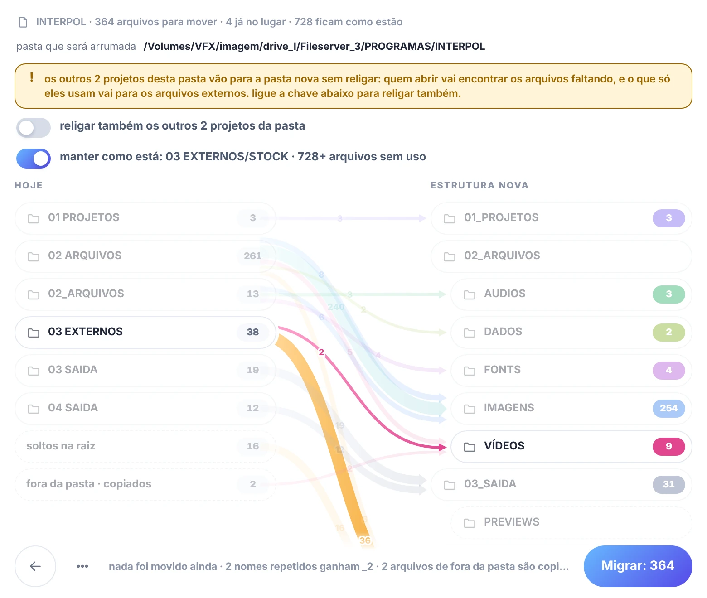</p>

o coletar **copia** para a pasta do projeto o que está fora dela. a migração **arruma a pasta que já existe**: o que está nela vai para a estrutura da [configuração > coletar](docs/producoes.md#-coletar), as pastas com outra grafia (`02 ARQUIVOS`, `02_ARQUIVOS`) se juntam e nada fica solto. abra pelo **⋯** da janela do CATADOR: '*Migrar a pasta para a estrutura nova…*'.

- **o desenho** → a pasta de **hoje** à esquerda, a **estrutura nova** à direita e uma faixa por tipo de arquivo ligando o que vai para onde: a seta na chegada, a largura pela quantidade e a cor do tipo (as mesmas da configuração), em degradê, do claro ao forte. cada faixa leva a sua quantidade: o mouse numa pasta acende só as faixas dela, e o mouse num número acende a faixa dele e lista os arquivos (até 15 nomes). nada é movido até o **Migrar**.
- **as esperas** → quem anima são as próprias faixas: ao abrir, enquanto a pasta é lida, o esqueleto do desenho com os traços correndo para a estrutura nova; ao trocar uma chave, uma luz percorre cada faixa até o plano novo chegar; ao migrar, cada faixa enche conforme os arquivos dela são movidos e a ponta da seta acende quando ela termina.
- **pastas grandes** → a leitura vai até 3 pastas para dentro. uma pasta com mais de 100 arquivos que o projeto não usa (um banco de presets, stock footage…), ou com mais níveis do que isso, **fica como está**: a janela mostra cada uma com uma chave '*manter como está*'; desligada, a pasta vai inteira para os arquivos externos. o que o projeto usa sai de qualquer profundidade.
- **o que vai para onde** → o `.aep` aberto e os outros `.aep` / `.aet` da pasta (em qualquer subpasta), para a pasta do tipo **projeto**, cada um na subpasta em que estava (`01 PROJETOS/versoes/x.aep` → `01_PROJETOS/versoes/x.aep`); os arquivos usados pelo projeto, para a pasta do tipo de cada um; o que está numa pasta de renders (`SAIDA`, `OUTPUT`, `RENDER`…), para a do tipo **saídas**, com as subpastas; todo o resto (não usado, autosave, `OLD`, pastas sem par), para a do tipo **arquivos externos**, com o caminho de antes dentro dela.
- **todos os projetos da pasta** → por padrão só o projeto aberto é religado; os outros vão para a pasta dos projetos sem religar (o After pede os arquivos quando forem abertos) e o que só eles usam conta como não usado. ligando '*religar também os outros projetos da pasta*', o After Effects abre cada um para ler o que ele usa (o plano passa a contar como usado o que **qualquer** projeto usa) e, depois de mover, abre de novo para religar, salvar e fechar; no fim, volta ao projeto de antes. demora mais: cada projeto é aberto duas vezes. o original de cada projeto religado fica guardado em `_originais_migracao`, dentro dos arquivos externos (salvo por um After mais novo, um projeto de versão mais velha sai convertido). um projeto que não abre (versão mais nova que a do After, corrompido) vai movido sem religar e aparece no fim. o projeto aberto precisa estar salvo.
- **ao migrar** → os arquivos são movidos (na mesma unidade é só trocar o nome: rápido, mesmo com vídeo grande), os itens são religados, o `.aep` é salvo no lugar novo, os outputs da fila de render passam a apontar para a pasta nova e as pastas antigas que ficaram vazias são apagadas. nome repetido no destino não sobrescreve: o segundo ganha `_2`.
- **antes de migrar** → a janela mostra, em cima, o **caminho da pasta** que será arrumada e os avisos que importam: os outros projetos que vão sem religar, o projeto fora de uma pasta de projetos (a migração arruma a pasta inteira onde ele está salvo). **Migrar** pede um **segundo clique** (o primeiro vira '*Confirmar: mover N*') e não responde ao `Ctrl+Enter`.
- **pastas que não migram** → isto é sobre **onde o `.aep` está salvo**, não sobre onde estão os arquivos que ele usa. a migração arruma a pasta inteira do projeto, então ela recusa quando o `.aep` está direto numa pasta do sistema (Área de Trabalho, Documentos, Downloads…), na raiz de um volume (ou na primeira pasta dele), na pasta de um tipo de projeto inteiro ou, com tipos de projeto na [configuração > projeto](docs/producoes.md#-projeto), fora delas: migrar ali moveria tudo o que está nessa pasta. a janela diz o motivo e o caminho: levar o projeto para a pasta dele (Projeto > Iniciar / Alterar) e usar o Coletar. **os arquivos usados que estão espalhados** (a Área de Trabalho de quem criou, outra pasta da rede) **continuam sendo copiados** para a estrutura, numa migração de qualquer pasta válida: é a origem '*fora da pasta · copiados*' do desenho.
- **desfazer** → arquivo movido no disco não volta com `Cmd+Z` / `Ctrl+Z`: a migração grava um registro na raiz (`_migracao_padeiro.json`) e o botão vira **Desfazer a migração** (também com segundo clique; logo depois de migrar ele espera 2 s, para um clique de reflexo não desfazer), que leva tudo de volta. os outros projetos voltam a ser os originais guardados, **menos os que foram salvos de novo depois da migração**: esses ficam como estão (o original continua guardado nos arquivos externos) e a janela diz quais. com o registro na pasta, ela não migra de novo.
- **se parar no meio** → o registro é gravado **a cada lote** (`_migracao_padeiro.andamento`, na raiz), antes de o lote seguinte começar: se a janela for fechada, o After Effects travar ou a rede cair, o que já foi movido está nele. ao abrir O CATADOR de novo, a janela avisa; na migração, o botão é **Desfazer a migração** e leva de volta o que tinha sido movido. sem conseguir gravar o registro na pasta (sem permissão), a migração não começa.

> 🚩 *obs:*\
> • os arquivos usados que estão **fora** da pasta do projeto (outra pasta da rede, este computador) são **copiados** para a pasta do tipo de cada um, como o Coletar faz, e o projeto passa a apontar para a cópia: no desenho, a origem '*fora da pasta · copiados*'. os originais ficam onde estão (outros projetos podem usar); o desfazer aponta de volta para eles e apaga as cópias.\
> • a pasta é lida até 10 níveis para dentro, 30 mil arquivos ou 15 segundos; passando disso, a migração avisa e não move nada.

### importar

**O VERSIONADOR** ([a página dele](docs/versionador.md)):

`◖ clique esquerdo` → escolha um projeto do After (`.aep` ou `.aet`) e ele é importado no projeto aberto, **de qualquer versão**: o de versão mais nova (ex.: salvo no 2026 e você está no 2025) vira antes uma cópia na versão que está rodando, na pasta temporária. a pasta que a importação cria leva o nome do arquivo original.

`◗ clique direito` → abre a janela **O VERSIONADOR**: salva o projeto aberto em até 3 versões mais velhas do After (`nome_AE24.aep`, `nome_AE23.aep`…), na pasta do projeto ou em outra.

- a conversão troca só o número da versão no cabeçalho do arquivo (como o [AEP-Downgrader](https://github.com/itsAnchorpoint/AEP-Downgrader) e o [AESHIFT](https://github.com/mason-reed24/aeshift-after-effects-tool)): efeitos, expressões e recursos que só existem na versão nova podem faltar ou dar aviso. **confira antes de usar em produção**.
- o original nunca é alterado.

### pastas

`◖ clique esquerdo` → abre a pasta do primeiro output do último item da fila de render. se a pasta ainda não existir (antes do render), abre a mais próxima que existe.

`◗ clique direito` → abre o [conversor de caminhos](docs/conversor.md).

### renomear

**O ETIQUETADOR**: dá a cada comp e a cada output da fila o nome no padrão da equipe.

`◖ clique esquerdo` → renomeia as comps selecionadas no painel de projeto: remove caracteres especiais, passa para MAIÚSCULAS, acrescenta o prefixo do formato (rodapé, cartão, lettering...) e põe a etiqueta do formato.

*o formato vem do nome da pasta em que a comp está (ex: `RODAPES`, `LETTERING - JOGO`) ou de um prefixo / sufixo já presente no nome da comp. o nome da pasta tem prioridade.*

`◗ clique direito` → aplica a mesma regra aos outputs de **todos** os itens da fila de render (o nome das comps não muda).

> 🚩 *obs:*\
> • com uma pasta do projeto selecionada, a pasta e todas as comps dentro dela são renomeadas.\
> • cada output continua na pasta em que estava; itens já renderizados não mudam e nomes repetidos na mesma pasta ganham um sufixo (`_2`, `_3`...).\
> • comps com o layer de texto `script_template_name` (último layer) recebem o nome definido nesse layer ([como usar](docs/templates.md#o-nome-da-comp-pelo-layer-script_template_name)).

**os formatos: prefixos e termos reconhecidos** (no singular ou plural, com ou sem acento, como palavras inteiras):

| prefixo | termos |
| --- | --- |
| **RDP** | RODAPE, RDP |
| **CRT** | CARTAO, CARTOES, CRT |
| **LETT** | LETTERING, LETT, LET |
| **CONFRONTO** | CONFRONTO |
| **TARJA** | TARJA, TRJ, TAR |
| **PASSAGEM** | PASSAGEM, TRANSICAO, TRANSICOES, LAPADA |
| **ASSINA** | ASSINATURA, ASSINA, ASS |
| **FOTO** | FOTO, IMG, IMAGEM, IMAGENS |
| **REF** | REFERENCIA, PREVIEW, REF, PREV |

### organizar

**O CONTRARREGRA**: deixa cada coisa do projeto no lugar certo, como o contrarregra antes de gravar.

`◖ clique esquerdo` → organiza o projeto no modelo da PROMO.

> 🚩 *obs:*\
> • **selecione antes as comps principais** (as que serão renderizadas): elas recebem a etiqueta 'EXPORTAR' e vão para '01 COMPS'.\
> • com uma pasta para as **comps editáveis** na árvore (configuração), comps com 'EDIT' na etiqueta vão para ela.\
> • comps com a etiqueta 'EXPORTAR', 'TEMPLATE' ou 'LOGO GLOBO' também vão para '01 COMPS'; as com a etiqueta de um formato reconhecido (ex: 'RODAPE', dada pelo renomear) vão para uma subpasta com esse nome.\
> • as demais comps vão para '02 PRECOMPS' (em subpastas pela etiqueta, se houver).\
> • footages vão para '03 ARQUIVOS' (VIDEOS, IMAGENS, AUDIO, SOLIDOS, DADOS) e arquivos ausentes para 'MISSING'. o texto da etiqueta antes de ':' vira subpasta.\
> • pastas que ficarem vazias são removidas.

`◗ clique direito` → abre **O CONTRARREGRA**: as **etiquetas** (os comentários do After) nos itens selecionados no painel Project que o organizar entende.

- **render** (EXPORTAR, TEMPLATE, LOGO GLOBO) e **editáveis** (EDIT): as etiquetas da configuração > organizar.
- **formatos** (RODAPE, CARTAO, LETTERING...): os formatos do **O ETIQUETADOR**; a comp vai para uma subpasta com o formato.
- **arquivos** (FUNDO, LOGO, FOTO, ESCUDOS, BANDEIRAS, TRILHA, LOC): a etiqueta do footage vira subpasta; a lista é da equipe (configuração > organizar > etiquetas dos arquivos).

`◖` numa etiqueta aplica nos selecionados e `◗` limpa a etiqueta deles; o número ao lado diz quantos itens do projeto já têm a etiqueta. o campo de cima aplica um texto livre (`Enter`; vazio limpa). a janela abre com o foco no campo de cima. no rodapé, a **borracha** (pede um segundo clique para confirmar) limpa a etiqueta de todos os itens do projeto e **Organizar** organiza (o mesmo que o `◖`). tudo desfaz com `Cmd+Z` (Mac) ou `Ctrl+Z` (Windows).

> 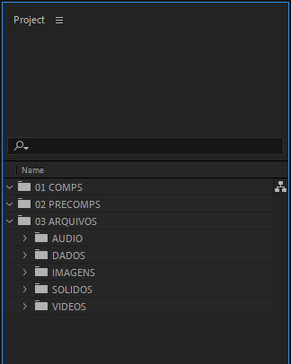

### arquivos

**O ARQUIVISTA**: renomeia os arquivos e as pastas de um diretório com a mesma regra do [renomear](#renomear) das comps, a da [configuração > renomear](docs/producoes.md#-renomear): o formato pelos termos, o prefixo do formato, a caixa, o separador, a remoção dos especiais e os nomes fixos. **a única diferença**: o formato vem só do nome do próprio arquivo ou pasta, nunca da pasta onde ele está (na comp, a pasta do projeto tem prioridade).

`◖ clique esquerdo` → abre a janela, **sempre vazia**: a pasta é você quem escolhe (nada vem do projeto aberto, da pasta de output ou da última vez).

<p align="center">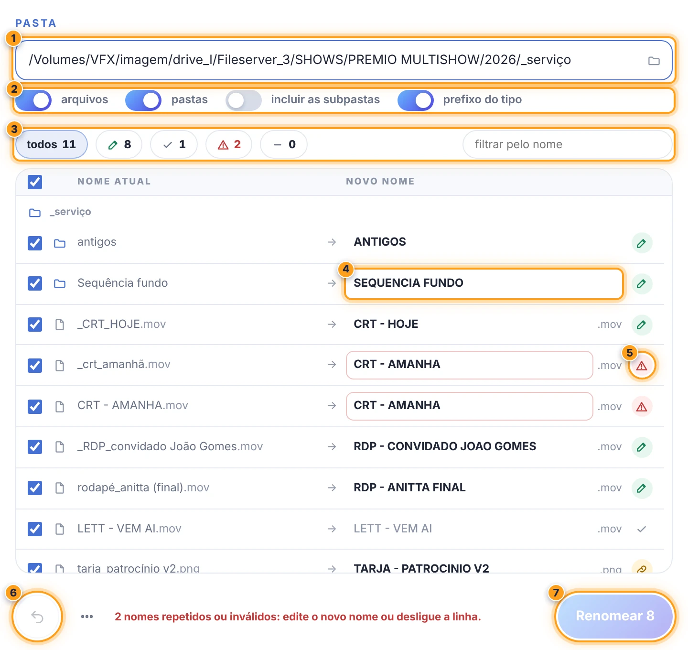</p>

| | |
| :---: | --- |
| ❶ | **a pasta**: a pastinha, dentro do campo, ou o caminho colado e `Enter`. a janela abre sem pasta nenhuma |
| ❷ | **as chaves**: renomear **arquivos**, **pastas**, **incluir as subpastas** (desligada: só a pasta escolhida) e o **prefixo do formato**. ficam lembradas neste computador. ligar ou desligar as subpastas relê a pasta, mas os nomes que você editou continuam |
| ❸ | **os filtros**: quantos itens em cada situação (todos, mudam, já no padrão, sem nome ou inválido, desligados) e a busca pelo nome. os que ganharam `_2` estão entre os que mudam |
| ❹ | **o novo nome**: um campo. o que você edita fica marcado, e a seta ao lado volta para a sugestão. a extensão (e os números de uma sequência) ficam fora do campo: não mudam |
| ❺ | **a situação**, em ícone: o lápis (muda), o visto (já no padrão), o aviso (ganhou `_2`: muda, mas confira), o alerta (não pode renomear), o elo (muda e é usado no projeto aberto, ou é uma pasta com um arquivo usado dentro) e o traço (desligado). a dica diz o motivo |
| ❻ | **desfazer**: a última renomeação volta, mesmo depois de fechar a janela. o que não voltar fica guardado para tentar de novo |
| ❼ | **Renomear**: o primeiro clique mostra quantos mudam e pede a confirmação; o segundo renomeia |

- **o prefixo do formato vem do nome do próprio** arquivo ou pasta, nunca da pasta onde ele está: `_CRT_HOJE.mov` → `CRT - HOJE.mov`; `rodapé_anitta (final).mov` → `RDP - ANITTA FINAL.mov`; a pasta `rodapés jogo` → `RDP - JOGO`. o arquivo sem um termo de formato no nome só ganha a caixa e o separador (`fundo palco.png` → `FUNDO PALCO.png`), mesmo dentro de uma pasta `RODAPES`.
- **nomes fixos** → o arquivo que tem o termo de um nome fixo sai sempre com ele, com ou sem o prefixo: `logo_globo_branco.png` → `LOGO GLOBO.png`.
- **desligar um por um** → a caixa de cada linha; a do título liga e desliga todos.
- **nome repetido ganha `_2`** → o item que daria um nome que já existe na mesma pasta ganha sozinho o primeiro sufixo livre (`_2`, `_3`…: com `X` e `X_2` já lá, o novo vira `X_3`) e o aviso na linha, para você conferir antes de confirmar; ele **continua** na renomeação. contam os itens da lista (os desligados, com o nome de hoje), os nomes que já estão no disco e os nomes novos, sem diferenciar maiúsculas e com os acentos do Mac e do Windows tratados como iguais. nenhum arquivo é sobrescrito.
- **nome inválido** → um nome vazio ou com um caractere que o sistema não aceita (`\ / : * ? " < > |`) fica com o alerta e **de fora** da renomeação: o botão renomeia o que dá e ele continua na lista, como está, para você resolver depois (editar o novo nome ou desligar a linha).
- **exportar a lista** → no **⋯**, *Exportar a lista (.csv)…* salva o nome, o caminho e a data de criação de cada item da lista (todos, como estão agora) numa planilha `.csv` que abre direto no Excel. a sequência de imagens leva a data do primeiro quadro; onde o sistema não guarda a data de criação, vai a da última alteração.
- **arrastar a pasta** → dá para arrastar uma pasta do Finder / Explorer para a janela: ela entra no campo e é lida (um arquivo solto traz a pasta em que ele está).
- **o progresso** → a renomeação vai em lotes: uma barra fina abaixo da tabela e a contagem no botão (`20 de 120`) mostram o andamento; o desfazer volta todos os lotes de uma vez.
- **em uso no projeto** → o arquivo que o projeto aberto usa é **religado** depois de renomeado (e os que estão dentro de uma pasta renomeada também), para não virar footage faltando. a pasta com um arquivo usado dentro mostra o elo e entra na contagem "em uso" do rodapé. o religar é **um passo só** do `Ctrl+Z` do After (*O ARQUIVISTA: religar*), no fim de todos os lotes.
- **o desfazer** → guarda só a **última** renomeação (um nível), neste computador, e volta tudo de uma vez. se algum item não voltar (aberto em outro programa, sem permissão), a janela diz quantos voltaram e quantos ficaram faltando, e o que faltou **fica guardado**: o botão continua, para tentar de novo depois de resolver. o religar de volta também é um passo só do `Ctrl+Z`.
- **sequências de imagens** → uma linha só: o nome muda em todos os quadros e os números ficam como estão. vira sequência um grupo de **3 imagens ou mais** com o mesmo nome, o mesmo separador, o número no fim com **3 dígitos ou mais** e a mesma extensão (`fundo_0001.png`, `fundo_0002.png`…); menos que isso, ou vídeo, cada arquivo é uma linha.
- **até 3000 itens** → a lista lê até 3000 itens (com as subpastas); passou disso, ela para e o rodapé avisa que a pasta tem mais itens do que a lista mostra. os que ficaram de fora contam para o `_2`, mas não são renomeados.
- **ficam de fora** → os projetos (`.aep`, `.aet` e os de outros programas), os arquivos escondidos e de sistema e as pastas de autosave e de logs do After.

> 🚩 *obs:*\
> • a ordem é sempre a mesma: os arquivos antes das pastas, e as pastas de dentro para fora.\
> • um item que não pôde ser renomeado (em uso por outro programa, sem permissão) fica como estava, e o aviso do rodapé diz qual.\
> • o desfazer do After (`Ctrl+Z`) não desfaz nomes de arquivos, só o religar no projeto: use o botão de desfazer da janela.

<br>

---

<br>

## 📍 painéis

| | |
| --- | --- |
| [🧩 instalação](#-instalação) | o instalador: checagem, instalar / atualizar e remover |
| [📄 A FORMA](docs/templates.md) | templates: buscar, fixados e recentes, preview, fontes, input, fila de render e editor de config |
| [✨ O CONFEITEIRO](docs/criador.md) | criar template: formulário, nomenclatura, layers editáveis e arquivo de configuração |
| [🔤 O TIPÓGRAFO](docs/fontes.md) | fontes: banco de fontes, o botão fontes e a janela de fontes do projeto |
| [🎬 O PROJETISTA](docs/projeto.md) | projeto: projeto novo pela atração (tipos de projeto em chips, ano do projeto), estrutura de pastas, editor e os dados de quem criou e salvou |
| [🗂️ O PRODUTOR](docs/producoes.md) | configuração: produções, links da barra, logs, drives da rede, renomear, organizar, coletar, busca, projeto e aparência (compartilhados pela equipe) |
| [📦 O CATADOR](#coletar) | coletar: os arquivos do projeto e os que faltam |
| [🔎 O ACESSORISTA](docs/acessorista.md) | busca de caminhos e busca nos textos do projeto |
| [🔁 O ADAPTADOR](docs/conversor.md) | conversor: caminhos Windows / macOS |
| [🧭 guia de UI](docs/guia-ui.md) | as regras para criar e mexer nas janelas: cores do tema, cantos, campos, ícones, animações, mensagens |

<br>

---

<br>

## 📍 teclado e atalhos

o mesmo vocabulário em todos os painéis:

> 🚩 *no macOS, use os atalhos com o **`Ctrl`**: o `Cmd` costuma ficar com o After Effects (vai para os menus dele) e não chega às janelas do padeiro. onde aparece `Ctrl/Cmd`, o `Ctrl` vale nos dois sistemas.*

| tecla | o que faz |
| --- | --- |
| `↑` `↓` | andam nas listas. `↓` na busca vai para o primeiro item; `↑` no primeiro volta para a busca |
| `Enter` | abre / seleciona. nos templates, seleciona e leva para o input |
| `Esc` | limpa a busca ou volta um passo |
| `Ctrl/Cmd+F` | foca a busca do painel |
| `Ctrl/Cmd+S` | salva (produções, criador de templates) |
| `Ctrl+Enter` | o botão principal da janela: preenche e cria a fila (templates), resolve (fontes), coleta (coletar), salva (versões), organiza (etiquetas) |
| `Ctrl+Z` / `Ctrl+Shift+Z` | desfaz / refaz no texto do input (templates) |
| `Ctrl/Cmd+C` | copia o caminho ou o texto do resultado em foco (O ACESSORISTA) |

- **barra** → `←` `→` andam pelos botões; `Enter` faz a ação do clique esquerdo e `Shift+Enter` a do direito.
- **listas suspensas** → com a lista aberta, digite para filtrar (útil com muitas produções).

os atalhos de cada painel estão na documentação dele.

<br>

---

<br>

## 📍 códigos de erro

todo erro do padeiro tem um código `PAD_`, que aparece **no fim** da mensagem (`selecione as comps ou pastas que serão renomeadas · PAD_032`): primeiro o que fazer, depois o código. o aviso pode ser fechado no ×. use o código para achar a causa:

| código | o que aconteceu |
| --- | --- |
| `#PAD_003` `#PAD_004` `#PAD_007` `#PAD_012` `#PAD_PATH_003` | sem acesso à rede: habilite '*Allow Scripts to Write Files and Access Network*' |
| `#PAD_005` | o projeto não foi preenchido pelo padeiro (instalar fontes depende disso) |
| `#PAD_006` `#PAD_035` | a pasta `FONTS` do template não existe ou não tem `.ttf` / `.otf` |
| `#PAD_008` | a fila de render está vazia |
| `#PAD_009` `#PAD_019` `#PAD_062` | pasta de output (ou caminho) não encontrada (no `#PAD_019`, o render vai para o output local) |
| `#PAD_017` | o `_config.json` do template é inválido |
| `#PAD_018` `#PAD_022` | o arquivo do template não foi encontrado |
| `#PAD_021` | erro no script do template (`_script.js`): o preenchimento fica feito |
| `#PAD_023` `#PAD_025` `#PAD_026` `#PAD_028` `#PAD_031` `#PAD_063` | criador de templates: comp principal ou layers editáveis faltando |
| `#PAD_027` | criador de templates: o teste de preenchimento falhou |
| `#PAD_029` | criador de templates: falta a atração ou o que é |
| `#PAD_032` `#PAD_033` | renomear: nada selecionado / outputs da fila que não puderam ser renomeados |
| `#PAD_034` | algumas fontes não puderam ser copiadas (ex: Adobe Fonts) |
| `#PAD_036` | organizar: erro ao organizar o projeto |
| `#PAD_043` | o painel pediu uma ação que o host não conhece (painel e host de versões diferentes: reabra o painel) |
| `#PAD_044` `#PAD_045` | editor de config: dado inválido / não foi possível gravar o arquivo |
| `#PAD_046` | o input está vazio |
| `#PAD_047` `#PAD_049` | preenchimento / fila de render fora de ordem (comece de novo) |
| `#PAD_048` | fila de render: nenhum preset de render escolhido |
| `#PAD_050` | o projeto está vazio |
| `#PAD_051` a `#PAD_057` | lista de produções: dado inválido, falha ao gravar ou arquivo carregado inválido |
| `#PAD_058` | não foi possível carregar o índice da busca (sem rede e sem cópia salva; no modo local, sem cópia) |
| `#PAD_059` `#PAD_060` `#PAD_069` | busca de textos: a comp ou o layer não existe mais (atualize a busca) |
| `#PAD_061` | conversor: nenhum caminho informado |
| `#PAD_064` | a lista de produções compartilhada (na rede) não está acessível |
| `#PAD_065` | outra pessoa salvou a lista de produções depois que você abriu o editor |
| `#PAD_066` `#PAD_067` `#PAD_068` | o painel não conseguiu carregar o padeiro da rede |
| `#PAD_070` `#PAD_071` `#PAD_072` `#PAD_PATH_001` `#PAD_PATH_002` | caminho de rede inválido, volume não montado ou pasta inacessível |
| `#PAD_073` `#PAD_074` | banco de fontes: trocar fontes sem o After Effects 2024 / nenhum arquivo para instalar ou banco sem pasta |
| `#PAD_075` | criador: a fila de render já está renderizando (preview .mp4) |
| `#PAD_076` | criador: nenhum preset de render H.264 para o preview .mp4 |
| `#PAD_077` | criador: o preview .mp4 não foi gerado |
| `#PAD_078` | configuração: endereço do webhook do log inválido (vazio, sem http(s):// ou com espaços/aspas) |
| `#PAD_079` | configuração: letra de drive inválida ou repetida |
| `#PAD_080` | configuração: o caminho do drive não é de rede (`//servidor/share/...`) |
| `#PAD_081` | configuração: volume sem nome, repetido ou sem servidor |
| `#PAD_082` | configuração: formato do renomear sem prefixo, etiqueta ou termos, prefixo repetido ou separador inválido |
| `#PAD_083` | configuração: nome fixo sem o termo ou sem o nome |
| `#PAD_084` | configuração: árvore de pastas do organizar inválida (nome vazio ou repetido, pasta pai inexistente, ciclo ou conteúdo em duas pastas) |
| `#PAD_085` | configuração: etiquetas de render vazias ou etiqueta automática fora delas |
| `#PAD_086` | configuração: endereço do webhook da busca inválido, ou caminho fixo sem nome, sem caminho ou repetido |
| `#PAD_087` | configuração: link sem nome ou com endereço inválido |
| `#PAD_088` | configuração: cor da aparência inválida (use `#rrggbb`) |
| `#PAD_089` | configuração > tipos de projeto: tipo de projeto sem nome ou sem caminho, repetido, com token desconhecido ou com `{o_que_e}` na pasta do projeto; ou o endereço do [webhook do projeto](docs/webhook-projeto.md) inválido (sem http(s):// ou com espaços/aspas) |
| `#PAD_090` | projeto: sem atração, sem título do filme ou sem ID e nome |
| `#PAD_091` | projeto: sem pasta de destino, projeto ainda não salvo, nome do arquivo vazio ou pasta que não pôde ser criada (o padeiro tenta três jeitos: criar direto, pelo sistema e, por último, criar neste computador e levar para a rede) |
| `#PAD_092` | projeto: já existe um `.aep` com esse nome na pasta |
| `#PAD_093` | coletar: itens que não puderam ser coletados (sem permissão, arquivo ausente) |
| `#PAD_094` | configuração: árvore do coletar inválida (nome vazio, repetido ou com `\ / : * ? " < > \|`, pasta pai inexistente, ciclo, tipo em duas pastas) ou sem nenhum tipo |
| `#PAD_095` | coletar: projeto não salvo (use o clique direito para escolher a pasta) |
| `#PAD_096` | modo local (ligado ou sem a rede): sem cópia da configuração neste computador, ou tentativa de editar a configuração da equipe |
| `#PAD_097` | criador de templates: variações de layout (nenhum efeito de menu selecionado, sufixo vazio ou repetido, layer do efeito removido) |
| `#PAD_098` | produção deste computador (configuração > templates, deste computador): sem nome ou sem pasta, ou com o nome de uma produção da equipe |
| `#PAD_100` | importar / versionador: o arquivo não é um projeto do After (`.aep` / `.aet`), a versão não pôde ser lida ou o painel está sem acesso aos arquivos |
| `#PAD_102` | versionador: projeto nunca salvo, sem pasta ou pasta que não existe |
| `#PAD_103` | etiquetas: nada selecionado no painel Project, ou só pastas |
| `#PAD_101` | primeira vez (tour): o arquivo escolhido não é a configuração da equipe, não é um JSON válido, ou a pasta não aceita gravar |
| `#PAD_110` | migrar: o registro não pôde ser gravado na pasta do projeto (sem permissão, ou a rede caiu no meio): sem registro, nada é movido |
| `#PAD_114` | arquivos: não há renomeação para desfazer |
| `#PAD_115` | a forminha: sem comp aberta, sem layer de texto selecionado ou sem texto no input |
| `#PAD_116` | a forminha: a comp aberta ou os layers dela mudaram desde a leitura (leia de novo a seleção) |
| `#PAD_117` | arquivos: a lista (.csv) não pôde ser gravada no lugar escolhido |
| `#PAD_118` | arquivos: a pasta escolhida no ARQUIVISTA não foi encontrada |
| `#PAD_112` | projeto: o `.aep` marcado na lista d'O PROJETISTA não foi encontrado (apagado ou movido) |
| `#PAD_111` | migrar: a pasta não pode ser migrada (pasta do sistema, raiz de um volume, a pasta de um tipo de projeto inteiro, fora das pastas de projetos, ou com projetos de outros programas, como Cinema 4D, Max e Premiere, que perderiam os arquivos: use o Coletar, que copia) |
| `#PAD_113` | render: nenhuma comp selecionada no painel Project nem aberta |
| `#PAD_119` | instalador (`Shift` + `◗` no pãozinho): `INSTALAR O PADEIRO.jsx` não foi encontrado na pasta do padeiro na rede (ao lado da pasta `extension/`) |
| `#PAD_099` | erro inesperado: anote a mensagem e avise a equipe |

<br>

---

<br>

## 📍 manutenção

o código da extensão, a estrutura dos arquivos, como testar sem o After Effects e onde ficam as configurações mais comuns estão em [`extension/README.md`](extension/README.md).
