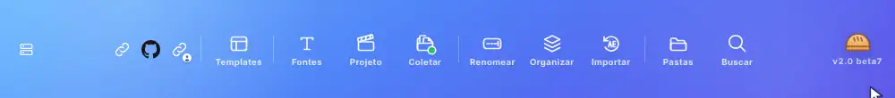
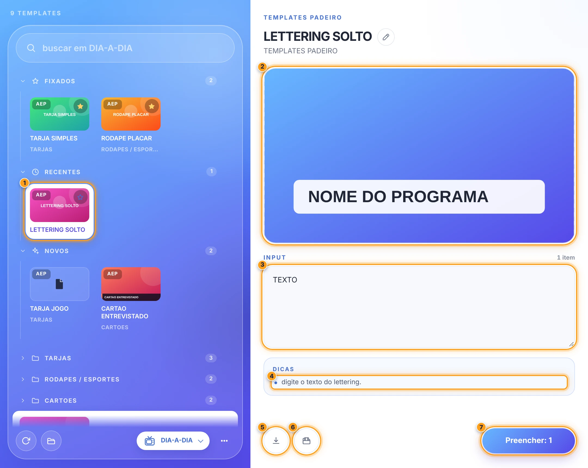
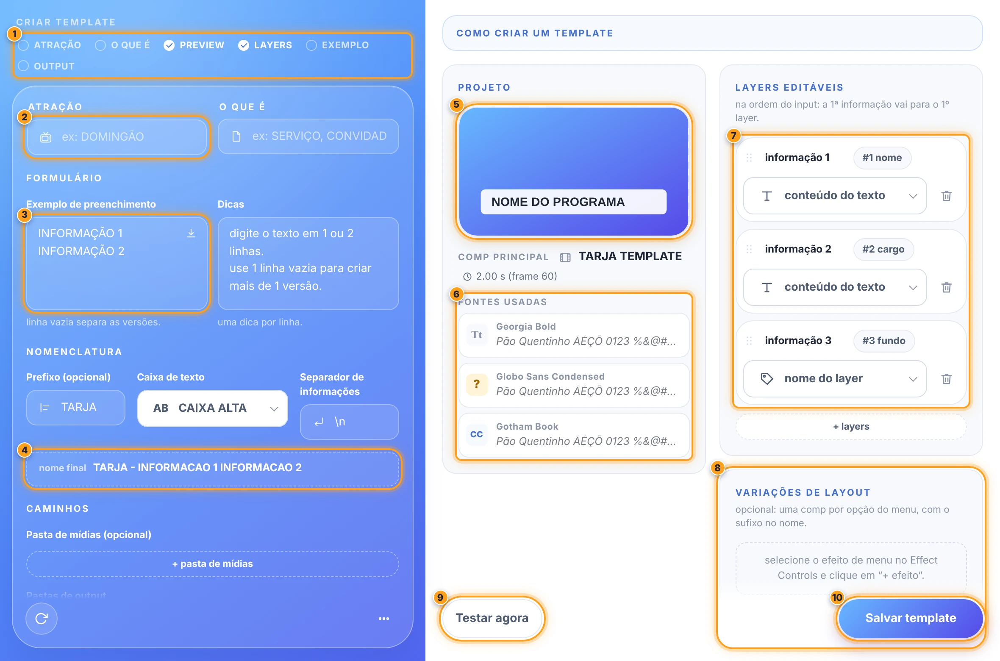
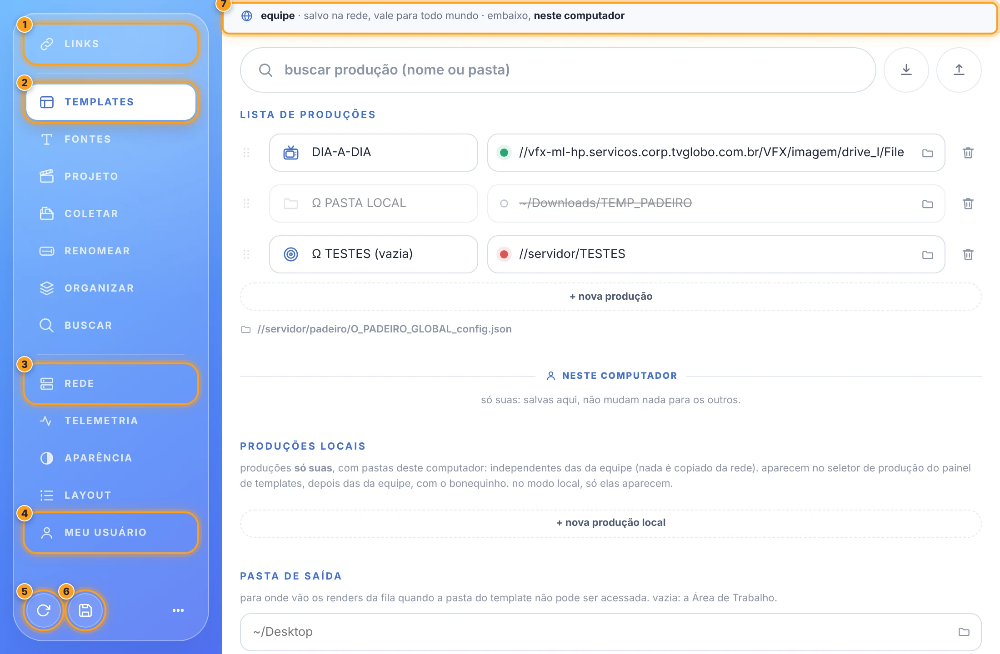
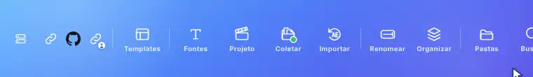
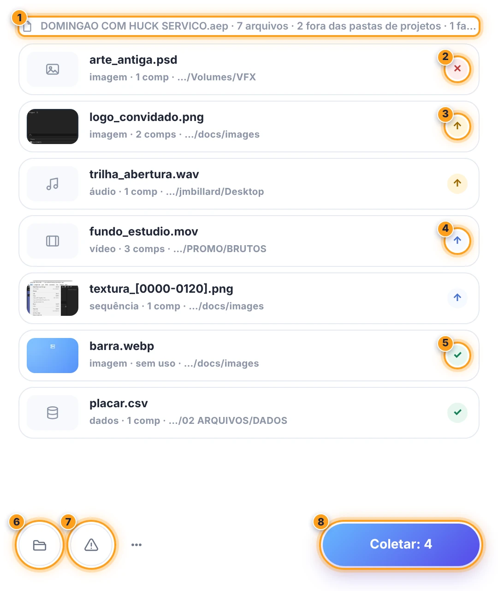
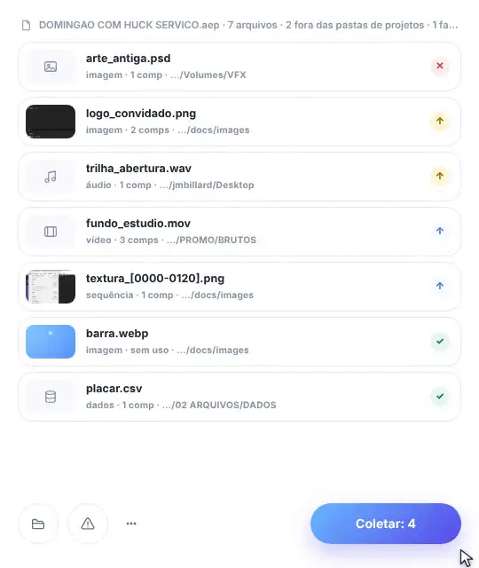

# 🥖 O PADEIRO · v2.0 beta7

🗨️ **pt-BR** ⚡ preenchimento em massa de templates e outras utilidades para o After Effects ⚡

o padeiro duplica comps, preenche os textos e cria a fila de render a partir de um projeto template. ideal para volumes grandes de "*artes iguais*" e caminhos de rede longos e confusos.

o fluxo é simples, em 3 etapas:\
`1 buscar` > `2 selecionar` > `3 preencher`

> 🚩 *a versão anterior (script ScriptUI, até a v1.97) continua disponível no branch [`LEGACY`](https://github.com/jmbillard/O-PADEIRO/tree/LEGACY).*

o padeiro é uma **extensão** do After Effects: a **barra** é um painel que pode ser acoplado em qualquer lugar da interface, como os painéis nativos. cada ferramenta tem **dois cliques** (`◖` esquerdo e `◗` direito) e as tarefas maiores abrem em **janelas** próprias, cada uma com um nome de ofício (ou objeto) da padaria e dos bastidores da TV: **a turma**.

### 🧑‍🍳 a turma

| | ferramenta | `◖ clique esquerdo` | `◗ clique direito` |
| :---: | --- | --- | --- |
|  | **Templates** | abre **[O FORNINHO](docs/templates.md)**: buscar, preencher e criar a fila de render | abre **[A FORMA](docs/criador.md)**: transformar a comp aberta num template novo |
|  | **Fontes** | **[O TIPÓGRAFO](docs/fontes.md)** resolve as fontes (instala as que faltam) | abre **[O TIPÓGRAFO](docs/fontes.md#-fontes-do-projeto-janela)**: cada fonte, a troca e a cópia |
|  | **Projeto** | abre **[A CLAQUETE](docs/projeto.md)**: projeto novo pela atração, ou o editor | **A CLAQUETE** salva o projeto na pasta dele |
|  | **Coletar** | **[O CATADOR](#coletar)** coleta os arquivos na pasta do projeto | abre **[O CATADOR](#coletar)**: os arquivos, outra pasta, os que faltam |
|  | **Renomear** | renomeia as comps selecionadas | renomeia todas as saídas de render |
|  | **Organizar** | **[O CONTRARREGRA](#organizar)** organiza o projeto | **O CONTRARREGRA** cria a estrutura de pastas |
|  | **Importar** | **[O VERSIONADOR](docs/versionador.md)** importa um projeto do After de qualquer versão | abre **[O VERSIONADOR](docs/versionador.md)**: salvar o projeto em versões mais velhas do After |
|  | **Pastas** | **O ADAPTADOR** abre a pasta do último render | abre **[O ADAPTADOR](docs/conversor.md)**: caminhos Windows ⇄ macOS |
|  | **Buscar** | abre **[O ACESSORISTA](docs/acessorista.md)**: busca de caminhos | abre **O ACESSORISTA**: busca nos textos dos layers |

e mais: **[O PRODUTOR](docs/producoes.md)**, a configuração (`◖ clique DUPLO` em qualquer ferramenta abre a aba dela), e o **[instalador](#-instalação)**.

| janela | menu `Window` > `Extensions` | para que serve |
| --- | --- | --- |
| a barra | **O PADEIRO** | as ferramentas e os atalhos para as janelas ([abaixo](#-a-barra-principal)) |
| 📄 [O FORNINHO](docs/templates.md) | **O FORNINHO** | os templates: buscar, selecionar e preencher, e criar a fila de render |
| ✨ [A FORMA](docs/criador.md) | **A FORMA** | o criador de templates: transformar a comp aberta em um novo template |
| 🎬 [A CLAQUETE](docs/projeto.md) | **A CLAQUETE** | o projeto: acha a pasta da atração, cria a estrutura e salva o `.aep` |
| 🔤 [O TIPÓGRAFO](docs/fontes.md) | **O TIPÓGRAFO** | as fontes do projeto: o estado de cada uma, trocar por outra e copiar para uma pasta |
| 📦 [O CATADOR](#coletar) | **O CATADOR** | os arquivos do projeto: coletar, coletar em outra pasta e resolver os que faltam |
| 🔎 [O ACESSORISTA](docs/acessorista.md) | **O ACESSORISTA** | buscar caminhos de atrações e textos nos layers do projeto |
| 🔁 [O ADAPTADOR](docs/conversor.md) | **O ADAPTADOR** | converter caminhos entre Windows e macOS |
| 🕰️ [O VERSIONADOR](docs/versionador.md) | **O VERSIONADOR** | salvar o projeto aberto em versões mais velhas do After (até 3 para trás) |
| 🗂️ [O PRODUTOR](docs/producoes.md) | **O PRODUTOR** | a configuração: o que é da equipe e o que é só deste computador |

cada janela tem a sua documentação, também aberta pelo **⋯ > ajuda / documentação** da própria janela.

### 🎨 o visual

todas as janelas falam a mesma língua: o **degradê** à esquerda, com as listas, as abas e os campos direto nele (só um contorno fino, sem caixas nem brilhos em volta), e a **folha branca** à direita. o escolhido ganha um contorno; os cantos arredondados são concêntricos; o respiro é de 16 px em volta; e os botões do rodapé ficam na mesma linha em todas as janelas, lado a lado. claro, escuro e as cores da equipe ficam na aba **aparência** d'[O PRODUTOR](docs/producoes.md#-aparência).

<table><tr>
<td width="34%">
<b>O FORNINHO</b>
</td>
<td width="33%">
<b>A FORMA</b>
</td>
<td width="33%">
<b>O PRODUTOR</b>
</td>
</tr></table>

> 🧭 *vai mexer nas telas? o [guia de UI](docs/guia-ui.md) tem as regras e as três checagens automáticas (cantos, rodapés e foco).*

 

## 📍 sumário

- [instalação](#-instalação)
- [a barra principal](#-a-barra-principal)
- [ferramentas da barra](#-ferramentas-da-barra)
- [painéis](#-painéis)
- [teclado e atalhos](#-teclado-e-atalhos)
- [códigos de erro](#-códigos-de-erro)
- [manutenção](#-manutenção)

 

---

 

## 📍 instalação

requer After Effects **2022 (22.0)** ou mais novo, no macOS ou no Windows.

1. no After Effects, acesse `File` > `Scripts` > `Run Script File...` e escolha o arquivo **`INSTALAR O PADEIRO.jsx`**, direto da **pasta do padeiro na rede** (a que tem a pasta `extension/` e o arquivo `O_PADEIRO_GLOBAL_config.json`).
2. o instalador guia o passo a passo. com tudo certo (os testes passam), ele abre direto na **ação**; '*anterior*' volta para a checagem:
   - **checagem** → confere a versão do After Effects, o acesso à rede, a pasta `extension/` e a lista de produções compartilhada. o que faltar fica marcado em vermelho (ou amarelo, se for só um aviso), com a explicação de como resolver. sem o acesso à rede, o link '*› abrir preferências de scripts e expressões*' abre a tela certa: marque a opção (veja [abaixo](#habilitando-o-acesso-à-rede)) e clique em '*› verificar de novo*'.
   - **ação** → '*instalar*' (ou '*atualizar*', se já estiver instalado) ou '*remover*'.
   - **andamento** → a barra mostra cada etapa e, no fim, o resumo.

   > 📟 *instalador (checagem):*
   >
   > 
3. **reinicie** o After Effects. no macOS, se o padeiro não aparecer em `Window` > `Extensions`, reinicie o computador: a liberação de extensões sem assinatura às vezes só vale depois disso.
4. abra a barra pelo menu `Window` > `Extensions` > `O PADEIRO` e acople onde preferir. as outras ferramentas abrem em janelas, pelos botões da barra (ou pelo mesmo menu).

> 🚩 *obs:*\
> • instale sempre **a partir da pasta do padeiro na rede**: o instalador grava onde está a lista de produções compartilhada, e é ela que mantém todo mundo com a lista mais atual.\
> • o **código do padeiro fica na rede**: o computador recebe só um carregador, que abre os painéis direto da pasta do padeiro. por isso, **para atualizar, basta fechar e abrir o painel de novo** depois que os arquivos da rede forem trocados.\
> • o instalador só precisa rodar de novo quando a lista de painéis mudar (um painel novo, por exemplo). o mesmo instalador também **remove** a extensão.\
> • sem acesso à pasta do padeiro na rede, os painéis avisam e tentam de novo sozinhos.\
> • o instalador roda dentro do After Effects, então o macOS não bloqueia (como acontece com scripts abertos pelo Finder).\
> • **janelas pretas no After Effects 2025**: resolvido a partir desta versão. se ainda acontecer, rode o instalador de novo (o carregador antigo usava outro manifest).\
> • o instalador também remove a versão antiga do padeiro (o script `O PADEIRO.jsx` da pasta `Scripts/ScriptUI Panels`), que deixou de existir.

### habilitando o acesso à rede

o padeiro lê e grava arquivos na rede (templates, lista de produções, fontes). na checagem, o instalador abre sozinho a tela de preferências certa: marque '**Allow Scripts to Write Files and Access Network**' e clique em '*› verificar de novo*'.

> 📋 *a opção nas preferências de scripting:*\
> 

 

---

 

## 📍 a barra principal

a barra se adapta ao tamanho do painel: horizontal, com os nomes embaixo dos ícones, ou vertical, com os nomes ao lado (bem estreita, só os ícones, com os links um embaixo do outro).

| | | |
| :---: | --- | --- |
| ❶ | **rede / local** | **servidor**: tudo vem da rede. **servidor com alerta amarelo**: a rede caiu e o padeiro usa as cópias deste computador (modo local, até a rede voltar). **notebook**: modo local, ligado por você. `◖` abre a [configuração > rede](docs/producoes.md#-rede) (no notebook, [meu usuário](docs/producoes.md#-meu-usuário)). |
| ❷ | **links** | os links da equipe e, com um bonequinho no canto, os seus (só neste computador), com o ícone de cada site ([configuração > links](docs/producoes.md#-links)). |
| ❸ | **a turma** | as ferramentas ([tabela acima](#-a-turma)), em grupos. a ordem, os grupos e quais aparecem ficam na aba **layout** da [configuração](docs/producoes.md#-layout): cada pessoa monta a sua barra a partir de um padrão da equipe. |
| ❹ | **bolinhas** | o estado de cada uma: no **projeto**, 🟢 com os dados do padeiro, 🟠 sem; nas **fontes**, 🟠 falta alguma, 🟢 tudo certo; no **coletar**, 🟡 arquivo fora das pastas de projetos, 🟢 tudo nelas. |
| ❺ | **pãozinho** | `◖` abre esta documentação; `◗` refaz o tour da barra. a versão do padeiro aparece embaixo dele. |

cada botão tem **duas ações**: `◖ clique esquerdo` e `◗ clique direito`. a dica de cada botão (passe o mouse) lista as duas, com o nome de quem faz. `◖ clique DUPLO` em qualquer ferramenta abre a configuração já na aba dela (ex: renomear → aba renomear).

### primeira vez (o tour)

sem a configuração da equipe (nem na rede, nem a cópia deste computador), a barra abre um tour num balão de vidro, e as ferramentas esperam:

1. **onde fica a configuração da equipe?** → **achar na rede** (escolha o `O_PADEIRO_GLOBAL_config.json`; o caminho fica gravado, como faz o instalador) · **criar uma nova** (numa pasta da rede, com os padrões; se já houver uma lá, vale ela) · **só aqui** (modo local, com os padrões).
2. **quem é você?** → a sigla do designer (a mesma de configuração > meu usuário).
3. **a turma** → cada ferramenta acende, com o nome e o que fazem os dois cliques. experimente `◖` e `◗` na ferramenta acesa: durante o tour, os cliques só acendem a linha do clique, não rodam nada.

`◗` no pãozinho refaz o tour da turma a qualquer hora.

### trabalhando na barra

**O CATADOR** (coletar) e **O TIPÓGRAFO** (fontes) mostram o andamento no próprio botão: o nome vira a contagem (`5/12`), uma linha fina enche embaixo e o ícone repete a animação; no fim, um brilho verde. o coletar vai arquivo por arquivo (o After Effects fica livre entre um e outro); as fontes contam as etapas do resolver (projeto → banco → conferindo) e o envio ao banco em segundo plano.

 

> 🚩 *obs:*\
> • a versão do padeiro aparece embaixo do pãozinho.\
> • a produção é escolhida no rodapé do painel de templates e vale para todos os painéis, que acompanham a troca na hora.

 

---

 

## 📍 ferramentas da barra

### fontes

as fontes de cada projeto aberto vão sozinhas para o [banco de fontes](docs/fontes.md) na rede e para a pasta de fontes do projeto. a bolinha no botão: 🟠 laranja quando falta algo, 🟢 verde quando está tudo certo.

`◖ clique esquerdo` → resolver: com tudo instalado, só avisa que está ok; faltando alguma, instala primeiro da pasta de fontes do projeto e depois do banco; a que não for achada abre O TIPÓGRAFO.

`◗ clique direito` → **O TIPÓGRAFO**, a janela de [fontes do projeto](docs/fontes.md#-fontes-do-projeto-janela): o estado de cada fonte, a troca por outra (com busca e prévia) e copiar as fontes para uma pasta.

### coletar

a bolinha no botão: 🟡 amarela quando o projeto tem algum arquivo fora das pastas de projetos ([configuração > projeto](docs/producoes.md): o começo fixo do caminho de cada categoria, como `…/PROGRAMAS`; `VFX-1` … `VFX-5` valem como `VFX`; no Windows, `L:\…` vale como o caminho de rede da letra no [mapa de drives](docs/producoes.md), e o nome do servidor, curto ou completo, não importa), 🟢 verde quando está tudo nelas. sem categorias na configuração, vale estar na rede.

enquanto trabalha, o nome do botão vira a contagem (`5/12`), uma linha fina enche embaixo dele e o ícone repete a animação; no fim, um brilho verde. o mesmo vale para as **fontes**: ao resolver (projeto → banco → conferindo) e ao enviar as fontes ao banco em segundo plano.

`◖ clique esquerdo` → **O CATADOR** copia os arquivos usados no projeto para a estrutura do projeto, na árvore de pastas da [configuração > coletar](docs/producoes.md#-coletar) (padrão: `01 PROJETOS` com o `.aep`, `02 ARQUIVOS` com FONTS, IMAGENS, VÍDEOS, AUDIOS e DADOS, e `03 SAIDA`), e troca os caminhos no projeto para as cópias. a raiz é a pasta de cima da `01 PROJETOS` (ou a pasta do `.aep`, se ele não estiver nela). depois, salva o projeto, sempre.

- cada tipo (vídeos, sequências de imagens, imagens, áudio, dados e fontes) vai para a sua pasta; tipos fora da árvore não são coletados.
- **sequências de imagens** são copiadas inteiras (os quadros do trecho usado), cada uma numa subpasta com o nome dela; a interpretação (fps, alpha) é mantida.
- arquivos que já estão na pasta do projeto ficam como estão: coletar de novo só copia o que é novo.

`◗ clique direito` → **O CATADOR**, a janela do coletar: uma linha por arquivo do projeto, com a miniatura (a imagem ou o primeiro quadro; áudio e dados com o ícone do tipo), o tipo, em quantas comps aparece e a pasta. clicar numa linha mostra o item no painel Project.

<table><tr><td width="56%"></td><td></td></tr></table>

| | | |
| :---: | --- | --- |
| ❶ | **o projeto** | o `.aep`, quantos arquivos e quantos estão fora do lugar. |
| ❷ | **✕ faltando** | o arquivo não existe (ou está num volume desmontado: o ❼ resolve). |
| ❸ | **↑ amarela** | fora das pastas de projetos (ex: a Área de Trabalho): o coletar leva para a pasta do projeto. |
| ❹ | **↑ azul** | nas pastas de projetos, mas fora da pasta deste projeto: o coletar copia. |
| ❺ | **✓** | já está na pasta do projeto. (**–** cinza: tipo fora da árvore do coletar.) |
| ❻ | **outra pasta** | coleta numa pasta escolhida. |
| ❼ | **resolver os que faltam** | procura cada arquivo faltando no volume certo (`VFX`, `VFX-1` … `VFX-5`), monta o share se precisar e relinka (desfaz com um Ctrl+Z). |
| ❽ | **Coletar** | copia o que falta para a estrutura do projeto; as setas sobem enquanto copia. o **⋯** abre a pasta do projeto. |

> 🚩 *obs:*\
> • o projeto precisa estar salvo (os arquivos vão para a pasta dele), ou use o clique direito.\
> • arquivos ausentes e fontes sem arquivo local (ex: Adobe Fonts) não são coletados: o padeiro avisa quais.

### importar

**O VERSIONADOR** ([a página dele](docs/versionador.md)):

`◖ clique esquerdo` → escolha um projeto do After (`.aep` ou `.aet`) e ele é importado no projeto aberto, **de qualquer versão**: o de versão mais nova (ex.: salvo no 2026 e você está no 2025) vira antes uma cópia na versão que está rodando, na pasta temporária. a pasta que a importação cria leva o nome do arquivo original.

`◗ clique direito` → abre a janela **O VERSIONADOR**: salva o projeto aberto em até 3 versões mais velhas do After (`nome_AE24.aep`, `nome_AE23.aep`…), na pasta do projeto ou em outra.

- a conversão troca só o número da versão no cabeçalho do arquivo (como o [AEP-Downgrader](https://github.com/itsAnchorpoint/AEP-Downgrader) e o [AESHIFT](https://github.com/mason-reed24/aeshift-after-effects-tool)): efeitos, expressões e recursos que só existem na versão nova podem faltar ou dar aviso. **confira antes de usar em produção**.
- o original nunca é alterado.

### pastas

`◖ clique esquerdo` → abre a pasta do primeiro arquivo de saída do último item da fila de render. se a pasta ainda não existir (antes do render), abre a mais próxima que existe.

`◗ clique direito` → abre o [conversor de caminhos](docs/conversor.md).

### renomear

`◖ clique esquerdo` → renomeia as comps selecionadas no painel de projeto: remove caracteres especiais, passa para MAIÚSCULAS e acrescenta o prefixo do tipo (rodapé, cartão, lettering...).

*o tipo vem do nome da pasta em que a comp está (ex: `RODAPES`, `LETTERING - JOGO`) ou de um prefixo / sufixo já presente no nome da comp. o nome da pasta tem prioridade.*

`◗ clique direito` → aplica a mesma regra aos arquivos de saída de **todos** os itens da fila de render (o nome das comps não muda).

> 🚩 *obs:*\
> • com uma pasta do projeto selecionada, a pasta e todas as comps dentro dela são renomeadas.\
> • cada saída continua na pasta em que estava; itens já renderizados não mudam e nomes repetidos na mesma pasta ganham um sufixo (`_2`, `_3`...).\
> • comps com o layer de texto `script_template_name` (último layer) recebem o nome definido nesse layer ([como usar](docs/templates.md#o-nome-da-comp-pelo-layer-script_template_name)).

**prefixos e termos reconhecidos** (no singular ou plural, com ou sem acento, como palavras inteiras):

| prefixo | termos |
| --- | --- |
| **RDP** | RODAPE, RDP |
| **CRT** | CARTAO, CARTOES, CRT |
| **LETT** | LETTERING, LETT, LET |
| **CONFRONTO** | CONFRONTO |
| **TARJA** | TARJA, TRJ, TAR |
| **PASSAGEM** | PASSAGEM, TRANSICAO, TRANSICOES, LAPADA |
| **ASSINA** | ASSINATURA, ASSINA, ASS |
| **FOTO** | FOTO, IMG, IMAGEM, IMAGENS |
| **REF** | REFERENCIA, PREVIEW, REF, PREV |

### organizar

**O CONTRARREGRA**: deixa cada coisa do projeto no lugar certo, como o contrarregra antes de gravar.

`◖ clique esquerdo` → organiza o projeto no modelo da PROMO.

> 🚩 *obs:*\
> • **selecione antes as comps principais** (as que serão renderizadas): elas recebem o comentário 'EXPORTAR' e vão para '01 COMPS'.\
> • com uma pasta para as **comps editáveis** na árvore (configuração), comps com 'EDIT' no comentário vão para ela.\
> • comps com comentário 'EXPORTAR', 'TEMPLATE' ou 'LOGO GLOBO' também vão para '01 COMPS'; as com o comentário de um tipo reconhecido (ex: 'RODAPE', dado pelo renomear) vão para uma subpasta com esse nome.\
> • as demais comps vão para '02 PRECOMPS' (em subpastas pelo comentário, se houver).\
> • footages vão para '03 ARQUIVOS' (VIDEOS, IMAGENS, AUDIO, SOLIDOS, DADOS) e arquivos ausentes para 'MISSING'. o texto do comentário antes de ':' vira subpasta.\
> • pastas que ficarem vazias são removidas.

`◗ clique direito` → cria só a estrutura de pastas (as que já existem são reaproveitadas).

> 

 

---

 

## 📍 painéis

| | |
| --- | --- |
| [🧩 instalação](#-instalação) | o instalador: checagem, instalar / atualizar e remover |
| [📄 O FORNINHO](docs/templates.md) | templates: buscar, fixados e recentes, preview, fontes, input, fila de render e editor de config |
| [✨ A FORMA](docs/criador.md) | criar template: formulário, nomenclatura, layers editáveis e arquivo de configuração |
| [🔤 O TIPÓGRAFO](docs/fontes.md) | fontes: banco de fontes, o botão fontes e a janela de fontes do projeto |
| [🎬 A CLAQUETE](docs/projeto.md) | projeto: projeto novo pela atração, estrutura de pastas e editor |
| [🗂️ O PRODUTOR](docs/producoes.md) | configuração: produções, links da barra, logs, drives da rede, renomear, organizar, coletar, busca, projeto e aparência (compartilhados pela equipe) |
| [📦 O CATADOR](#coletar) | coletar: os arquivos do projeto, outra pasta e os que faltam |
| [🔎 O ACESSORISTA](docs/acessorista.md) | busca de caminhos e busca nos textos do projeto |
| [🔁 O ADAPTADOR](docs/conversor.md) | conversor: caminhos Windows / macOS |
| [🧭 guia de UI](docs/guia-ui.md) | as regras para criar e mexer nas janelas: cores do tema, cantos, campos, ícones, animações, mensagens |

 

---

 

## 📍 teclado e atalhos

o mesmo vocabulário em todos os painéis:

| tecla | o que faz |
| --- | --- |
| `↑` `↓` | andam nas listas. `↓` na busca vai para o primeiro item; `↑` no primeiro volta para a busca |
| `Enter` | abre / seleciona. nos templates, seleciona e leva para o input |
| `Esc` | limpa a busca ou volta um passo |
| `Ctrl/Cmd+F` | foca a busca do painel |
| `Ctrl/Cmd+S` | salva (produções, criador de templates) |
| `Ctrl/Cmd+Enter` | preenche (templates) |
| `Ctrl/Cmd+Z` / `Ctrl/Cmd+Shift+Z` | desfaz / refaz no texto do input (templates) |
| `Ctrl/Cmd+C` | copia o caminho ou o texto do resultado em foco (O ACESSORISTA) |

- **barra** → `←` `→` andam pelos botões; `Enter` faz a ação do clique esquerdo e `Shift+Enter` a do direito.
- **listas suspensas** → com a lista aberta, digite para filtrar (útil com muitas produções).

os atalhos de cada painel estão na documentação dele.

 

---

 

## 📍 códigos de erro

todo erro do padeiro começa com um código `#PAD_` (o aviso pode ser fechado no ×). use o código para achar a causa:

| código | o que aconteceu |
| --- | --- |
| `#PAD_003` `#PAD_004` `#PAD_007` `#PAD_012` `#PAD_PATH_003` | sem acesso à rede: habilite '*Allow Scripts to Write Files and Access Network*' |
| `#PAD_005` | o projeto não foi preenchido pelo padeiro (instalar fontes depende disso) |
| `#PAD_006` `#PAD_035` | a pasta `FONTS` do template não existe ou não tem `.ttf` / `.otf` |
| `#PAD_008` | a fila de render está vazia |
| `#PAD_009` `#PAD_019` `#PAD_062` | pasta de output (ou caminho) não encontrada |
| `#PAD_017` | o `_config.json` do template é inválido |
| `#PAD_018` `#PAD_022` | o arquivo do template não foi encontrado |
| `#PAD_021` | um layer editável da config não existe no template |
| `#PAD_023` `#PAD_025` `#PAD_026` `#PAD_028` `#PAD_031` `#PAD_063` | criador de templates: comp principal ou layers editáveis faltando |
| `#PAD_027` | criador de templates: o teste de preenchimento falhou |
| `#PAD_029` | criador de templates: falta a atração ou o que é |
| `#PAD_032` `#PAD_033` | renomear: nada selecionado / saídas que não puderam ser renomeadas |
| `#PAD_034` | algumas fontes não puderam ser copiadas (ex: Adobe Fonts) |
| `#PAD_036` | organizar: erro ao organizar o projeto |
| `#PAD_043` | o painel pediu uma ação que o host não conhece (painel e host de versões diferentes: reabra o painel) |
| `#PAD_044` `#PAD_045` | editor de config: dado inválido / não foi possível gravar o arquivo |
| `#PAD_046` | o input está vazio |
| `#PAD_047` `#PAD_048` `#PAD_049` | preenchimento / fila de render fora de ordem (comece de novo) |
| `#PAD_050` | o projeto está vazio |
| `#PAD_051` a `#PAD_057` | lista de produções: dado inválido, falha ao gravar ou arquivo de importação inválido |
| `#PAD_058` | não foi possível baixar o índice de caminhos do acessorista |
| `#PAD_059` `#PAD_060` `#PAD_069` | busca de textos: a comp ou o layer não existe mais (atualize a busca) |
| `#PAD_061` | conversor: nenhum caminho informado |
| `#PAD_064` | a lista de produções compartilhada (na rede) não está acessível |
| `#PAD_065` | outra pessoa salvou a lista de produções depois que você abriu o editor |
| `#PAD_066` `#PAD_067` `#PAD_068` | o painel não conseguiu carregar o padeiro da rede |
| `#PAD_070` `#PAD_071` `#PAD_072` `#PAD_PATH_001` `#PAD_PATH_002` | caminho de rede inválido, volume não montado ou pasta inacessível |
| `#PAD_073` `#PAD_074` | banco de fontes: trocar fontes sem o After Effects 2024 / nenhum arquivo para instalar ou banco sem pasta |
| `#PAD_075` | criador: a fila de render já está renderizando (preview .mp4) |
| `#PAD_076` | criador: nenhum template de output H.264 para o preview .mp4 |
| `#PAD_077` | criador: o preview .mp4 não foi gerado |
| `#PAD_078` | configuração: endereço do webhook do log inválido (vazio, sem http(s):// ou com espaços/aspas) |
| `#PAD_079` | configuração: letra de drive inválida ou repetida |
| `#PAD_080` | configuração: o caminho do drive não é de rede (`//servidor/share/...`) |
| `#PAD_081` | configuração: volume sem nome, repetido ou sem servidor |
| `#PAD_082` | configuração: tipo de renomear sem prefixo, comentário ou termos, prefixo repetido ou separador inválido |
| `#PAD_083` | configuração: nome fixo sem o termo ou sem o nome |
| `#PAD_084` | configuração: árvore de pastas do organizar inválida (nome vazio ou repetido, pasta pai inexistente, ciclo ou conteúdo em duas pastas) |
| `#PAD_085` | configuração: comentários de render vazios ou comentário automático fora deles |
| `#PAD_086` | configuração: endereço do webhook da busca inválido ou arquivo de índice não escolhido |
| `#PAD_087` | configuração: link sem nome ou com endereço inválido |
| `#PAD_088` | configuração: cor da aparência inválida (use `#rrggbb`) |
| `#PAD_089` | configuração > projeto: categoria sem nome ou sem caminho, repetida, com token desconhecido ou sem `{atracao}` |
| `#PAD_090` | projeto: sem atração, sem título do filme ou sem ID e nome |
| `#PAD_091` | projeto: sem pasta de destino, projeto ainda não salvo, nome do arquivo vazio ou pasta que não pôde ser criada |
| `#PAD_092` | projeto: já existe um `.aep` com esse nome na pasta |
| `#PAD_093` | coletar: itens que não puderam ser coletados (sem permissão, arquivo ausente) |
| `#PAD_094` | configuração: árvore do coletar inválida (nome vazio, repetido ou com `\ / : * ? " < > \|`, pasta pai inexistente, ciclo, tipo em duas pastas) ou sem nenhum tipo |
| `#PAD_095` | coletar: projeto não salvo (use o clique direito para escolher a pasta) |
| `#PAD_096` | modo local (ligado ou sem a rede): sem cópia da configuração neste computador, ou tentativa de editar a configuração da equipe |
| `#PAD_097` | criador de templates: variações de layout (nenhum efeito de menu selecionado, sufixo vazio ou repetido, layer do efeito removido) |
| `#PAD_098` | produção local (configuração > templates, neste computador): sem nome ou sem pasta, ou com o nome de uma produção da equipe |
| `#PAD_100` | importar / versionador: o arquivo não é um projeto do After (`.aep` / `.aet`), a versão não pôde ser lida ou o painel está sem acesso aos arquivos |
| `#PAD_102` | versionador: projeto nunca salvo, sem pasta ou pasta que não existe |
| `#PAD_101` | primeira vez (tour): o arquivo escolhido não é a configuração da equipe, não é um JSON válido, ou a pasta não aceita gravar |
| `#PAD_099` | erro inesperado: anote a mensagem e avise a equipe |

 

---

 

## 📍 manutenção

o código da extensão, a estrutura dos arquivos, como testar sem o After Effects e onde ficam as configurações mais comuns estão em [`extension/README.md`](extension/README.md).
