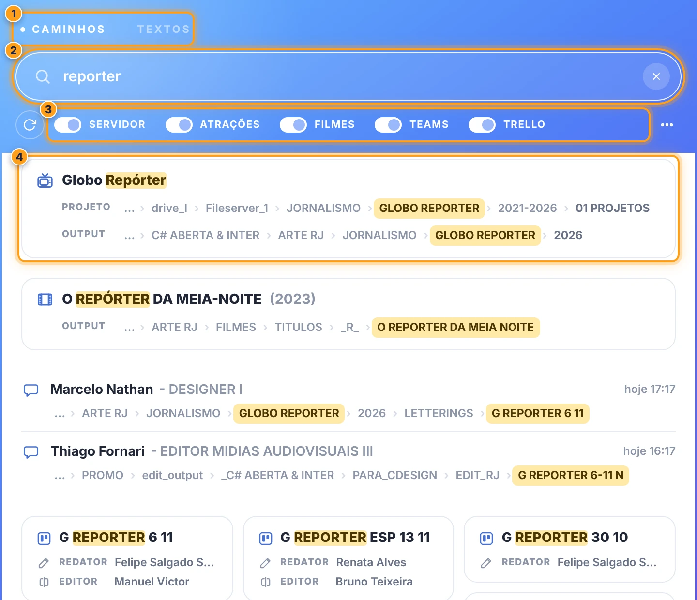
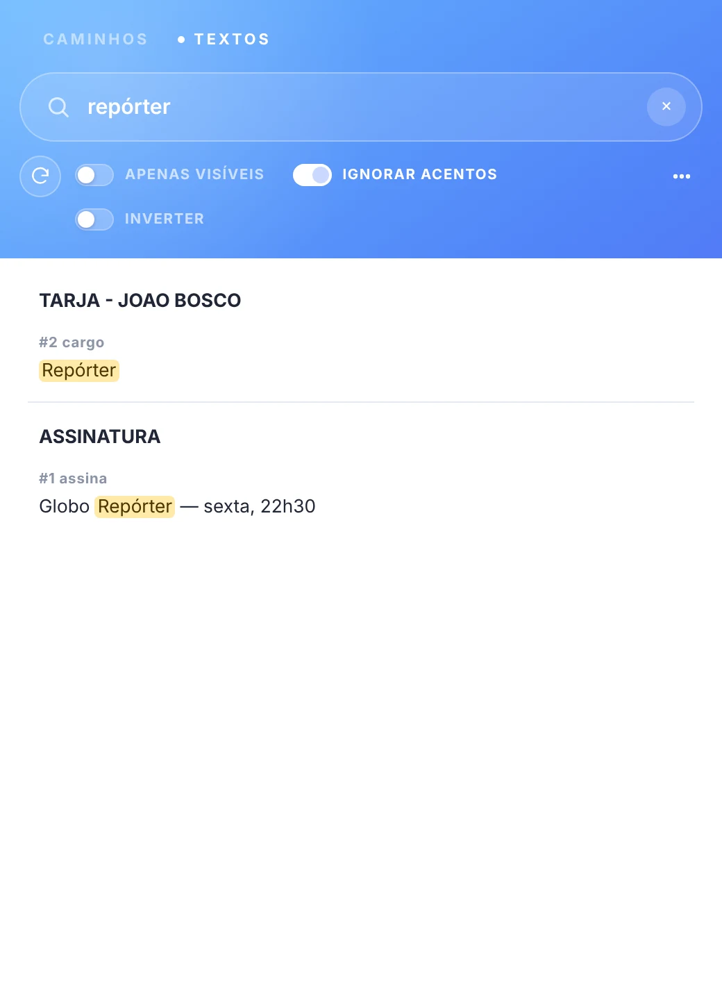

# 🔎 O ACESSORISTA

[← O PADEIRO](../README.md)

o painel **O ACESSORISTA**: as buscas do padeiro, em duas abas (caminhos e textos).

a janela abre com 720 px de largura (ou mais, se os interruptores precisarem: eles ficam sempre numa linha) e baixa: sem uma busca, ela mostra o cabeçalho e um pouco da folha branca (onde aparecem o loader e os avisos). a folha branca com os resultados entra quando você pesquisa. a cada busca ela se ajusta sozinha: alarga para os toggles caberem numa linha e os caminhos aparecerem inteiros (até 70% da largura da tela; ela nunca estreita sozinha) e ajusta a altura para caber os resultados (até 85% da altura da tela; passando disso, a lista rola).

### caminhos

<table><tr><td width="50%"></td><td></td></tr></table>

| | | |
| :---: | --- | --- |
| ❶ | **abas** | **caminhos** e **textos** (o mesmo painel). |
| ❷ | **busca** | atração, claquete, quem mandou, pasta do projeto, output ou caminho (a partir de 2 caracteres). |
| ❸ | **origens da busca** | liga e desliga cada uma: caminhos fixos, atrações, filmes, Teams e Trello. a seta relê o índice. |
| ❹ | **resultados** | o ícone diz de onde vem; o trecho achado fica marcado. clique numa pasta do caminho para abri-la. |

`◖ clique esquerdo` em **buscar**, na barra. pesquise por atração, claquete, quem mandou, pasta do projeto, output ou caminho (a partir de 2 caracteres) e abra as pastas direto no Finder / Explorer.

os resultados vêm sem títulos de seção: o ícone de cada item diz de qual **origem** ele vem. em todos, cada pasta do caminho é um botão: o clique abre **aquela** pasta (a do meio também, não só a última).

| ícone | origem | o que mostra | até | o clique |
| --- | --- | --- | :---: | --- |
| servidor | **caminhos fixos** (as pastas da equipe da [configuração > buscar](producoes.md#-buscar)) | o nome e a linha **CAMINHO** | 10 | cada pasta do caminho abre aquela pasta |
| TV de tubo | **atrações** | o nome e as linhas **PASTA DO PROJETO** e **OUTPUT** | 20 | cada pasta do caminho abre aquela pasta |
| película | **filmes** | o título, o ano de produção entre parênteses e a linha **OUTPUT** | 20 | cada pasta do caminho abre aquela pasta |
| balão | **Teams** (últimos 30 dias) | quem mandou - cargo, quando (hoje, ontem, o dia da semana até 6 dias atrás ou a data, com a hora) e, embaixo, o caminho da mensagem. a busca procura em quem mandou e no caminho (não no texto da mensagem) | 20 | o balão abre a mensagem no Teams; cada pasta do caminho abre aquela pasta |
| quadro do Trello | **Trello** (últimos 15 dias) | cards em grade: a claquete, o redator e o editor | 24 | o card abre no Trello |

- **como a busca compara** → sem acentos, maiúsculas e pontuação, sempre a partir do começo de uma palavra: '*não*' acha '*NAO APAGAR*', mas não '*an**NA - O***'; '*3/11*' acha '*3/11*' e '*3 11*', mas não '*31/10*'.
- **apelidos das atrações** → quando o que você digita é o começo do nome ou de um *pattern* de uma atração (com 3 letras ou mais), a busca também procura os outros nomes dela: '*GREP*' ou '*G REP*' trazem também o que tem **GLOBO REPORTER** e **G REPORTER** (mensagens, cards, pastas). em cima dos resultados aparece '*também: Globo Repórter*'.
- **interruptores** (ao lado do atualizar) → um por origem: **CAMINHOS FIXOS**, **ATRAÇÕES**, **FILMES**, **TEAMS** e **TRELLO** (a mesma ordem dos resultados). desligada, a origem sai da busca (só aparecem as que têm itens). a escolha fica ao atualizar. no índice local não há interruptores: no lugar, de onde vêm os caminhos.
- **⋯** → ajuda (esta página) e recarregar o painel.
- **caminho** → aparece em breadcrumb: clique em qualquer pasta para abri-la. a pasta que contém o termo buscado fica destacada em amarelo. quando o caminho não cabe, as pastas iniciais saem (com '*…*'); a última e a destacada ficam sempre.
- **atualizar** (o botão redondo, abaixo da busca) → baixa os caminhos de novo (no índice local, indexa as pastas de novo; no modo local, relê a cópia, sem a rede). ao lado dele aparece de onde vêm os caminhos no índice local ('*índice local · 18.430 itens · 09:12 HOJE*') ou o andamento da indexação.

### índice local

em vez do webhook, cada computador pode ter o seu **índice local** ([configuração > buscar](producoes.md#-buscar), embaixo, em **neste computador**): as pastas escolhidas e todas as subpastas, lidas pelo painel e guardadas no computador. a busca procura pelo **nome** de cada pasta (ícone de pasta, nome e a linha **CAMINHO**; até 30) e mostra também os caminhos fixos. com **só pastas** desligado, o índice guarda também os arquivos: eles aparecem com o ícone de arquivo, e a linha **CAMINHO** é a pasta onde o arquivo está. funciona sem rede.

- a última indexação aparece na hora; ela é refeita quando as pastas mudam, uma vez por dia (se ligado) ou no **atualizar**. enquanto indexa, a busca continua com o índice anterior.
- a janela [PROJETO](projeto.md) procura a claquete pelo nome das pastas: vale a pasta cujo nome é o começo da claquete (*MAIS VOCE* para *MAIS VOCE 30 10*). acerta menos que as atrações do webhook (sem os *patterns*).

### modo local

no [modo local](producoes.md#-meu-usuário) (sem a rede da equipe, ligado à mão ou quando a rede cai), a busca de caminhos **não tenta a rede**: usa na hora a **cópia** do índice salva neste computador (ou o índice local, se for o escolhido). em cima dos resultados aparece de quando é a cópia ('*modo local · cópia do índice de 14:32 28/10*'): os caminhos podem estar desatualizados. sem cópia nenhuma, o painel avisa ('*modo local: sem cópia do índice*'): com a rede, desligue o modo local e clique em atualizar, ou escolha o índice local. a janela [PROJETO](projeto.md) segue a mesma regra.

> 🚩 *obs:*\
> • os caminhos vêm do workflow **PROMO - BUSCAR**, que já devolve o índice pronto (com as mensagens do Teams mais recentes). o painel baixa sozinho, em segundo plano, sem travar o After Effects: a cópia salva aparece na hora e é trocada quando a resposta chega. sem conexão, vale a cópia salva (avisando '*usando o último índice salvo*'). a resposta pode vir como o JSON do índice, como o JSON em texto ou embrulhada pelo n8n (`[{ "indice": "…" }]`): o painel entende as três.\
> • o endereço do workflow e os caminhos fixos ficam na [configuração > buscar](producoes.md#-buscar).\
> • no macOS, os volumes de rede necessários são montados ao abrir uma pasta. no Windows, os caminhos do Mac (`/Volumes/...`) são convertidos pelo mapa da [configuração > rede](producoes.md#-rede).\
> • cada origem mostra no máximo o número da coluna **até** da tabela: refine o termo para ver os demais.

### textos

> 

`◗ clique direito` em **buscar**, na barra. o painel lê os textos de todos os layers do projeto e filtra enquanto você digita.

- **APENAS VISÍVEIS** → só layers ligados.
- **IGNORAR ACENTOS** → '*amazonia*' também encontra '*Amazônia*' (ligado por padrão).
- **INVERTER** → layers que **não** contêm o termo.
- clique em um resultado → abre a comp com o layer selecionado, no tempo em que o texto aparece.
- **atualizar** (antes das opções) → lê o projeto de novo (depois de alterar os textos).

> 🚩 *obs:*\
> • a busca ignora maiúsculas e minúsculas, e caracteres como `(`, `.` ou `?` não têm significado especial.

 

---

 

## 📍 teclado

| tecla | o que faz |
| --- | --- |
| `↓` (na busca) | vai para o primeiro resultado |
| `↑` `↓` | andam nos resultados; `↑` no primeiro volta para a busca |
| `Enter` | abre (pasta, comp ou layer) |
| `Ctrl/Cmd+C` | copia o caminho ou o texto do resultado em foco |
| `Esc` | nos resultados, volta para a busca; na busca, limpa |
| `Ctrl/Cmd+F` | foca a busca da aba |
| `←` `→` (nas abas) | trocam de aba |
