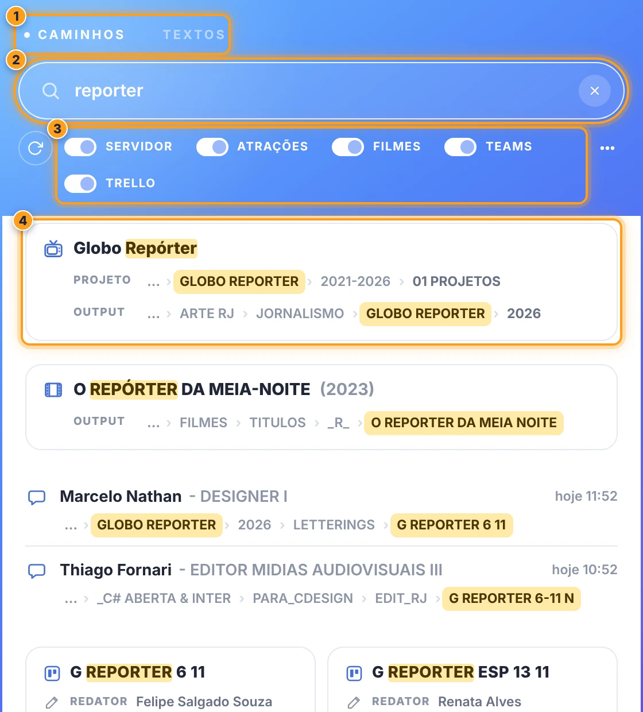
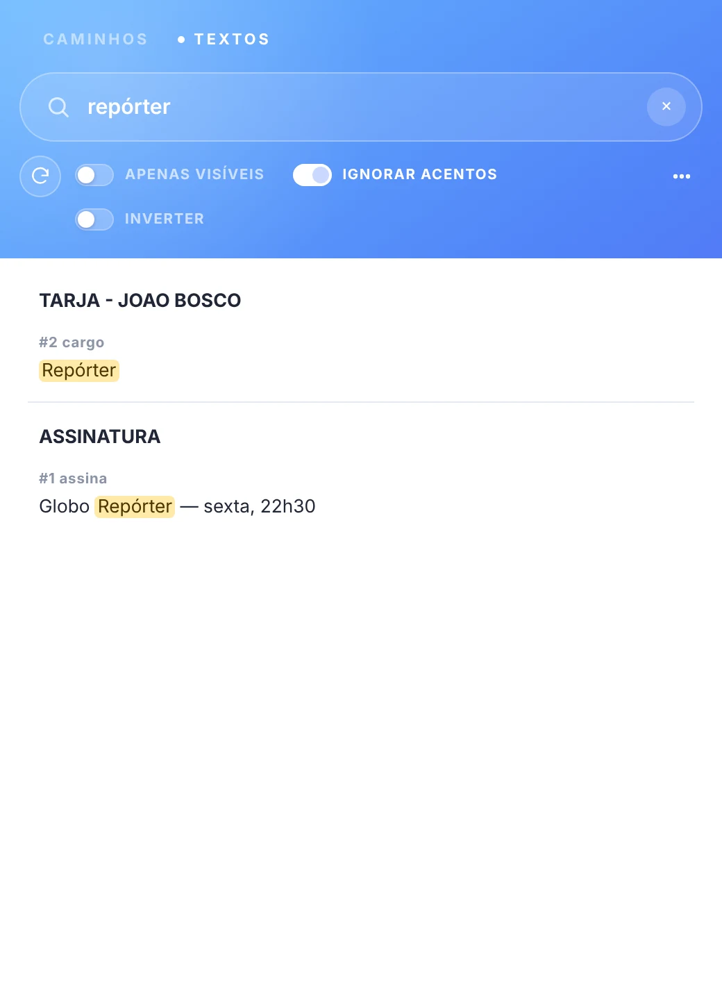

# 🔎 O ACESSORISTA

[← O PADEIRO](../README.md)

o painel **O ACESSORISTA**: as buscas do padeiro, em duas abas (caminhos e textos).

a janela abre com 720 px de largura e baixa: sem uma busca, ela mostra só o cabeçalho (o loader e os avisos aparecem sobre o degradê). a folha branca com os resultados entra quando você pesquisa. a cada busca ela se ajusta sozinha: alarga para os toggles caberem numa linha e os caminhos aparecerem inteiros (até 70% da largura da tela; ela nunca estreita sozinha) e ajusta a altura para caber os resultados (até 85% da altura da tela; passando disso, a lista rola).

### caminhos

> 

`◖ clique esquerdo` em **buscar**, na barra. pesquise por atração, claquete, quem mandou, projeto, output ou caminho (a partir de 2 caracteres) e abra as pastas direto no Finder / Explorer.

os resultados vêm sem títulos de seção: o ícone de cada item diz de onde ele vem.

| ícone | de onde | o que mostra | o clique |
| --- | --- | --- | --- |
| balão | **Teams** (últimos 30 dias) | quem mandou - cargo, a data e, embaixo, o caminho da mensagem | o balão abre a mensagem no Teams |
| quadro do Trello | **Trello** (últimos 15 dias) | cards em grade: a claquete, o redator e o editor | o card abre no Trello |
| TV de tubo | **atrações** | o nome e as linhas **PROJETO** e **OUTPUT** | — |
| película | **filmes** | o título, o ano de produção entre parênteses e a linha **OUTPUT** | — |
| servidor | **servidor** (caminhos fixos) | o nome e a linha **CAMINHO** | — |

- **categorias** → TEAMS, TRELLO, ATRAÇÕES, FILMES e SERVIDOR: cada uma tem um interruptor para entrar ou sair da busca.
- **⋯** → ajuda (esta página) e recarregar o painel.
- **caminho** → aparece em breadcrumb: clique em qualquer pasta para abri-la. a pasta que contém o termo buscado fica destacada em amarelo. quando o caminho não cabe, as pastas iniciais saem (com '*…*'); a última e a destacada ficam sempre.
- **atualizar** (antes dos interruptores) → baixa os caminhos de novo.

> 🚩 *obs:*\
> • os caminhos vêm do workflow **PROMO - BUSCAR**, que já devolve o índice pronto (com as mensagens do Teams mais recentes). o painel baixa sozinho, em segundo plano, sem travar o After Effects: a cópia salva aparece na hora e é trocada quando a resposta chega. sem conexão (ou no modo local), vale a cópia salva.\
> • se o workflow novo não responder e ainda não houver cópia, o painel usa o índice antigo.\
> • no macOS, os volumes de rede necessários são montados ao abrir uma pasta. no Windows, os caminhos do Mac (`/Volumes/...`) são convertidos pelo mapa da [configuração > rede](producoes.md#-rede).\
> • aparecem no máximo 20 itens por categoria (24 cards do Trello): refine o termo para ver os demais.

### textos

> 

`◗ clique direito` em **buscar**, na barra. o painel lê os textos de todos os layers do projeto e filtra enquanto você digita.

- **APENAS VISÍVEIS** → só layers ligados.
- **IGNORAR ACENTOS** → '*amazonia*' também encontra '*Amazônia*' (ligado por padrão).
- **INVERTER** → layers que **não** contêm o termo.
- clique em um resultado → abre a comp com o layer selecionado, no tempo em que o texto aparece.
- **atualizar** (antes dos interruptores) → lê o projeto de novo (depois de alterar os textos).

> 🚩 *obs:*\
> • a busca ignora maiúsculas e minúsculas, e caracteres como `(`, `.` ou `?` não têm significado especial.

 

---

 

## 📍 teclado

| tecla | o que faz |
| --- | --- |
| `↓` (na busca) | vai para o primeiro resultado |
| `↑` `↓` | andam nos resultados; `↑` no primeiro volta para a busca |
| `Enter` | abre (pasta, comp ou layer) |
| `Ctrl/Cmd+C` | copia o caminho ou o texto do resultado em foco |
| `Esc` | nos resultados, volta para a busca; na busca, limpa |
| `Ctrl/Cmd+F` | foca a busca da aba |
| `←` `→` (nas abas) | trocam de aba |
