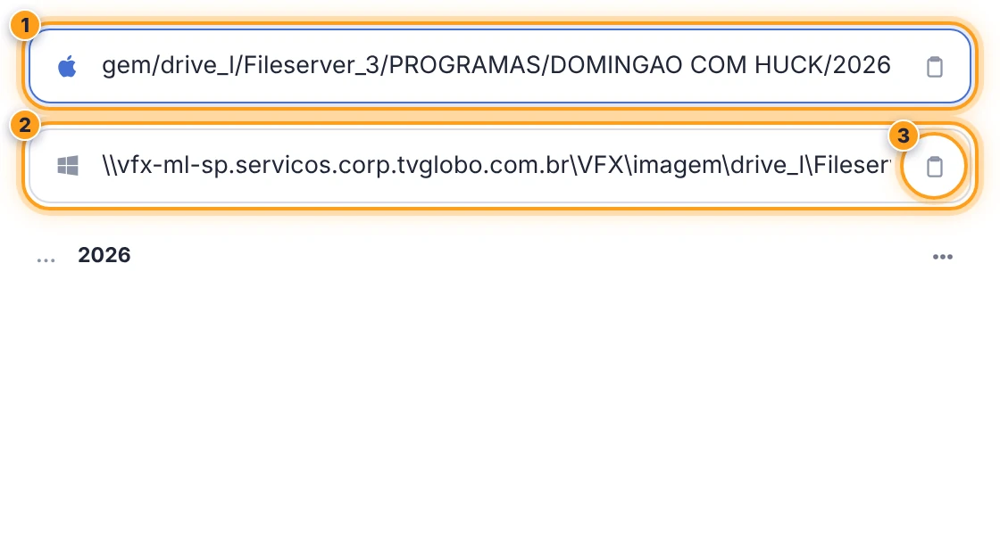

# 🔁 O ADAPTADOR · conversor de caminhos

[← O PADEIRO](../README.md)

o painel **O ADAPTADOR**: converte caminhos entre Windows e macOS.

<table><tr><td width="50%"></td><td></td></tr></table>

| | | |
| :---: | --- | --- |
| ❶ | **macOS** | o caminho do Mac (`/Volumes/…`). |
| ❷ | **Windows** | o mesmo caminho no Windows (`\\\\servidor\\…` ou a letra do mapa de drives). |
| ❸ | **copiar** | a prancheta de cada campo copia o caminho. |

`◗ clique direito` em **pastas**, na barra. o conversor abre com a pasta da última saída da fila de render.

- **cole um caminho em qualquer lugar do painel** → o padeiro reconhece se é macOS ou Windows, coloca no campo certo e converte o outro.
- **prancheta** (dentro de cada campo) → copia o caminho.
- `Enter` no campo do sistema atual → abre o caminho no Finder / Explorer (ou a pasta mais próxima que existe).
- **rodapé** → as pastas do caminho do sistema atual, das últimas para as primeiras (as iniciais saem com '*…*' quando não cabem). clique numa delas para abrir aquela pasta.
- **⋯** (canto inferior direito) → ajuda (esta página) e recarregar o painel.
- `Esc` → limpa os dois campos.

> 🚩 *obs:*\
> • aceita caminhos com aspas ('*copiar como caminho*' do Windows), letras de drive mapeadas (ex: `L:\`) e endereços `smb://` do Finder.
