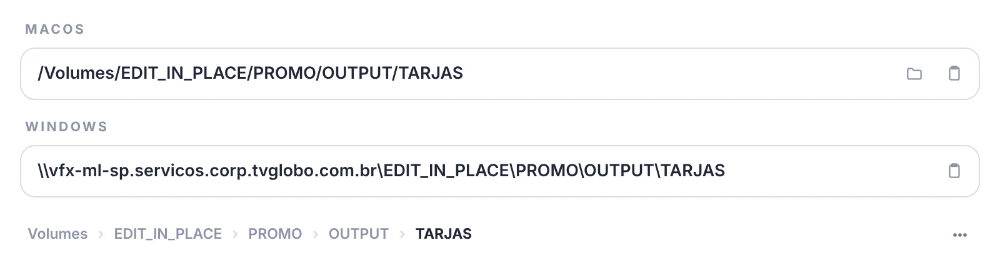

# 🔁 conversor de caminhos

[← O PADEIRO](../README.md)

o painel **O PADEIRO conversor**: converte caminhos entre Windows e macOS.

> 

`◗ clique direito` em **pastas**, na barra. o conversor abre com a pasta da última saída da fila de render.

- **cole um caminho em qualquer lugar do painel** → o padeiro reconhece se é macOS ou Windows, coloca no campo certo e converte o outro.
- **copiar** → copia o caminho.
- **abrir pasta** → abre o caminho no sistema atual (ou a pasta mais próxima que existe).
- **atualizar** (canto inferior esquerdo) → volta a usar a pasta da última saída da fila de render.
- **⋯** (canto inferior direito) → ajuda (esta página) e recarregar o painel.
- `Esc` → limpa os dois campos.

> 🚩 *obs:*\
> • aceita caminhos com aspas ('*copiar como caminho*' do Windows), letras de drive mapeadas (ex: `L:\`) e endereços `smb://` do Finder.
