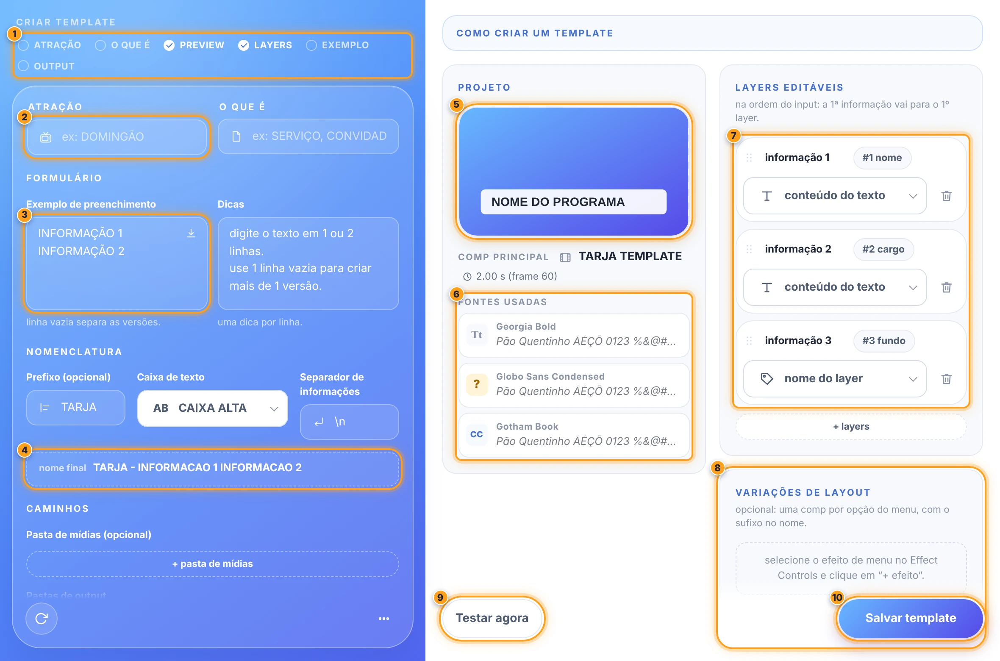
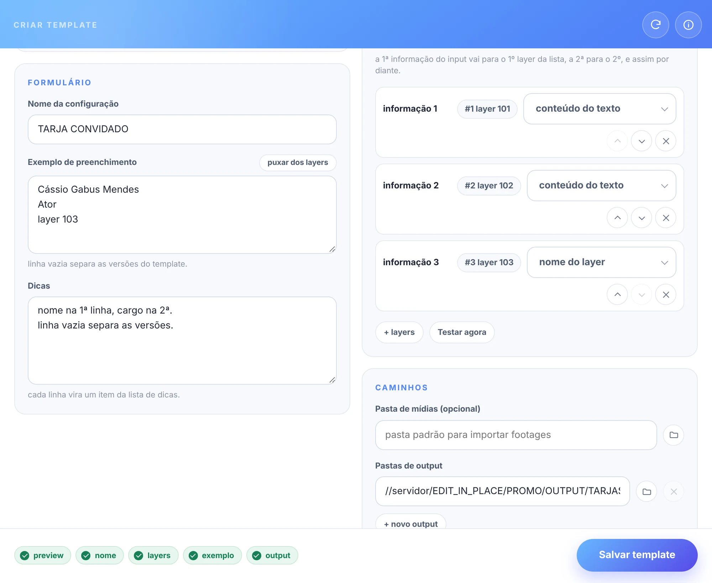

# ✨ A FORMA · criar template

[← O PADEIRO](../README.md)

o painel **A FORMA**: transforma a comp aberta em um novo template do padeiro.

um template do padeiro é um conjunto de arquivos:

- o **projeto** do After Effects com a comp principal (de preferência salvo como `.aet`);
- `<nome>_config.json` → como preencher o template;
- `<nome>_preview.png` → a imagem de preview;
- a pasta `FONTS` → os arquivos das fontes usadas no projeto.



| | | |
| :---: | --- | --- |
| ❶ | **o que falta** | o checklist: cada item fica marcado quando está pronto; clicar leva ao campo. |
| ❷ | **atração e o que é** | a atração (com a busca, ou uma nova) e o que é (ex: SERVIÇO, CONVIDADO, AESP). |
| ❸ | **exemplo e dicas** | o exemplo de preenchimento (uma linha por informação; a seta puxa o texto dos layers) e as dicas, uma por linha. |
| ❹ | **nome final** | como as comps vão se chamar: prefixo, caixa de texto e separador. |
| ❺ | **preview** | clique para capturar o frame da agulha da timeline. |
| ❻ | **fontes usadas** | cada fonte da comp, escrita nela mesma (? = não instalada). |
| ❼ | **layers editáveis** | a ordem das informações no input e o que cada uma muda no layer. |
| ❽ | **variações de layout** | opcional: um efeito de menu (ou um checkbox) da comp principal, cada opção vira uma comp com o sufixo no nome. |
| ❾ | **testar agora** | preenche uma cópia com o exemplo, para conferir antes de salvar. |
| ❿ | **salvar template** | grava o projeto, a config, o preview e as fontes. |


1. limpe o projeto: remova tudo o que não for necessário para a comp principal.
2. abra a comp principal e `◗ clique direito` em **templates**, na barra.
3. escolha a '*atração*' e preencha o '*o que é*' (os primeiros campos, no topo), o '*exemplo de preenchimento*' e as '*dicas*'.
4. posicione a agulha da timeline em um frame de referência e clique no preview ('*capturar preview*' aparece sobre ele no hover, ou direto quando ainda não há preview).
5. escolha a '*caixa de texto*', o '*prefixo*' e o '*separador*'.
6. selecione os layers editáveis na comp, na ordem de preenchimento, e clique em '*+ layers*' (os que já estavam selecionados ao abrir entram sozinhos).
7. se quiser, clique em '*+ pasta de mídias*' (uma só) e escolha as '*pastas de output*'.
8. use '*Testar agora*' (canto esquerdo do rodapé) para conferir o preenchimento com o exemplo.
9. clique em '*Salvar template*' (ou `Ctrl/Cmd+S`).
10. se quiser, clique em '*gerar preview .mp4*' no aviso de template salvo (ou em '*agora não*'): o padeiro renderiza a comp principal (H.264 de 15 Mbps, meia resolução) como `<template>_preview.mp4`, e a janela de templates passa a mostrar o vídeo.

- **↻** (cabeçalho) → limpa o formulário e começa de novo.
- **⋯** (cabeçalho) → ajuda (esta página) e recarregar o painel.

> 📟 *o que falta para salvar:*
>
> 

o topo do criador, antes do **⋯**, mostra o que falta: **atração**, **o que é**, **preview**, **layers**, **exemplo** e **output**. clique em um item para ir até ele. o item **exemplo** avisa quando o número de informações do exemplo não bate com o número de layers.

ao salvar, o padeiro:

1. marca a comp principal com o comentário `TEMPLATE`.
2. abre a janela de salvar do sistema já com o nome do arquivo (a atração + o que é: `DOMINGAO COM HUCK SERVICO.aep`), na pasta do projeto aberto ou, se ele ainda não foi salvo, na pasta de templates da produção escolhida (cancelar não muda nada).
3. grava o `_config.json` e o `_preview.png` ao lado do projeto.
4. copia as fontes usadas para a pasta `FONTS`.
5. abre a pasta do template, depois que você escolhe gerar ou não o preview em vídeo (no aviso de template salvo: '*gerar preview .mp4*', '*agora não*' ou o ×), para não interromper o processo.
6. limpa o formulário e fecha A FORMA: o próximo template começa do zero.

### formulário e nomenclatura

- **atração** (obrigatória) → o template é dessa atração. digitar busca as atrações (no índice do webhook ou no índice local, como a [janela projeto](projeto.md)) e mostra os cartões logo abaixo; a escolhida fica com o nome oficial e, se tiver pasta de output, ela entra nas '*pastas de output*' (trocar de atração troca essa pasta). não achou? **nova atração**: o nome e a categoria (aba PROJETO da configuração) abrem embaixo.
- **o que é** → o nome do template (ex: `SERVIÇO`, `CONVIDADO`, `AESP`); identifica o template no log e entra no nome do arquivo. embaixo, o template por inteiro: `DOMINGÃO COM HUCK · SERVIÇO`.
- **exemplo de preenchimento** → idealmente, o texto usado no preview. o ícone de importar, no canto do campo, puxa dos layers: monta o exemplo com o texto atual dos layers editáveis.
- **dicas** → cada linha vira um item da lista de dicas. seja claro: inclua instruções para footages, controles de expressão e tudo o que for preciso.
- **prefixo** (opcional) → começo do nome de todas as comps criadas. vazio, o nome da comp é só a informação do input (ex: `JOAO BOSCO REPORTER` em vez de `TARJA - JOAO BOSCO REPORTER`).
- **caixa de texto** → `CAIXA ALTA`, `caixa baixa`, `Título` ou `livre` (sem conversão).
- **separador** → o texto que separa informações diferentes no input. use `\n` para uma informação por linha.

### layers editáveis

> 

- **+ layers** → adiciona os layers selecionados na comp principal.
- **método** → '*conteúdo do texto*' preenche um layer de texto; '*nome do layer*' renomeia o layer.
- **⠿ puxador** (à esquerda) → arraste para mudar a ordem dos layers (com o puxador em foco, `↑` `↓` também movem).
- **lixeira** (no fim da linha, fora do campo) → remove o layer.
- clique no nome do layer → seleciona o layer na comp.
- **fontes usadas** (abaixo do preview) → cada fonte do projeto com uma prévia: o nome e um texto fixo ("Pão Quentinho ÁÉÇÕ 0123 %&@#", com acentos, números e símbolos) desenhado com ela, a partir do arquivo da fonte ou das fontes instaladas. sem nenhum dos dois, aparece '*prévia indisponível*'. as fontes vêm em ordem alfabética, com um selo à esquerda: **Tt** para as instaladas no computador, **CC** para as do Adobe Fonts (Creative Cloud) e **?** (amarelo) para as que não existem no computador.
- **testar agora** (rodapé, ao lado de começar de novo) → preenche os layers com o primeiro bloco do exemplo e captura um novo preview (o texto do exemplo não muda).

> 🚩 *obs:*\
> • a 1ª informação do input vai para o 1º layer da lista, a 2ª para o 2º, e assim por diante.\
> • o separador só é usado com mais de um layer editável.\
> • todo template pode ter várias pastas de output: o render é copiado em todas. sem nenhuma, vale o output padrão.

### variações de layout

opcional: um efeito de menu da comp principal (ex: um Dropdown Menu Control com esquerda e direita) gera **uma comp por opção** em cada preenchimento, com o sufixo da opção no fim do nome (`TARJA - JOAO BOSCO E` e `TARJA - JOAO BOSCO D`).

- **+ efeito** → selecione no Effect Controls da comp principal o efeito (ou a propriedade do menu) e clique: a linha do efeito mostra o layer, o efeito e o total de opções do menu, e cada opção ganha o campo do **sufixo**.
- **⟳** (dentro da linha do efeito) → troca pelo efeito selecionado agora (os sufixos ficam).
- **+ opção** → quando o padeiro não consegue ler o total de opções do menu. só a última opção sai (a lixeira): a posição na lista é o número da opção no menu.
- **checkbox** → um **Checkbox Control** também vale: as opções são sempre duas, **desligado** e **ligado**, cada uma com o seu sufixo (ex: `SEM LOGO` e `COM LOGO`). no config, o efeito fica com `"kind": "checkbox"`.
- **nomes finais com o exemplo** → um por opção. cada opção precisa de um sufixo, sem repetir (o item **layout** do topo avisa).

### arquivo de configuração

> 📋 *exemplo:* `RODAPE CONVIDADO_config.json`
>
> ```jsonc
> // "\n" representa uma quebra de linha.
> {
>   "atracao": { "name": "CONVERSA COM BIAL", "path": "…/PROGRAMAS/CONVERSA COM BIAL", "out": "…/CONVERSA COM BIAL" }, // → a atração (nome, pasta e pasta de output).
>   "configName": "TARJA RODAPÉ CONVIDADO", // → o que é.
>   "exemple": "CÁSSIO\nGABUS MENDES\n---\nATOR",             // → texto de exemplo do input.
>   "tip": "digite o texto em 1, 2 ou 3 linhas para nome e informação.\n\nuse 1 linha com '---' para separar nome e informação.", // → dicas.
>
>   "compName": "RDP - CONVIDADO TEMPLATE", // → nome da comp principal.
>   "prefix": "RDP",                        // → prefixo do nome das comps criadas.
>   "refTime": 2,                           // → tempo (s) em que todas as informações estão visíveis.
>   "separator": "---",                     // → texto que separa as informações.
>   "textCase": "upperCase",                // → "upperCase", "lowerCase", "titleCase" ou "freeCase".
>
>   "inputLayers": [                             // → layers editáveis, na ordem de preenchimento.
>     {"layerIndex": 4, "method": "textContent"}, // → índice do layer: 1, 2, 3...
>     {"layerIndex": 5, "method": "textContent"}  // → "textContent" preenche o texto, "layerName" renomeia o layer.
>   ],
>
>   "inputFx": {"layerIndex": 1, "fxName": "layout", "optionIndex": 1, "options": ["E", "D"]}, // → variações de layout (opcional).
>
>   "importPath": "~/Downloads", // → pasta padrão para importar footages.
>   "outputPath": [              // → pastas de output.
>     "//10.228.183.146/edit_in_place/PROMO/cdesign_output/C# ABERTA & INTER/ARTE SP/CONVERSA COM BIAL/CONVIDADOS"
>   ]
> }
> ```

> 📋 *variações de layout* (`inputFx`):\
> o primeiro layer da comp principal tem um controlador de expressão chamado '**layout**' com **2 opções** de alinhamento, esquerda e direita, e os sufixos '**E**' e '**D**'.\
> cada preenchimento desse template gera **2 comps**: uma alinhada à esquerda, com sufixo '**E**', e outra à direita, com sufixo '**D**'. as variações são editadas no [editor de config](templates.md#editor-de-config).\
> com um **checkbox** (`"kind": "checkbox"`), os sufixos são o desligado e o ligado, nessa ordem: `{"fxName": "logo", "optionIndex": 1, "kind": "checkbox", "options": ["SEM LOGO", "COM LOGO"]}`. *o padeiro legacy (v1) não conhece o checkbox: um template assim só preenche nesta versão.*

<br>

---

<br>

## 📍 teclado

| tecla | o que faz |
| --- | --- |
| `Ctrl/Cmd+S` | salva o template |
