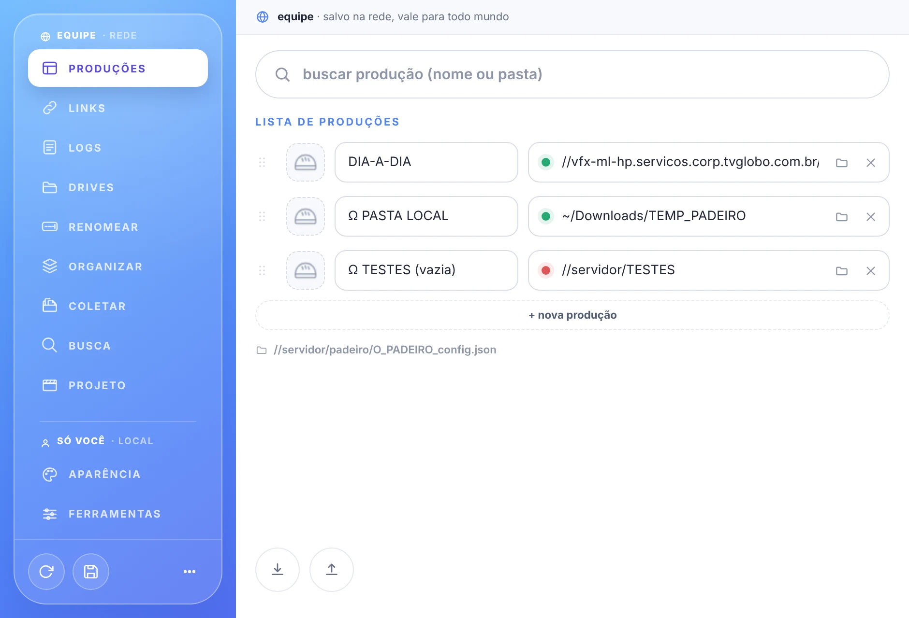

# 🗂️ configuração

[← O PADEIRO](../README.md)

a janela **O PADEIRO configuração** (`⋯` → '*Configuração*', no painel de templates) tem as abas num cartão de vidro à esquerda, como a lista do painel de templates, com recarregar, salvar (disquete) e o `⋯` no rodapé dele. em janela estreita, o cartão vira uma fila no topo.

as abas ficam em dois grupos, conforme **onde** cada uma é salva:

| grupo | abas | onde fica |
| --- | --- | --- |
| 🌐 **equipe** | templates, projeto, coletar, renomear, organizar, buscar, links, rede | no `O_PADEIRO_config.json` da rede: vale para todo mundo |
| 👤 **local** | aparência, layout (com os seus links), meu usuário | na pasta de dados do usuário, neste computador: não muda nada para os outros |

uma faixa no topo de cada aba repete onde ela é salva (🌐 *equipe · salvo na rede* ou 👤 *local · salvo neste computador*).

**padrão da equipe** → a aparência e o layout têm um padrão da equipe, na rede: é o que aparece para quem não personalizou. nas abas **aparência** e **layout**, a faixa diz '*usando o padrão da equipe*' até a primeira mudança; depois, '*personalizado*', com o botão '*voltar ao padrão da equipe*'. para mudar o padrão da equipe, use **⋯ > editar o padrão da equipe**: as duas abas passam a editar o da rede (a faixa fica azul) até '*voltar às minhas preferências*'.

> 🚩 *atalho:* `◖ clique DUPLO` numa ferramenta da barra abre esta janela já na aba dela (templates e fontes → templates, pastas → rede, renomear, organizar, coletar, buscar, projeto, links da equipe → links, os seus → layout). é tudo gravado pelo **disquete** (no rodapé do cartão das abas) ou `Ctrl/Cmd+S`; um ponto amarelo no disquete avisa que há alterações não salvas. o disquete grava tudo de uma vez: o que é da equipe na rede e o que é local neste computador (o aviso diz o que foi para onde).

## 📍 templates

a aba **templates** é a lista de produções. uma **produção** é uma pasta que contém (ou vai conter) templates do padeiro, organizados em subpastas como a equipe preferir.

a lista de produções é **uma só para a equipe**: o arquivo `O_PADEIRO_config.json`, na pasta do padeiro na rede. quando alguém muda a lista, os painéis de todo mundo atualizam sozinhos.

> 📟 *aba templates*:
>
> 

1. clique em '*+ nova produção*'.
2. escolha um ícone (opcional), digite o nome e escolha a pasta de templates pelo ícone de pasta dentro do campo (o ponto à esquerda do caminho fica verde quando a pasta existe). o **×** no mesmo campo exclui a produção.
3. clique no **disquete** (ou `Ctrl/Cmd+S`).

- **reordenar** → arraste uma produção pelos pontinhos à esquerda (`↑` `↓` com o puxador em foco também movem).
- **buscar** (a barra no topo da aba) → mostra só as produções com o termo no nome ou no caminho.
- **importar / exportar** (os botões com setas, no canto inferior esquerdo, só nesta aba) → lê ou grava uma lista completa, com os ícones.
- **recarregar** → lê a configuração de novo, descartando o que não foi salvo.
- **⋯** → ajuda (esta página) e recarregar o painel.

> 🚩 *obs:*\
> • a ordem da lista é a do seletor de produção (no rodapé do painel de templates): arraste pelos pontinhos à esquerda de cada produção para reordenar (com o filtro ativo, o arraste fica escondido).\
> • o caminho do arquivo da lista aparece no fim da lista de produções.\
> • o ícone tem **24 x 24 pixels**: imagens maiores são cortadas no centro e reduzidas.\
> • se outra pessoa salvou a lista depois que você abriu o editor, o padeiro **não** sobrescreve o trabalho dela: recarregue e refaça as alterações. uma cópia da lista anterior fica em `O_PADEIRO_config.bak.json`.\
> • sem acesso ao arquivo compartilhado (rede fora), não há lista: os painéis avisam e voltam a ler sozinhos quando a rede voltar.
<br>

---

<br>

## 📍 projeto

a aba **projeto** ajusta a janela [PROJETO](projeto.md): onde os projetos são salvos e o nome do arquivo.

- **pasta dos projetos** → a raiz: a pasta de cada retranca fica dentro dela. sem pasta, a janela PROJETO pede uma ao salvar.
- **uma pasta para cada projeto** → cria, dentro da pasta da retranca, uma pasta com o nome do arquivo, com a [estrutura do coletar](#-coletar) dentro (o `.aep` em `01 PROJETOS`, os arquivos em `02 ARQUIVOS`, as saídas em `03 SAIDA`).
- **nome do arquivo** → o nome do `.aep`, com variáveis:

  | variável | vira |
  | --- | --- |
  | `{id}` | o ID do projeto (ex: `EMP123456`) |
  | `{projeto}` | o nome do projeto, no formato da aba **renomear** (acentos e caixa) |
  | `{usuario}` | a sigla de quem salva (na janela PROJETO; por padrão, as 3 primeiras letras do usuário do sistema) |
  | `{retranca}` | o nome da pasta da retranca (ex: `em ponto`) |
  | `{data}` | a data de hoje (`aaaa-mm-dd`) |

  embaixo do campo, um exemplo mostra como o nome fica.
- **retrancas** → o começo do ID indica a retranca: `EMP123456` → a pasta de `EMP`. a pasta pode ficar dentro da pasta dos projetos (`JORNAIS/em ponto`) ou ser um caminho completo. vale o código mais longo que combinar (`EMP` ganha de `EM`). '*importar do índice da busca*' traz as entradas da busca no formato `COD - nome`, com o caminho delas.
<br>

---

<br>

## 📍 coletar

a aba **coletar** define a **estrutura de pastas de cada projeto**: onde o botão **coletar** (na barra) copia os arquivos usados e onde a janela **projeto** salva o `.aep`. é uma árvore no mesmo jeito da aba organizar. vem com a estrutura padrão:

```
01 PROJETOS        ← o .aep (tipo projeto)
02 ARQUIVOS
   FONTS           ← fontes
   IMAGENS         ← imagens e sequências de imagens
   VÍDEOS          ← vídeos
   AUDIOS          ← áudio
   DADOS           ← dados (json, csv, txt...)
03 SAIDA           ← previews e finais para avaliação (criada vazia)
```

a raiz da estrutura é a pasta do projeto: a de cima da pasta do tipo **projeto** (`01 PROJETOS`). pastas sem tipo (como `02 ARQUIVOS` e `03 SAIDA`) também são criadas. '*usar a estrutura padrão*' (abaixo das opções) troca a árvore por esta.

- **árvore** → as mesmas regras do organizar: arrastar, renomear, '*+ nova pasta*', **×** para excluir.
- **tipos de arquivo** → projeto (.aep), vídeos, sequências de imagens, imagens, áudio, dados e fontes. arraste cada tipo para a pasta que deve recebê-lo. o tipo que fica na raiz (riscado) **não é coletado** (o projeto, fora da árvore, fica na própria pasta do projeto).
- **sequências de imagens** → copiadas inteiras (os quadros do trecho usado no projeto), cada uma numa subpasta com o nome dela (`render_0001.png` → `render`). a interpretação do item (fps, alpha) é mantida.
- **repetir as pastas do painel de projeto** → ligado, dentro da pasta do tipo o arquivo fica nas mesmas pastas em que está no painel de projeto (ex: `videos / Material`).
- **salvar o projeto depois de coletar** → grava o projeto já apontando para as cópias.
<br>

---

<br>

## 📍 renomear

a aba **renomear** define como o botão **renomear** (na barra) padroniza os nomes das comps. vem preenchida com os tipos de sempre; outra equipe ajusta para os tipos de peça dela.

- **testar** (no topo) → digite o nome de uma comp e veja na hora como ela fica com a tabela em edição.
- **formato do nome** → a **caixa de texto** (CAIXA ALTA, caixa baixa, Título ou como está), o **separador** entre o prefixo e o nome (` - `; os espaços contam) e **remover caracteres especiais** (ligado, tira acentos e símbolos: **JOÃO!** vira **JOAO**). a caixa e os acentos valem para a parte descritiva; o prefixo do tipo fica como foi escrito. o separador também é o dos nomes criados pelos templates.
- **tipos de peça** → o **prefixo** do nome, o **comentário** da comp e os **termos** que identificam o tipo no nome da comp (ou da pasta dela), separados por vírgula. ex: `RDP` · `RODAPE` · `rodapé, rdp`: **rodapé_joão silva** → **RDP - JOAO SILVA**.
- **nomes fixos** → a comp que tem o termo no nome (ou no comentário) passa a se chamar sempre o mesmo nome. ex: **LOGO GLOBO**.

> 🚩 *obs:*\
> • a ordem importa: vale o primeiro tipo encontrado. arraste pelos pontinhos para reordenar.\
> • os termos são palavras: maiúsculas e acentos não importam (`rodape` reconhece **Rodapé**), e o plural com S também vale (`tarja` reconhece **TARJAS**). plurais irregulares entram como outro termo (`cartao, cartoes`).\
> • o comentário do tipo também é usado pelo **organizar**.
<br>

---

<br>

## 📍 organizar

a aba **organizar** define a árvore de pastas que o botão **organizar** (na barra) monta no projeto. vem preenchida com a árvore de sempre (`01 COMPS`, `02 PRECOMPS`, `03 ARQUIVOS` com `VIDEOS`, `IMAGENS`, `AUDIO`, `SOLIDOS` e `DADOS`, e `MISSING`).

a aba tem duas colunas: à esquerda, a **árvore do projeto** (no azul); à direita, os **tipos de item** e os ajustes.

- **árvore** → clique no nome para renomear a pasta. arraste a pasta pelos pontinhos: **sobre outra pasta**, ela entra; **entre duas pastas** (aparece uma linha), fica no mesmo nível; sobre **raiz do projeto**, volta para a raiz. '*+ nova pasta*' (no lado branco, abaixo dos tipos) cria uma pasta na raiz; o **×** (passe o mouse) exclui.
- **tipos de item** → comps de render, comps editáveis, outras comps, vídeos, imagens, áudio, sólidos, dados e arquivos ausentes. arraste um tipo (o cartão da direita ou a etiqueta na árvore) para a pasta que deve recebê-lo; uma pasta pode receber mais de um tipo. cada cartão mostra onde o tipo está. o **×** da etiqueta (ou soltar o tipo na raiz) tira o tipo da pasta.
- **comps de render** → a comp vai para a pasta das comps de render quando o comentário dela contém um destes termos (ou o comentário de um tipo de peça da aba renomear).
- **comps editáveis** → com uma pasta para o tipo **comps editáveis** na árvore, a comp vai para ela quando o comentário contém um destes termos (padrão: `EDIT`, que também vale para `EDITAR`). sem essa pasta, as editáveis ficam com as outras comps.
- **comentário automático** → dado às comps selecionadas sem comentário (ao organizar) e às comps criadas pelos templates. precisa conter um dos termos de render.
- **extensões de dados** → arquivos tratados como dados (`.csv`, `.json`...).
- **comentários viram subpastas** → ligado, comps e arquivos com comentário ficam numa subpasta com o nome dele (ex: `01 COMPS / RODAPE`). na árvore, cada pasta que recebe itens mostra isso numa subpasta tracejada, '*comentários viram subpastas*'.

> 🚩 *obs:*\
> • renomear uma pasta leva as subpastas junto; excluir uma pasta sobe as subpastas e os tipos dela para a pasta de cima.\
> • o tipo que não está em nenhuma pasta fica na raiz do projeto (aparece na linha **raiz do projeto**).\
> • `Esc` cancela um arrasto; perto das bordas, a árvore rola sozinha.\
> • a pasta dos arquivos ausentes só é criada quando há algum arquivo ausente.
<br>

---

<br>

## 📍 buscar

a aba **buscar** ajusta a busca de caminhos (**O ACESSORISTA**).

- **índice** → de onde vem o índice de caminhos (atrações, projetos e outputs):
  - **webhook** → um endereço da web que devolve o índice.
  - **arquivo de índice** → um arquivo JSON (na rede, por exemplo) no mesmo formato que o webhook devolveria: `{ "categoria": [ { "atracao": "...", "mac": { "caminho": "..." }, "win": { "caminho": "..." } } ] }`. dá para usar a busca sem nenhum webhook.

  o índice é lido de novo a cada 30 s; ao trocar a origem, é lido na hora.
- **categorias** → identificadas automaticamente no índice que o webhook devolve (cada lista do índice vira uma categoria, com a quantidade de itens). dê a cada uma o nome que aparece na busca; sem nome, vale o automático (ex: `atracoes_teams` → **TEAMS**). '*atualizar as categorias*' lê o índice de novo.

> 🚩 *obs:* uma categoria com nome guardado que não veio no índice aparece riscada, com '*não veio*'.
<br>

---

<br>

## 📍 links

a aba **links** (🌐 equipe) define os links que aparecem no começo da barra de todo mundo (ex: a planilha de apontamento de projetos). os seus (👤 local) ficam na aba **layout**, abaixo das ferramentas: ficam só neste computador e aparecem na barra depois dos da equipe, com um **bonequinho** no canto do ícone.

cada link tem um **nome** (aparece na dica), o **endereço** e o **ícone**: por padrão, o do próprio site (favicon). clique no ícone para escolher outra imagem (24 x 24 pixels, como o das produções); o **↺** no canto volta para o favicon. arraste pelos pontinhos para mudar a ordem; o **×** no campo do endereço exclui o link.

> 🚩 *obs:*\
> • sem favicon (site sem o arquivo ou rede fora), aparece o desenho de um link.\
> • os seus links podem ser editados e salvos mesmo sem acesso à lista da rede.
<br>

---

<br>

## 📍 rede

a aba **rede** junta o que é configurado uma vez para a equipe e quase nunca muda: onde fica o registro de uso e o mapa dos drives.

### registro de uso

define onde o padeiro registra cada preenchimento: data, produção, template, quantidade, usuário, máquina e projeto.

| opção | o que faz |
| --- | --- |
| **webhook** | envia cada registro para o endereço do campo (`http://` ou `https://`) |
| **CSV por produção** | um arquivo só por produção, `O_PADEIRO_log.csv`, na pasta de templates dela: cada preenchimento acrescenta uma nova linha (o arquivo é criado na primeira vez, com cabeçalho; separador `;`, abre direto no Excel) |
| **CSV global** | um arquivo só para a equipe toda, `O_PADEIRO_log.csv`, na mesma pasta da lista de produções (`O_PADEIRO_config.json`): cada preenchimento de qualquer produção acrescenta uma nova linha |
| **desligado** | não registra nada |

> 🚩 *obs:*\
> • o endereço do webhook fica guardado mesmo com o CSV ou o log desligado: basta voltar para "webhook".\
> • se o CSV não puder ser gravado na hora (aberto no Excel, rede fora), a linha fica guardada na máquina e entra no arquivo no próximo preenchimento.

### drives

é o mapa da rede que o padeiro usa para converter caminhos entre Windows e Mac (conversor, busca de caminhos e os caminhos dos templates). vem preenchida com o mapa de sempre; outra equipe, com outros servidores, ajusta aqui.

- **drives da rede** → a letra do Windows e o caminho de rede que ela representa (`//servidor/share/pasta`). ex: `L:` → `//vfx-ml-sp.../VFX/imagem/drive_l`: `L:\PROMO\x` vira `//vfx-ml-sp.../VFX/imagem/drive_l/PROMO/x` (e `/Volumes/drive_l/PROMO/x` no Mac).
- **volumes sem letra** → volumes montados no Mac (`/Volumes/NOME`) que não têm letra no Windows: o nome do volume e o servidor onde ele está.
- **servidor padrão** → usado quando o volume não está em nenhuma das listas.

> 🚩 *obs:*\
> • a letra pode ser digitada com ou sem `:`; caminhos com `\` são convertidos para `/` ao salvar.\
> • os painéis passam a usar o mapa novo em alguns segundos, sem reiniciar o After Effects.
<br>

---

<br>

## 📍 aparência

a aba **aparência** (👤 local) define o visual de todas as janelas do padeiro **neste computador**. sem personalização, vale o padrão da equipe (que se edita em **⋯ > editar o padrão da equipe**).

- **modo** e **fundo** → dois menus lado a lado: claro, escuro ou automático (segue o sistema); degradê ou sólido.
- **cores** → o quadradinho com o espectro mostra as duas amostras: no **degradê**, início e fim (o fundo das janelas e da barra); no **sólido**, só a primeira (a cor do fundo e dos destaques); a linha da segunda fica desabilitada e ela volta ao trocar para degradê. cada amostra fica sobre a própria cor no quadradinho: a volta em torno do centro é a **matiz** e a distância do centro é a **saturação** (no centro, sem cor; na borda, a cor pura). **arraste** a amostra por todo o quadradinho (ou clique nele para levar até ali a amostra da linha aberta); clicar numa amostra abre a linha dela. ao lado, cada amostra tem uma linha com o nome e o código (`#rrggbb`, para digitar); clique na linha para abrir o **brilho** (o trilho mostra o efeito na própria cor; o quadradinho mostra as cores no brilho da cor da linha aberta, e a amostra dela fica por cima). no degradê, o destaque (botões, títulos, seleção) é o tom do meio entre início e fim; os tons claros (seleção, avisos, bordas de foco) são calculados a partir dele. com cores claras, o padeiro ajusta a leitura sozinho: o destaque usado em textos escurece até dar para ler (no modo escuro, clareia), e os textos e ícones sobre o degradê (barra, abas, botões) trocam o branco por um tom escuro.
- **fonte** → Inter (padrão), a do sistema, Helvetica / Arial, Segoe UI, Roboto, Georgia ou monoespaçada. a fonte precisa estar instalada no computador.
- **logo da barra** → uma imagem no lugar do pãozinho (reduzida para caber, sem cortar; PNG com fundo transparente fica melhor). '*voltar ao pãozinho*' desfaz.
- **restaurar a aparência padrão** → volta tudo ao visual de sempre.

> 🚩 *obs:* enquanto você edita, só esta janela mostra a prévia; ao salvar, as outras janelas mudam em alguns segundos.

> 💡 *exemplo:* [config da PROMO GNEWS](exemplos/gnews/README.md): pastas, nomenclatura, busca e barra montadas a partir da barra antiga da promo, com o que ainda falta para chegar igual.
<br>

---

<br>

## 📍 layout

a aba **layout** (👤 local) monta a **sua** barra (sem personalização, vale o padrão da equipe), no mesmo esquema do organizar: à esquerda, no azul, a **barra em fila única** (como ela aparece); à direita, o que está **fora da barra**.

- **ordem** → arraste cada ferramenta da barra pelos pontinhos.
- **tirar** → o **×** de uma ferramenta (ou dos links, no topo) tira ela da barra; passe o mouse para ver o ×.
- **fora da barra** → cada ferramenta tirada vira um bloco à direita, com o que ela faz; o **+** põe de volta, no fim da barra (os links voltam ao começo).
- **separadores** → '*+ separador*' (à direita, abaixo dos blocos) acrescenta um no fim da barra; arraste para o lugar. cada separador vira uma divisória na barra; o **×** tira. um grupo sem nenhuma ferramenta some junto com a divisória.

> 🚩 *obs:* a barra acompanha em alguns segundos. separadores no começo, no fim ou dois seguidos são ignorados ao salvar.

**meus links** → abaixo, na coluna branca, os seus links: só neste computador, aparecem na barra depois dos da equipe, com um **bonequinho** no canto do ícone (detalhes em [links](#-links)). eles não entram no padrão da equipe: em **⋯ > editar o padrão da equipe**, a seção some.
<br>

---

<br>

## 📍 meu usuário

a aba **meu usuário** (👤 local) guarda o que é seu, só nesta máquina:

- **sigla do designer** → a sua sigla, usada na variável `{usuario}` do nome dos projetos. vazia, vale a padrão (as 3 primeiras letras do usuário do sistema). é a mesma do bonequinho da [janela projeto](projeto.md).
- **pasta dos projetos** → onde a janela projeto salva neste computador, no lugar da pasta da equipe (aba **projeto**). as retrancas com caminho relativo ficam dentro dela; as com caminho completo continuam onde estão. vazia, vale a da equipe.
- **pasta de saída** → para onde vão os renders da fila quando a pasta de output do template não pode ser acessada. vazia, a Área de Trabalho.
- **templates neste computador** → uma pasta deste computador para cada produção da lista:
  - produção com a pasta da equipe **local** (`~/...`, como a `Ω PASTA LOCAL`): a daqui vale **sempre** (cada um escolhe onde fica a sua).
  - produção com a pasta da equipe **na rede**: a daqui é a **cópia**, usada no modo local (ligado ou com a rede fora). **copiar** traz da rede só os arquivos novos ou que mudaram (nada é apagado na cópia).
  - sem pasta aqui, vale a da equipe.
- **modo local** → trabalhar **sem a rede**. é exatamente o que o padeiro faz sozinho quando a rede cai; ligar à mão só evita que ele tente a rede (bom em casa ou numa VPN lenta).
  - a configuração da equipe vem da **última cópia** guardada neste computador (atualizada sempre que o padeiro lê a configuração com a rede) e fica só para leitura.
  - os templates vêm das pastas deste computador (**templates neste computador**) e a busca de caminhos usa o **último índice baixado**.
  - os projetos vão para a **pasta dos projetos** daqui (sem ela, a Área de Trabalho), e as retrancas com caminho completo (na rede) também.
  - **todos** os renders da fila vão para a **pasta de saída** daqui (sem ela, a Área de Trabalho).
  - os logs esperam a volta para a rede (o webhook não é chamado).
  - o ícone na ponta da barra oposta à do pãozinho (à esquerda; na vertical, no topo) mostra o modo: **servidor** na rede, **servidor com o alerta amarelo** quando a rede caiu e **notebook** no modo local ligado por você. um clique abre esta aba. a aba meu usuário também avisa quando a rede caiu.

> 🚩 *obs:* a cópia da configuração é guardada na primeira vez que o padeiro abre com a rede: sem ela, o modo local não liga (`#PAD_096`). a configuração da equipe só volta a ser editável com a rede.
<br>

---

<br>

## 📍 teclado

| tecla | o que faz |
| --- | --- |
| `Ctrl/Cmd+S` | salva a configuração |
| `Ctrl/Cmd+F` | foca o filtro |
| `↑` `↓` (em um campo) | vão para o mesmo campo da linha de cima / de baixo |
| `Esc` | limpa o filtro |
