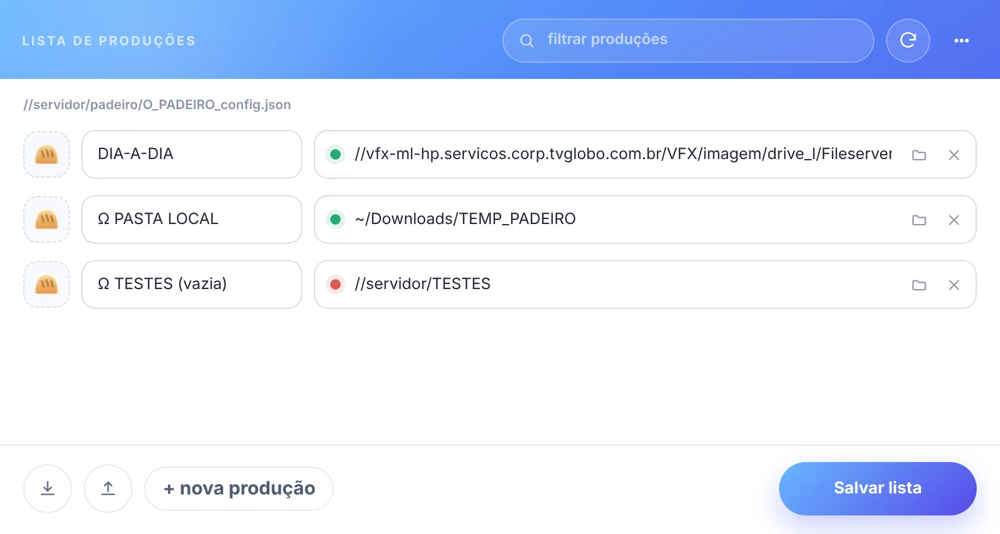

# 🗂️ produções

[← O PADEIRO](../README.md)

o painel **O PADEIRO produções**: a lista de produções da equipe.

uma **produção** é uma pasta que contém (ou vai conter) templates do padeiro, organizados em subpastas como a equipe preferir.

a lista de produções é **uma só para a equipe**: o arquivo `O_PADEIRO_config.json`, na pasta do padeiro na rede. quando alguém muda a lista, a barra e os painéis de todo mundo atualizam sozinhos.

> 📟 *editor de produções* (`◖ clique DUPLO` no ícone da produção, na barra):
>
> 

1. clique em '*+ nova produção*'.
2. escolha um ícone (opcional), digite o nome e escolha a pasta de templates (o ponto ao lado do caminho fica verde quando a pasta existe).
3. clique em '*Salvar lista*' (ou `Ctrl/Cmd+S`).

- **filtrar** → mostra só as produções com o termo no nome ou no caminho.
- **importar / exportar** → lê ou grava uma lista completa, com os ícones.
- **recarregar** → lê a lista de novo, descartando o que não foi salvo.
- **⋯** → ajuda (esta página) e recarregar o painel.

> 🚩 *obs:*\
> • a lista é sempre gravada em ordem alfabética: use caracteres especiais ou números no início do nome para colocar uma produção no topo.\
> • o ícone tem **24 x 24 pixels**: imagens maiores são cortadas no centro e reduzidas.\
> • se outra pessoa salvou a lista depois que você abriu o editor, o padeiro **não** sobrescreve o trabalho dela: recarregue e refaça as alterações. uma cópia da lista anterior fica em `O_PADEIRO_config.bak.json`.\
> • sem acesso ao arquivo compartilhado (rede fora), não há lista: os painéis avisam e voltam a ler sozinhos quando a rede voltar.

 

---

 

## 📍 teclado

| tecla | o que faz |
| --- | --- |
| `Ctrl/Cmd+S` | salva a lista |
| `Ctrl/Cmd+F` | foca o filtro |
| `↑` `↓` (em um campo) | vão para o mesmo campo da linha de cima / de baixo |
| `Esc` | limpa o filtro |
