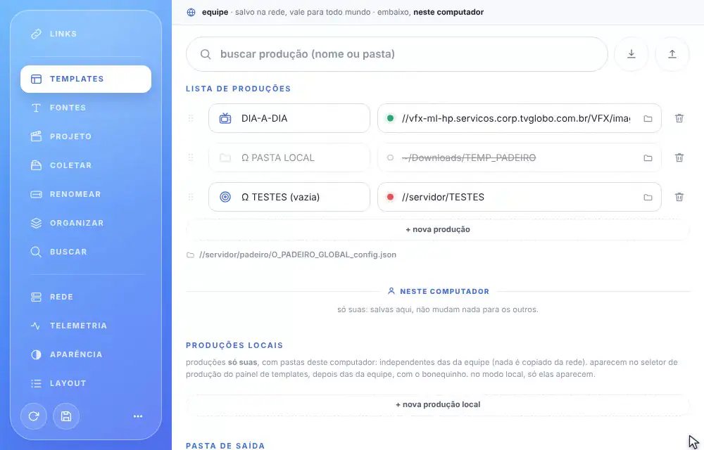
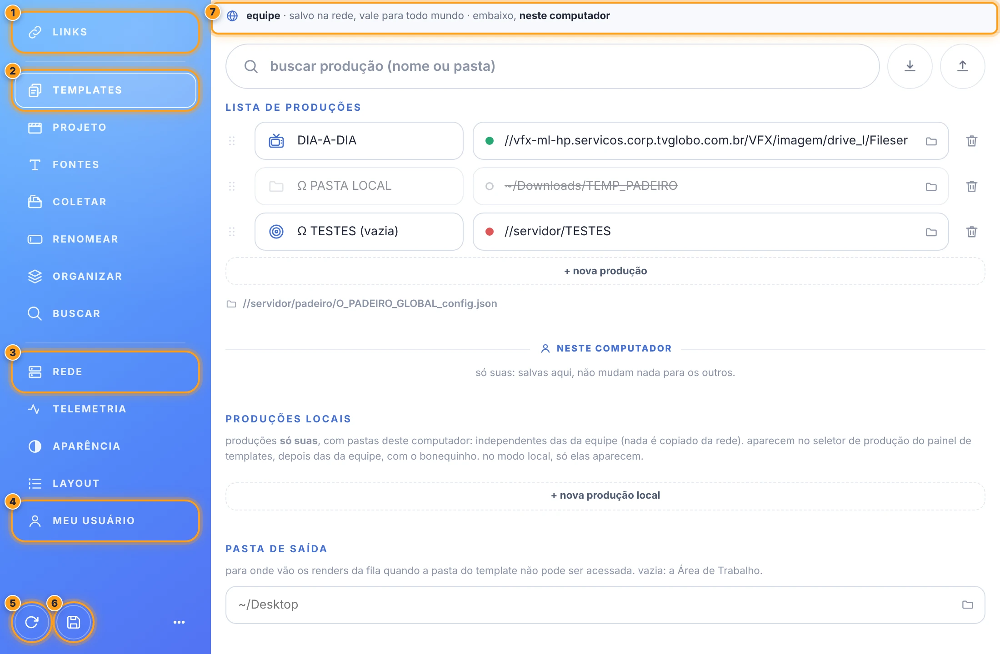

# 🗂️ O PRODUTOR · configuração

[← O PADEIRO](../README.md)

a janela **O PRODUTOR** (a configuração) (`⋯` → '*Configuração*', no painel de templates) tem as abas direto no degradê à esquerda, como a lista do painel de templates, com recarregar, salvar (disquete) e o `⋯` no rodapé. a aba aberta fica com um contorno fino.

<p align="center"></p>



| | | |
| :---: | --- | --- |
| ❶ | **links** | os links da barra (o primeiro, como na barra). |
| ❷ | **as ferramentas** | uma aba por ferramenta, na ordem da barra (templates, fontes, projeto, coletar, renomear, organizar, buscar). |
| ❸ | **rede** | os drives e volumes da rede, os logs e o resto. |
| ❹ | **meu usuário** | só deste computador: a sigla, as pastas, o modo local. |
| ❺ | **recarregar** | lê a configuração do arquivo de novo. |
| ❻ | **salvar** | grava (`Ctrl/Cmd+S`). |
| ❼ | **onde é salvo** | 🌐 equipe (na rede, vale para todo mundo) ou 👤 neste computador. |

as abas ficam em três grupos, separados por uma linha:

| grupo | abas |
| --- | --- |
| **links** | links (o primeiro, como na barra) |
| **ferramentas** | templates, projeto, coletar, renomear, organizar, buscar |
| **o resto** | rede, aparência, layout, meu usuário |

**nas listas** → os pontinhos à esquerda reordenam; a **lixeira**, à direita da linha e fora dos campos, exclui a linha (a tampa levanta ao passar o mouse). os campos de caminho mostram o fim do caminho.

**onde cada coisa é salva** → as ferramentas, os links e a rede são da 🌐 **equipe** (no `O_PADEIRO_GLOBAL_config.json` da rede: vale para todo mundo). aparência, layout e meu usuário são 👤 **locais** (na pasta de dados do usuário, neste computador: não muda nada para os outros).

**👤 neste computador** → numa aba da equipe, as opções que são só suas ficam embaixo de uma linha com o bonequinho e **NESTE COMPUTADOR**:

| aba | neste computador |
| --- | --- |
| templates | produções locais · output local |
| projeto | pasta dos projetos |
| buscar | de onde vêm os caminhos (webhook ou índice local) |
| links | meus links |

uma faixa no topo de cada aba repete onde ela é salva (🌐 *equipe · salvo na rede · embaixo, neste computador* ou 👤 *local · salvo neste computador*).

**padrão da equipe** → a aparência e o layout têm um padrão da equipe, na rede: é o que aparece para quem não personalizou. nas abas **aparência** e **layout**, a faixa diz '*usando o padrão da equipe*' até a primeira mudança; depois, '*personalizado*', com o botão '*voltar ao padrão da equipe*'. para mudar o padrão da equipe, use **⋯ > editar o padrão da equipe**: as duas abas passam a editar o da rede (a faixa fica azul) até '*voltar às minhas preferências*'.

> 🚩 é tudo gravado pelo **disquete** (no rodapé do cartão das abas) ou `Ctrl/Cmd+S`; um ponto amarelo no disquete (e o aviso '*alterações não salvas*', no topo à direita) avisa que há alterações não salvas. o disquete grava tudo de uma vez: o que é da equipe na rede e o que é local neste computador (o aviso diz o que foi para onde).

> 🚩 o que é **só seu** (meu usuário, presets de render, links pessoais, aparência e layout personalizados, as partes '*neste computador*') salva **sozinho**, um instante depois de cada mudança, separado do padrão da equipe: um problema numa aba da equipe não segura o seu ajuste. se um campo seu ainda estiver pela metade (uma produção local sem a pasta, por exemplo), o ponto no disquete continua e o **Salvar** diz o que falta.

## 📍 templates

a aba **templates** é a lista de produções. uma **produção** é uma pasta que contém (ou vai conter) templates do padeiro, organizados em subpastas como a equipe preferir.

a lista de produções é **uma só para a equipe**: o arquivo `O_PADEIRO_GLOBAL_config.json`, na pasta do padeiro na rede. (as versões antigas usavam `O_PADEIRO_config.json`: na primeira vez, o padeiro copia esse arquivo com o nome novo, e daí em diante cada versão grava o seu, sem uma estragar a configuração da outra.) quando alguém muda a lista, os painéis de todo mundo atualizam sozinhos.


1. clique em '*+ nova produção*'.
2. escolha um ícone (opcional: o ícone dentro do campo do nome abre a biblioteca de ícones; ele aparece no seletor de produção do painel de templates), digite o nome e escolha a pasta de templates pelo ícone de pasta dentro do campo (o ponto à esquerda do caminho fica verde quando a pasta existe). a **lixeira**, à direita da linha (fora do campo), exclui a produção.
3. clique no **disquete** (ou `Ctrl/Cmd+S`).

- **reordenar** → arraste uma produção pelos pontinhos à esquerda (`↑` `↓` com o puxador em foco também movem).
- **buscar** (a barra no topo da aba) → mostra só as produções com o termo no nome ou no caminho.
- **importar / exportar** (os botões com setas, ao lado da busca) → lê ou grava uma lista completa, com os ícones.
- **recarregar** → lê a configuração de novo, descartando o que não foi salvo.
- **⋯** → ajuda (esta página) e recarregar o painel.

> 🚩 *obs:*\
> • a ordem da lista é a do seletor de produção (no rodapé do painel de templates): arraste pelos pontinhos à esquerda de cada produção para reordenar (com o filtro ativo, o arraste fica escondido).\
> • o caminho do arquivo da lista aparece no fim da lista de produções.\
> • os ícones vêm da **biblioteca de ícones** (a pasta `extension/client/icons/`, a mesma dos tipos de projeto da aba PROJETO). uma produção com um ícone antigo (imagem) continua com ele até você escolher outro.\
> • se outra pessoa salvou a lista depois que você abriu o editor, o padeiro **não** sobrescreve o trabalho dela: recarregue e refaça as alterações. uma cópia da lista anterior fica em `O_PADEIRO_GLOBAL_config.bak.json`.\
> • sem acesso ao arquivo compartilhado (rede fora), não há lista: os painéis avisam e voltam a ler sozinhos quando a rede voltar.

**👤 neste computador** (embaixo, só suas):

- **produções locais** → produções **só suas**, com pastas deste computador, independentes das da equipe (nada é copiado da rede). cada linha tem o nome e a pasta (a pastinha escolhe, a **lixeira** à direita exclui; os pontinhos reordenam); '*+ nova produção local*' acrescenta. aparecem no seletor de produção do painel de templates depois das da equipe, no grupo **neste computador**, com o bonequinho. o nome não pode repetir o de uma produção da equipe.
  > 🚩 *obs:* produções da equipe com caminho deste computador (`~/...`, `/Users/...`, `C:\...` ou uma letra fora do mapa de drives) são **ignoradas**: não aparecem para ninguém (na lista da equipe, ficam riscadas). quem tinha escolhido uma pasta para elas ganhou uma produção local com essa pasta.
- **output local** → a pasta deste computador para onde vão os renders da fila quando a pasta de output do template não pode ser acessada. vazia, a Área de Trabalho.
- **lista de templates** → as seções do topo do [painel de templates](templates.md#fixados-e-recentes): **recentes** (quantos templates aparecem, de 0 a 30; padrão 5) e **novos** (criados há até quantos dias, de 0 a 90; padrão 15). 0 esconde a seção. vale ao reabrir o painel de templates.
<br>

---

<br>

## 📍 projeto

a aba **projeto** define os **tipos de projeto** da atração nova: os **chips** que aparecem embaixo da busca da [janela PROJETO](projeto.md#-projeto-novo-numa-tela).

- **tipos de projeto** → cada tipo num cartão:
  - **NOME** → o nome, com o **ícone** dentro do campo (clique para trocar); a **lixeira**, fora do campo, exclui o tipo;
  - **PROJETO** → o caminho da pasta da atração nova, com tokens;
  - **OUTPUT** → o caminho da pasta de output dela, com tokens (opcional: sem ele, a janela não propõe a pasta de output). com `{o_que_e}`, a pasta acompanha o que se digita (`…/VTs/{atracao}/{o_que_e}` → `…/VTs/VT REUNIAO/CHAMADA`); sem o que é, esse pedaço some. **espaços a mais não passam**: em todo caminho de output (aqui, na claquete e nas pastas de output dos templates), dois ou mais espaços seguidos viram um e os espaços em volta das barras e nas pontas somem, ao salvar e na hora de usar. o `{atracao}` não é obrigatório em nenhum dos dois caminhos.

  embaixo de cada caminho, a prévia; a pastinha escolhe a pasta do tipo (o `/{atracao}` entra no fim). os pontinhos reordenam (a ordem é a dos chips).
- **tokens** → clique num token para pôr no caminho em foco (onde está o cursor):

  | token | vira |
  | --- | --- |
  | `{atracao}` | o nome da atração nova, sem acentos, em maiúsculas. sem ele, o tipo é a própria atração (MOOD MENSAL: digitar *mood* na claquete já leva para a pasta do mês) |
  | `{ano}` | o ano atual (`2026`) |
  | `{mes}` | o mês atual (`01` a `12`) |
  | `{mes_extenso}` | o mês atual por extenso, em maiúsculas e sem acento (`NOVEMBRO`, `MARCO`) |
  | `{proximo_mes}` | o próximo mês por extenso (`DEZEMBRO`; em dezembro, `JANEIRO`) |
  | `{proximo_mes_num}` | o número do próximo mês (`12`; em dezembro, `01`) |
  | `{ano_proximo_mes}` | o ano do próximo mês (em dezembro, o ano que vem) |
  | `{tipo}` | o nome do tipo de projeto (`{categoria}`, o nome antigo, continua valendo nos caminhos já salvos) |
  | `{letra}` | a primeira letra do nome, sem o artigo (*Os Três Patetas* → `T`; números → `#`) |
  | `{o_que_e}` | o **o que é**, digitado na claquete depois da atração (`SERVICO`). vale só no **OUTPUT** e no **ARQUIVO**: a pasta do projeto é decidida antes de ele existir |

  ex: `…/SHOWS/{atracao}/{ano}` → `…/SHOWS/DOMINGAO/2026` (na configuração, a prévia mostra `ATRACAO` no lugar do nome); `…/FILMES/TITULOS/_{letra}_/{atracao}` → `…/_T_/OS TRES PATETAS`.
- **arquivo** → opcional: o nome do `.aep` da atração criada pelo tipo, com os mesmos tokens (MOOD MENSAL: `{proximo_mes} NA GLOBO` → `DEZEMBRO NA GLOBO.aep`; o o que é entra depois). com `{o_que_e}`, o o que é entra **no lugar do token**, não no fim: `{o_que_e} DO {atracao}` → `CHAMADA DO VT REUNIAO.aep`. vazio: a atração (ou o último nível) + o que é. a atração que já existe no índice fica com o nome dela.
- **{letra}** → só um token do caminho, como os outros: os filmes seguem o mesmo fluxo de todos os tipos (o `.aep` é a atração + o que é).
- **ícone** → o escolhido no seletor (clique no ícone, dentro do campo do nome): todos os desenhos do padeiro, estáticos. vale nos chips da janela PROJETO. o tipo novo começa com a pasta.
- a ordem na janela PROJETO: primeiro a atração que já existe (achada pelo nome, na pasta dela); se não existe ou é nova, o chip do tipo; se nenhum serve, **outra pasta…** (livre). sem tipos de projeto na configuração, só o livre.


**👤 neste computador** (embaixo):

- **presets de render** → os dois presets de render do **seu** After Effects que o botão **Render** da barra (O FORNO) usa: **render final** (o clique: na pasta de output do projeto, com o nome da comp) e **preview** (o clique direito: na pasta de previews das saídas, `COMP_prev_v01`, `_v02`…, sem substituir o anterior). cada pessoa tem a sua lista de presets, por isso ficam só neste computador. sem preset escolhido, a fila usa o padrão do After. se a pasta não puder ser acessada (rede fora, modo local, projeto sem output ou ainda não salvo), o render vai para o [output local](#-templates) deste computador (vazio: a Área de Trabalho). a lista é lida do After quando a aba abre.
- **pasta dos projetos** → para onde vai o projeto de uma atração nova quando a pasta do tipo não pode ser acessada (rede fora ou modo local), na estrutura `{tipo}/{atracao}`. vazia, a Área de Trabalho.

> 🚩 *obs:* uma atração que já existe (achada pelo nome) continua indo para a pasta dela; os caminhos dos tipos valem só para a atração nova.
<br>

---

<br>

## 📍 coletar

a aba **coletar** define a **estrutura de pastas de cada projeto**: onde o botão **coletar** (na barra) copia os arquivos usados e onde a janela **projeto** salva o `.aep`. é uma árvore no mesmo jeito da aba organizar. vem com a estrutura padrão:

```
01_PROJETOS        ← o .aep (tipo projeto)
02_ARQUIVOS
   FONTS           ← fontes
   IMAGENS         ← imagens e sequências de imagens
   VIDEOS          ← vídeos
   AUDIOS          ← áudio
   DADOS           ← dados (json, csv, txt...)
03_SAIDA           ← finais para avaliação (tipo saídas; criada vazia)
   PREVIEWS        ← previews (criada vazia)
04_REFS            ← referências (criada vazia)
05_EXTERNOS        ← o que não é usado pelo projeto (tipo arquivos externos; criada vazia)
```

a raiz da estrutura é a pasta do projeto: a de cima da pasta do tipo **projeto** (`01_PROJETOS`). pastas sem tipo (como `02_ARQUIVOS` e `04_REFS`) também são criadas. '*usar a estrutura padrão*' (abaixo dos tipos) troca a árvore por esta.

- **árvore** → as mesmas regras do organizar: arrastar, renomear, '*+ nova pasta*', **×** para excluir.
- **nomes** → o padrão da promo: só letras maiúsculas, números, `_` e `-`, sem acento nem cedilha. o campo já corrige enquanto digita (`Vídeos` → `VIDEOS`).
- **tipos de arquivo** → projeto (.aep), vídeos, sequências de imagens, imagens, áudio, dados e fontes. arraste cada tipo para a pasta que deve recebê-lo. cada tipo tem uma cor, a mesma da aba organizar e da migração.
- **saídas e arquivos externos** → não são coletados: dizem para onde a [migração](../README.md#migrar-a-pasta-para-a-estrutura-nova) do CATADOR leva os renders (`03_SAIDA`) e o que o projeto não usa (`05_EXTERNOS`). a pasta deles é sempre criada com a estrutura. o tipo que fica na raiz (riscado) **não é coletado** (o projeto, fora da árvore, fica na própria pasta do projeto).
- **sequências de imagens** → copiadas inteiras (os quadros do trecho usado no projeto), cada uma numa subpasta com o nome dela (`render_0001.png` → `render`). a interpretação do item (fps, alpha) é mantida.
- **sempre salva** → depois de copiar, os itens apontam para as cópias e o projeto é salvo.
<br>

---

<br>

## 📍 renomear

a aba **renomear** define como o botão **renomear** (na barra) padroniza os nomes das comps. vem preenchida com os tipos de sempre; outra equipe ajusta para os tipos de peça dela. a mesma regra vale para o **[O ARQUIVISTA](../README.md#arquivos)**, nos nomes dos arquivos e das pastas (lá, o formato vem só do nome do próprio arquivo ou pasta).

- **testar** (no topo) → digite o nome de uma comp e veja na hora como ela fica com a tabela em edição.
- **formato do nome** → a **caixa de texto** (CAIXA ALTA, caixa baixa, Título ou como está), o **separador** entre o prefixo e o nome (` - `; os espaços contam) e **remover caracteres especiais** (ligado, tira acentos e símbolos: **JOÃO!** vira **JOAO**). a caixa e os acentos valem para a parte descritiva; o prefixo do tipo fica como foi escrito. o separador também é o dos nomes criados pelos templates.
- **tipos de peça** → o **prefixo** do nome, o **comentário** da comp e os **termos** que identificam o tipo no nome da comp (ou da pasta dela): digite um termo e a vírgula (ou Enter) para virar um chip; o `×` do chip (ou backspace no campo vazio) tira. ex: `RDP` · `RODAPE` · `rodapé, rdp`: **rodapé_joão silva** → **RDP - JOAO SILVA**.
- **nomes fixos** → a comp que tem o termo no nome (ou no comentário) passa a se chamar sempre o mesmo nome. ex: **LOGO GLOBO**.

> 🚩 *obs:*\
> • a ordem importa: vale o primeiro tipo encontrado. arraste pelos pontinhos para reordenar.\
> • os termos são palavras: maiúsculas e acentos não importam (`rodape` reconhece **Rodapé**), e o plural com S também vale (`tarja` reconhece **TARJAS**). plurais irregulares entram como outro termo (`cartao, cartoes`).\
> • o comentário do tipo também é usado pelo **organizar**.
<br>

---

<br>

## 📍 organizar

a aba **organizar** define a árvore de pastas que o botão **organizar** (na barra) monta no projeto. vem preenchida com a árvore de sempre (`01 COMPS`, `02 PRECOMPS`, `03 ARQUIVOS` com `VIDEOS`, `IMAGENS`, `AUDIO`, `SOLIDOS` e `DADOS`, e `MISSING`).

a aba tem duas colunas: à esquerda, a **árvore do projeto** (no azul); à direita, os **tipos de item** e os ajustes.

- **árvore** → clique no nome para renomear a pasta. arraste a pasta pelos pontinhos: **sobre outra pasta**, ela entra; **entre duas pastas** (aparece uma linha), fica no mesmo nível; sobre **raiz do projeto**, volta para a raiz. '*+ nova pasta*' (no lado branco, abaixo dos tipos) cria uma pasta na raiz; o **×** (passe o mouse) exclui.
- **tipos de item** → comps de render, comps editáveis, outras comps, vídeos, imagens, sequências de imagens (na pasta das imagens, por padrão), áudio, sólidos, dados e arquivos ausentes. arraste um tipo (o cartão da direita ou a etiqueta na árvore) para a pasta que deve recebê-lo; uma pasta pode receber mais de um tipo. cada cartão mostra onde o tipo está. o **×** da etiqueta (ou soltar o tipo na raiz) tira o tipo da pasta.
- **comps de render** → a comp vai para a pasta das comps de render quando o comentário dela contém um destes termos (ou o comentário de um tipo de peça da aba renomear).
- **comps editáveis** → com uma pasta para o tipo **comps editáveis** na árvore, a comp vai para ela quando o comentário contém um destes termos (padrão: `EDIT`, que também vale para `EDITAR`). sem essa pasta, as editáveis ficam com as outras comps.
- **comentário automático** → dado às comps selecionadas sem comentário (ao organizar) e às versões criadas ao preencher um template. precisa conter um dos termos de render.
- **extensões de dados** → arquivos tratados como dados (`.csv`, `.json`...).
- **etiquetas dos arquivos** → as etiquetas dos footages na janela de etiquetas do **O CONTRARREGRA** (`◗` no organizar): o comentário vira subpasta (padrão: FUNDO, LOGO, FOTO, ESCUDOS, BANDEIRAS, TRILHA, LOC). os campos de termos desta aba mostram cada termo como um **chip**.
- **comentários viram subpastas** → ligado, comps e arquivos com comentário ficam numa subpasta com o nome dele (ex: `01 COMPS / RODAPE`). na árvore, cada pasta que recebe itens mostra isso numa subpasta tracejada, '*comentários viram subpastas*'.

> 🚩 *obs:*\
> • renomear uma pasta leva as subpastas junto; excluir uma pasta sobe as subpastas e os tipos dela para a pasta de cima.\
> • o tipo que não está em nenhuma pasta fica na raiz do projeto (aparece na linha **raiz do projeto**).\
> • `Esc` cancela um arrasto; perto das bordas, a árvore rola sozinha.\
> • a pasta dos arquivos ausentes só é criada quando há algum arquivo ausente.
<br>

---

<br>

## 📍 buscar

a aba **buscar** ajusta a busca de caminhos (**O ACESSORISTA**) e as atrações da janela [PROJETO](projeto.md).

- **webhook** → o endereço do workflow **PROMO - BUSCAR**, que devolve o índice pronto (Teams, Trello, atrações e filmes). vazio, vale o padrão (`…/webhook/buscar`).
- **caminhos fixos** → pastas que aparecem sempre na busca (a fonte **CAMINHOS FIXOS** do acessorista, com o ícone de servidor e até 10 por busca), para todo mundo. cada linha tem um **nome** e um **caminho** (do Mac, `/Volumes/...`, ou da rede do Windows, `\\servidor\share\...`); a pastinha escolhe a pasta, a **lixeira** à direita exclui a linha e os pontinhos reordenam. o servidor e o share saem do próprio caminho (ou do mapa da aba **rede**), e o volume é montado ao abrir.

**👤 de onde vêm os caminhos** (neste computador, embaixo) → o que o [acessorista](acessorista.md) e a janela [PROJETO](projeto.md) usam aqui:
  - **webhook da equipe** → o índice do webhook acima.
  - **índice local** → as pastas da lista (a pastinha escolhe, a **lixeira** à direita exclui), lidas com todas as subpastas e guardadas neste computador. **só pastas** deixa o índice mais leve (sem os arquivos); **atualizar sozinho uma vez por dia** refaz o índice ao abrir a busca. **indexar agora** refaz na hora e mostra a última indexação (quando, quantos itens e o tamanho).
  - uma janela do acessorista ou do projeto já aberta passa a usar a escolha nova quando você volta para ela.

> 🚩 *obs:* no [modo local](#-meu-usuário), o webhook não é chamado: o acessorista e a janela PROJETO usam a cópia do índice salva neste computador (ou o índice local). o índice antigo (com as fontes de antes e a escolha de um arquivo de índice) saiu do padeiro.
<br>

---

<br>

## 📍 links

a aba **links** (🌐 equipe) define os links que aparecem no começo da barra de todo mundo (ex: a planilha de apontamento de projetos). os seus (**👤 meus links**, embaixo, neste computador) ficam só nesta máquina e aparecem na barra depois dos da equipe, com um **bonequinho** no canto do ícone.

cada link tem um **nome** (aparece na dica), o **endereço** e o **ícone**: por padrão, o do próprio site (favicon). clique no ícone para escolher outra imagem (24 x 24 pixels, como o das produções); o **↺** no canto volta para o favicon. arraste pelos pontinhos para mudar a ordem; a **lixeira**, à direita da linha, exclui o link.

> 🚩 *obs:*\
> • sem favicon (site sem o arquivo ou rede fora), aparece o desenho de um link.\
> • os seus links podem ser editados e salvos mesmo sem acesso à lista da rede.
<br>

---

<br>

## 📍 telemetria

a aba **telemetria** concentra o que sai do padeiro para fora: em cima, o da equipe (o registro de uso e o cadastro no banco, em breve); embaixo, **neste computador**, se este computador envia o registro dele.

### registro de uso (equipe)

define onde o padeiro registra cada preenchimento: data, produção, template, quantidade, usuário, máquina e o arquivo do template. pelo **webhook** vão também a atração do template (a da lista de atrações), os dados do projeto (quadro, o que é, pasta e output, os mesmos da janela PROJETO) e a versão do padeiro (`versao_padeiro`); o CSV continua com as colunas de sempre.

| opção | o que faz |
| --- | --- |
| **webhook** | envia cada registro para o endereço do campo (`http://` ou `https://`) |
| **CSV por produção** | um arquivo só por produção, `O_PADEIRO_log.csv`, na pasta de templates dela: cada preenchimento acrescenta uma nova linha (o arquivo é criado na primeira vez, com cabeçalho; separador `;`, abre direto no Excel) |
| **CSV global** | um arquivo só para a equipe toda, `O_PADEIRO_log.csv`, na mesma pasta da lista de produções (`O_PADEIRO_GLOBAL_config.json`): cada preenchimento de qualquer produção acrescenta uma nova linha |
| **desligado** | não registra nada |

> 🚩 *obs:*\
> • o endereço do webhook fica guardado mesmo com o CSV ou o log desligado: basta voltar para "webhook".\
> • se o CSV não puder ser gravado na hora (aberto no Excel, rede fora), a linha fica guardada na máquina e entra no arquivo no próximo preenchimento.

### cadastro no banco *(em breve, desligado)*

reservado: ao criar o projeto de uma atração ou de um filme novo, a etapa CRIAR da janela PROJETO **propõe** o cadastro (o nome, o tipo e a pasta vão para um webhook que atualiza o banco das atrações e a busca). na hora, **pular** (o padrão, para testes) ou **cadastrar**.

### neste computador

'*enviar o meu registro de uso*': ligado, este computador registra cada template preenchido como a equipe definiu acima (inclusive nas produções locais); desligado, nada sai daqui.

## 📍 rede

a aba **rede** junta o que é configurado uma vez para a equipe e quase nunca muda: o mapa dos drives.

### drives

é o mapa da rede que o padeiro usa para converter caminhos entre Windows e Mac (conversor, busca de caminhos e os caminhos dos templates). vem preenchida com o mapa de sempre; outra equipe, com outros servidores, ajusta aqui.

- **drives da rede** → a letra do Windows e o caminho de rede que ela representa (`//servidor/share/pasta`). ex: `L:` → `//vfx-ml-sp.../VFX/imagem/drive_l`: `L:\PROMO\x` vira `//vfx-ml-sp.../VFX/imagem/drive_l/PROMO/x` (e `/Volumes/drive_l/PROMO/x` no Mac).
- **volumes sem letra** → volumes montados no Mac (`/Volumes/NOME`) que não têm letra no Windows: o nome do volume e o servidor onde ele está.
- **servidor padrão** → usado quando o volume não está em nenhuma das listas.

> 🚩 *obs:*\
> • a letra pode ser digitada com ou sem `:`; caminhos com `\` são convertidos para `/` ao salvar.\
> • os painéis passam a usar o mapa novo em alguns segundos, sem reiniciar o After Effects.
<br>

---

<br>

## 📍 aparência

a aba **aparência** (👤 local) define o visual de todas as janelas do padeiro **neste computador**. sem personalização, vale o padrão da equipe (que se edita em **⋯ > editar o padrão da equipe**).

- **modo** e **fundo** → dois menus lado a lado: claro, escuro ou automático (segue o sistema); degradê ou sólido. o escuro é o inverso do claro sobre o degradê: os textos, os ícones e os contornos (barra, listas, abas, botões) ficam pretos, e o item escolhido ganha um contorno escuro. a prévia ao lado mostra as duas colunas de uma janela com as escolhas.
- **cores** → o quadradinho com o espectro mostra as duas amostras: no **degradê**, início e fim (o fundo das janelas e da barra); no **sólido**, só a primeira (a cor do fundo e dos destaques); a linha da segunda fica desabilitada e ela volta ao trocar para degradê. cada amostra fica sobre a própria cor no quadradinho: a volta em torno do centro é a **matiz** e a distância do centro é a **saturação** (no centro, sem cor; na borda, a cor pura). **arraste** a amostra por todo o quadradinho (ou clique nele para levar até ali a amostra da linha aberta); clicar numa amostra abre a linha dela. ao lado, cada amostra tem uma linha com o nome e o código (`#rrggbb`, para digitar); clique na linha para abrir o **brilho** (o trilho mostra o efeito na própria cor; o quadradinho mostra as cores no brilho da cor da linha aberta, e a amostra dela fica por cima). no degradê, o destaque (botões, títulos, seleção) é o tom do meio entre início e fim; os tons claros (seleção, avisos, bordas de foco) são calculados a partir dele. com cores claras, o padeiro ajusta a leitura sozinho: o destaque usado em textos escurece até dar para ler (no modo escuro, clareia), e os textos e ícones sobre o degradê (barra, abas, botões) trocam o branco por um tom escuro.
- **fonte** → Inter (padrão), a do sistema, Helvetica / Arial, Segoe UI, Roboto, Georgia ou monoespaçada. a fonte precisa estar instalada no computador.
- **logo da barra** → uma imagem no lugar do pãozinho (reduzida para caber, sem cortar; PNG com fundo transparente fica melhor). '*voltar ao pãozinho*' desfaz.
- **restaurar a aparência padrão** → volta tudo ao visual de sempre.

> 🚩 *obs:* enquanto você edita, só esta janela mostra a prévia; ao salvar, as outras janelas mudam em alguns segundos.

> 💡 *exemplo:* [config da PROMO GNEWS](exemplos/gnews/README.md): pastas, nomenclatura, busca e barra montadas a partir da barra antiga da promo, com o que ainda falta para chegar igual.
<br>

---

<br>

## 📍 layout

a aba **layout** (👤 local) monta a **sua** barra (sem personalização, vale o padrão da equipe), no mesmo esquema do organizar: à esquerda, no azul, a **barra em fila única** (como ela aparece); à direita, o que está **fora da barra**.

- **ordem padrão** → links | Templates | Projeto (Iniciar / Alterar, Fontes, Coletar, Render) | Organização (Renomear, Organizar, Arquivos) | Pastas, Buscar, Importar AEP, Logo Globo (`|` é um separador).
- **gavetas** → cada gaveta é um bloco com contorno, com o nome e quantas ferramentas mostra (`3`, ou `3 de 4` com alguma escondida). os pontinhos do título movem a gaveta inteira pela barra; os de uma ferramenta de dentro mudam a ordem **só dentro da gaveta** (uma ferramenta não sai da gaveta dela). a primeira de dentro é a do `◗` no botão da gaveta.
- **ordem** → arraste as gavetas, as ferramentas soltas e os separadores pelos pontinhos.
- **esconder** → o **×** (passe o mouse para ver) esconde uma ferramenta, a gaveta inteira (o × do título) ou os links (no topo). uma gaveta com uma ferramenta só à mostra aparece solta na barra; com nenhuma, some.
- **fora da barra** → o que foi escondido vira um bloco à direita, com o que faz (a ferramenta de uma gaveta leva o nome dela em cima); o **+** põe de volta no mesmo lugar: a ferramenta no fim da gaveta dela, a gaveta e a ferramenta solta no fim da barra (os links voltam ao começo).
- **o formato de antes** → a barra salva antes das gavetas continua valendo: cada gaveta fica no lugar da primeira ferramenta dela, com a ordem de dentro padrão.
- **separadores** → '*+ separador*' (à direita, abaixo dos blocos) acrescenta um no fim da barra; arraste para o lugar. cada separador vira uma divisória na barra; o **×** tira. um grupo sem nenhuma ferramenta some junto com a divisória.

> 🚩 *obs:* a barra acompanha em alguns segundos. separadores no começo, no fim ou dois seguidos são ignorados ao salvar.

<br>

---

<br>

## 📍 meu usuário

a aba **meu usuário** (👤 local) guarda o que é seu e não é de nenhuma ferramenta, só nesta máquina (as opções locais de cada ferramenta ficam na aba dela, embaixo, em **neste computador**):

- **designer** → o seu nome nos projetos (variável `{usuario}`), ou uma sigla, se preferir. vazio, vale o usuário do sistema, completo. é o mesmo do bonequinho da [janela projeto](projeto.md).
- **modo local** → trabalhar **sem a rede**. é exatamente o que o padeiro faz sozinho quando a rede cai; ligar à mão só evita que ele tente a rede (bom em casa ou numa VPN lenta).
  - a configuração da equipe vem da **última cópia** guardada neste computador (atualizada sempre que o padeiro lê a configuração com a rede) e fica só para leitura.
  - só as [produções locais](#-templates) aparecem no painel de templates, e a busca de caminhos usa na hora a **cópia do último índice baixado** (ou o índice local), sem tentar a rede e mostrando de quando é a cópia.
  - as atrações novas vão para a [pasta dos projetos](#-projeto) daqui (sem ela, a Área de Trabalho).
  - **todos** os renders da fila vão para o [output local](#-templates) daqui (sem ele, a Área de Trabalho).
  - os logs esperam a volta para a rede (o webhook não é chamado).
  - o ícone na ponta da barra oposta à do pãozinho (à esquerda; na vertical, no topo) mostra o modo: **servidor** na rede, **servidor com o alerta amarelo** quando a rede caiu e **notebook** no modo local ligado por você. um clique no servidor abre a aba **rede**; no notebook, esta aba. a aba meu usuário também avisa quando a rede caiu.

> 🚩 *obs:* a cópia da configuração é guardada na primeira vez que o padeiro abre com a rede: sem ela, o modo local não liga (`#PAD_096`). a configuração da equipe só volta a ser editável com a rede.
<br>

---

<br>

## 📍 teclado

| tecla | o que faz |
| --- | --- |
| `Ctrl/Cmd+S` | salva a configuração |
| `Ctrl/Cmd+F` | foca o filtro |
| `↑` `↓` (em um campo) | vão para o mesmo campo da linha de cima / de baixo |
| `Esc` | limpa o filtro |
