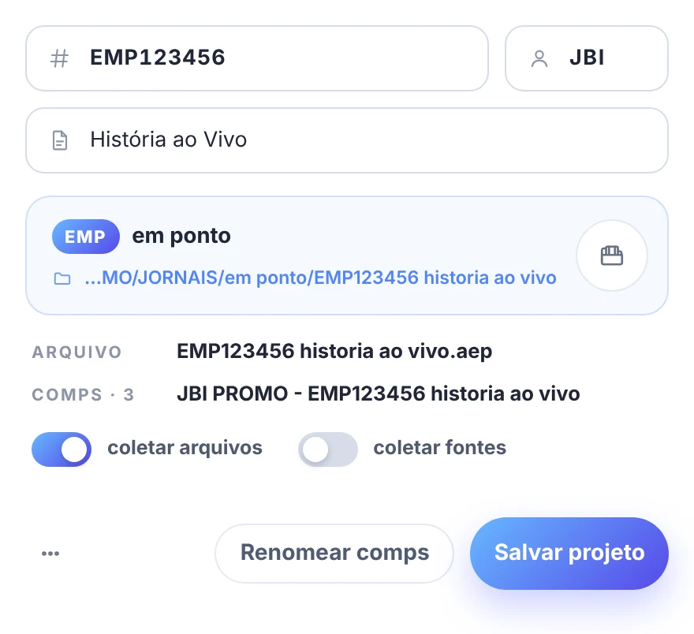

# 🎬 projeto

[← O PADEIRO](../README.md)

a janela **O PADEIRO projeto** cria um projeto novo a partir da **atração**: acha a atração e a pasta dela, cria a estrutura (`01 PROJETOS`, `02 ARQUIVOS`, `03 SAIDA`) e salva o `.aep` com o nome padronizado. depois de criado, a mesma janela vira um **editor** simples da atração, do o que é, do designer e das pastas.

> 🚩 *o collect dos arquivos é do botão **coletar** da barra ([abaixo](#-coletar-os-arquivos)).*

abra pelo botão **projeto** da barra (`◖`). o `◗ clique direito` no mesmo botão salva o projeto (se ainda não foi criado pela janela, abre a janela).

> 📟 *janela projeto*:
>
> 

## 📍 projeto novo, em duas telas

**ATRAÇÃO → CRIAR**. o que é opcional aparece só quando é preciso, na mesma tela; **‹ voltar** volta para a atração. quem acha a atração de primeira faz: digitar → `Enter` → digitar o que é → `Enter`.

1. **ATRAÇÃO** → digite a atração (ex: `DOMINGÃO`). enquanto você digita, o padeiro procura no índice da [busca](acessorista.md) (o mesmo do acessorista, na memória) e **lista as atrações em cartões**, com a primeira marcada (até 4; com mais, continue digitando). `Enter` (ou **Próximo**) segue com a marcada.
   - **como acha** → pelo nome completo (o nome ou um *pattern* da atração é o começo do que foi digitado: *MAIS VOCE* para `MAIS VOCE 30 10`) ou pelo nome em parte, palavra a palavra (cada palavra digitada é uma palavra do nome, na ordem; só a última, ou a que vem antes de um número, pode estar pela metade: `la na minha` → *Lá na Minha Terra*; `GREP 6 11` → *G REPORTER*), a partir de 3 letras. quando a completa acha, as parciais ficam de fora.
   - **nova atração** (sempre no fim da lista; marcada sozinha quando nada é encontrado) → o **nome** (já vem com o que foi digitado, sem números no fim) e a **categoria** abrem logo abaixo do cartão: as da [configuração > projeto](producoes.md#-projeto), cada uma com o seu ícone e o caminho com tokens (ex: `…/SHOWS/{atracao}/{ano}`), com a prévia do caminho. a **última categoria usada** vem escolhida (neste computador). **nenhuma destas: escolher a pasta…** (no fim das categorias) é a saída livre; sem categorias na configuração, o **escolher a pasta…** fica no lugar da lista. a pasta da atração nova é criada ao criar o projeto.
   - **outra pasta…** → abre o navegador de pastas ao seguir.
   - **filmes** seguem o mesmo fluxo: a pasta da letra é só o token `{letra}` do caminho (`…/FILMES/TITULOS/_{letra}_/{atracao}` → `…/_T_/OS TRES PATETAS`).
   - se a pasta da categoria não pode ser acessada (rede fora ou modo local), o projeto vai para a **pasta dos projetos** deste computador (`{categoria}/{atracao}`), com o aviso na prévia.
2. **CRIAR** → no topo, a atração e o designer; logo abaixo, **o que é** (ex: `SERVIÇO`, `ELENCO`, `AESP`). o `.aep` é a atração + o que é, sem acentos e caracteres especiais, em maiúsculas (ex: `MAIS VOCE SERVICO.aep`). o nome do `.aep` e a árvore mudam enquanto você digita. uma atração pode ter vários projetos.
   - **já na pasta** → uma linha com o último `.aep` alterado da pasta de projetos (`hoje 14:32 · +2`).
   - **nome repetido** → o aviso e as duas saídas ali mesmo: **abrir o existente** ou **salvar como … 2** (o padrão; a árvore já mostra o `… 2.aep`).
   - **a estrutura** (o cartão azul): `01 PROJETOS` com o `.aep`, `02 ARQUIVOS` com `FONTS`, `IMAGENS` e `VÍDEOS`, e `03 SAIDA` (a pasta de projetos que já existe aparece mais clara).
   - **pasta de output** → numa linha só, a escolhida e o caminho (ex: `SERVICO · nova`, `…/2026/SERVICO`). o clique abre as opções embaixo: a da atração (do caminho de output da categoria, ou a do índice), a **subpasta do "o que é"** dentro dela (o padrão), **pular** (não cria nem grava nada; dá para escolher depois, no editor) e **outra pasta…** (com a pastinha). cada uma diz se **já existe** ou é **nova** (a nova é criada junto com o projeto); a escolha (menos a outra pasta) fica lembrada neste computador.
   - **Criar projeto** (ou `Enter` no "o que é") cria as pastas que faltam e salva o `.aep`; a janela cresce sozinha para caber tudo. no macOS, se o volume da rede do caminho (ex: `/Volumes/VFX`) não estiver montado, o padeiro monta antes, como o acessorista faz ao abrir uma pasta. `AUDIOS` e `DADOS` o [coletar](#-coletar-os-arquivos) cria quando o projeto usar áudio ou dados.

> 🚩 *obs:* se a pasta da atração já tem uma pasta de projetos (`01 PROJETOS`, `01PROJETOS`, `PROJETOS`…), ela é usada.

## 📍 dados gravados no projeto

os dados do padeiro ficam **no próprio projeto**, num grupo próprio dos metadados (XMP `padeiro:`):

| campo | exemplo | quem grava |
|---|---|---|
| `padeiro:atracao` | LÁ NA MINHA TERRA | janela projeto |
| `padeiro:oQueE` | SERVIÇO | janela projeto |
| `padeiro:designer` | JBILLARD | janela projeto; o template grava se faltar |
| `padeiro:pasta` | a raiz da estrutura | janela projeto |
| `padeiro:output` | a pasta de output | janela projeto; o template grava se faltar |
| `padeiro:producao` | DIA-A-DIA | template (a do último preenchido) |
| `padeiro:templates` | os templates usados (nome e pasta), um por linha | template (acumula) |
| `padeiro:criado` | 2026-11-05 | o primeiro que gravar |
| `padeiro:versao` | 1 | todos |

o nome do `.aep` (`dc:title`), o designer (`dc:creator`) e a data (`dc:date`) também ficam nos campos comuns, que aparecem nas informações do arquivo. o projeto **com os dados do padeiro** (bolinha verde) é o que tem a atração e está salvo na pasta dele.

ao **preencher** ou **importar** um template, o padeiro registra o template e a produção e grava o que ainda faltar (o designer, a data e a pasta de output do template). o que a janela projeto gravou não muda. as fontes: o [coletar](#-coletar-os-arquivos) junta as do projeto na pasta de fontes da estrutura, e o botão **fontes** da barra instala as de lá (ou, sem ela, as da pasta `FONTS` de cada template usado).

projeto de antes desta versão: os campos antigos (`dc:coverage`, `dc:relation`, `dc:publisher`, `dc:source`, `dc:identifier`) são lidos e, na próxima gravação, passam para os novos.

## 📍 editor

ao abrir a janela com um projeto criado por ela:

- **atração** e **designer** (bonequinho) → a atração é buscada como na etapa ATRAÇÃO: digitar mostra as atrações logo abaixo, e a escolhida fica com o nome oficial e a pasta dela. o designer vazio vale o da [configuração > meu usuário](producoes.md#-meu-usuário) (por padrão, o usuário do computador, completo).
- **o que é** → embaixo, o nome do `.aep` (a atração + o que é) e, quando muda, o nome de hoje. um projeto antigo com o nome fora desse padrão fica com o nome dele até a atração ou o o que é mudarem.
- **pasta** → o caminho do projeto. o botão de pasta dentro do campo escolhe outra pasta.
- **output** → a pasta de output do projeto. o botão de pasta dentro do campo escolhe outra.
- **Salvar** → grava os campos e salva o `.aep` **na pasta de projetos da estrutura, com o nome de baixo** (cria a pasta de projetos se faltar; as outras pastas da estrutura o [coletar](#-coletar-os-arquivos) cria quando precisar). com outro nome ou em outro lugar, o arquivo antigo continua onde estava e a janela avisa onde; senão, ela fecha.

**projeto já salvo, mas sem os dados do padeiro** (um `.aep` antigo, por exemplo) → a janela pula as etapas e abre direto no editor. a busca roda sozinha com o nome do arquivo: a primeira atração achada já vem marcada (com a pasta dela) e o resto do nome vai para o **o que é**. sem nenhuma, fica o nome do arquivo e o aviso. confira e **Salvar**.

abrir outro projeto troca os dados da janela.

### bolinha na barra

o botão **projeto** da barra mostra uma bolinha:

- 🟢 **verde** → o projeto aberto está salvo com os dados do padeiro, dentro da pasta dele.
- 🟠 **laranja** → o projeto aberto não tem os dados (ainda não foi salvo, ou foi salvo sem a janela projeto) ou está salvo fora da pasta dele (ex: um "salvar como" na Área de Trabalho). nesse caso, o editor avisa e o **Salvar** leva o `.aep` de volta para a pasta.
- sem bolinha → projeto vazio (sem arquivo e sem itens).

## 📍 coletar os arquivos

o botão **coletar** da barra varre o projeto, copia as mídias usadas (vídeos, sequências de imagens, imagens, áudio, dados e fontes) para a estrutura do projeto, troca os caminhos para as cópias e salva o projeto. detalhes na [barra](../README.md#coletar).

## 📍 menu ⋯

- **novo projeto** → começa as etapas de novo.
- **abrir a pasta** → no Explorer / Finder.
- **ajuda / documentação** → esta página.
- **recarregar painel**
