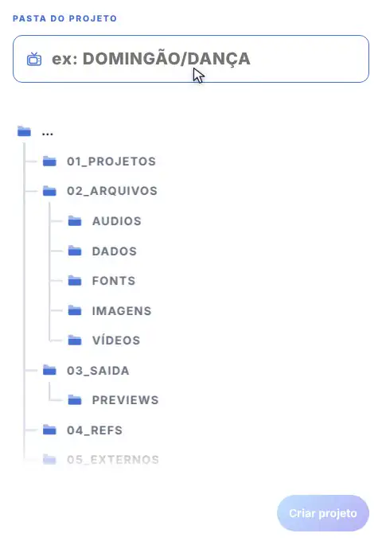
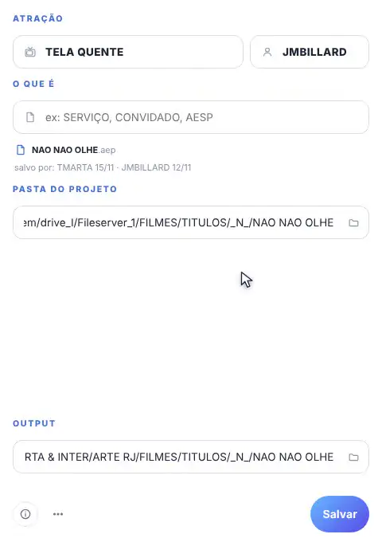
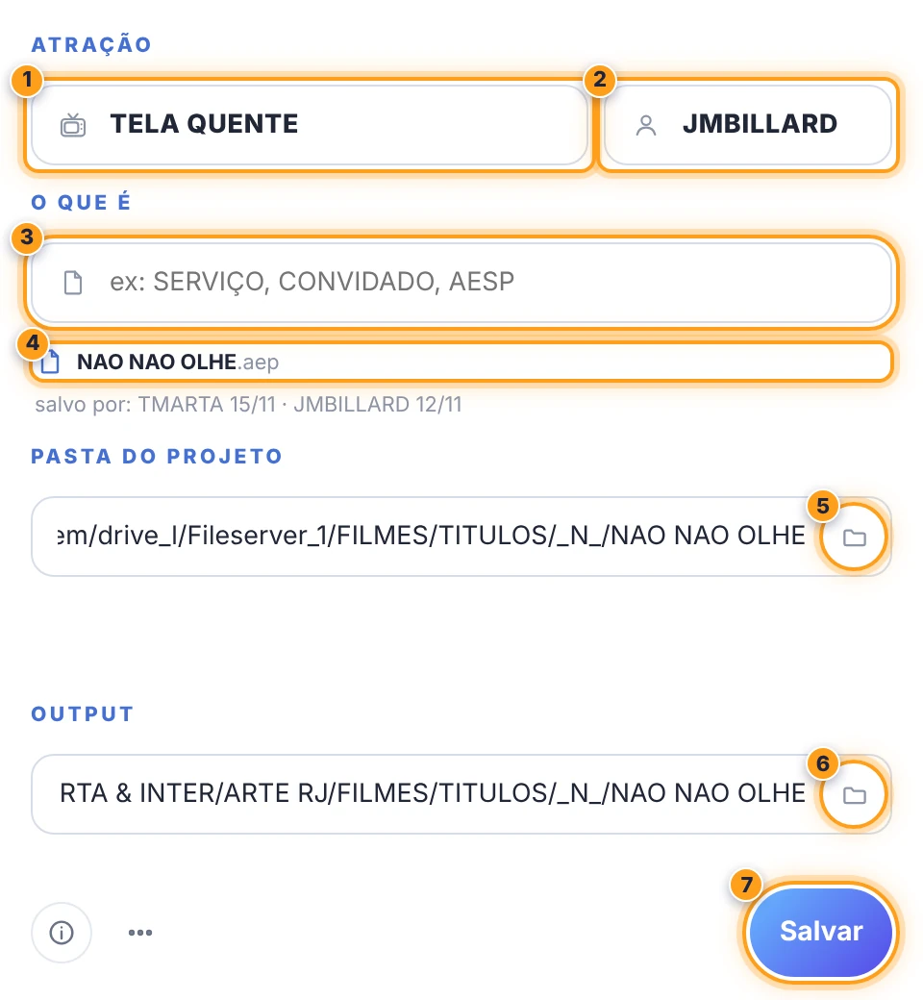

# 🎬 A CLAQUETE · projeto

[← O PADEIRO](../README.md)

a janela **A CLAQUETE** cria um projeto novo a partir da **atração**: acha a atração e a pasta dela, cria a estrutura (`01_PROJETOS`, `02_ARQUIVOS`, `03_SAIDA`, `04_REFS`) e salva o `.aep` com o nome padronizado. depois de criado, a mesma janela vira um **editor** simples da atração, do o que é, do designer e das pastas, e mostra **quem criou e quem salvou** o projeto.

> 🚩 *o collect dos arquivos é do botão **coletar** da barra ([abaixo](#-coletar-os-arquivos)).*

abra pela gaveta **projeto** da barra, no botão **criar** (`◖`); quando o projeto aberto já tem os dados do padeiro, o botão se chama **alterar** e abre o editor. o `◗ clique direito` no mesmo botão salva o projeto (se ainda não foi criado pela janela, abre a janela).

<table><tr><td align="center"> atração nova: o texto digitado é o nome; o tipo no começo só marca o chip</td><td align="center"> os dados do projeto: quem criou, quem salvou e as pastas</td></tr></table>

<table><tr><td></td><td></td></tr></table>

| | projeto novo | | o editor (projeto já criado) |
| :---: | --- | :---: | --- |
| ❶ | **o caminho**: a atração e, com barras, as pastas dela | ❶ | **atração** (com a mesma busca e as barras) |
| ❷ | uma **atração achada** (pasta e output já conhecidos) | ❷ | **designer** (a sigla) |
| ❸ | **nova atração**: os chips dos tipos (um clique cria nela, com o nome digitado) | ❸ | **o que é** (ex: SERVIÇO, CONVIDADO, AESP) |
| ❹ | **outra pasta…**: o navegador de pastas | ❹ | o **nome do .aep** (o último nível + o que é) |
| ❺ | **Criar projeto** | ❺ | **trocar a pasta**: leva o .aep e a estrutura |
| | | ❻ | **pasta de output** |
| | | ❼ | **Salvar** |

## 📍 projeto novo, em três passos

tudo numa tela só, em três passos: **qual atração?** (o campo e a lista), **onde?** (a pasta do projeto, com as regras em chips) e **abrir ou criar?** (o **JÁ NA PASTA**, o **o que é** e o botão). quem acha a atração faz: digitar → `Tab` (completa com a primeira linha) → (as pastas, se quiser) → `Enter` → digitar o que é → `Enter`. a janela abre com 440 × 840 px (cabe a tela inteira, com a lista do output aberta) e não encolhe abaixo de 380 × 580; o que não couber rola, e o botão fica no rodapé. *(os tamanhos vêm do manifest: valem depois de rodar o instalador de novo.)*

> 🚩 *teclado:* nas listas, `↓` / `↑` andam pelas opções e `Enter` escolhe a marcada; `Tab` completa com a marcada ou, sem nenhuma, com a primeira linha da lista (o card, o filme ou a atração; com a barra, a pasta do nível). o `Tab` logo depois de digitar espera a busca responder antes de completar; sem nada achado, o foco passa para a primeira opção da lista (o primeiro chip da **nova atração**, e `Enter` cria nele). a opção marcada pelas setas sobe quando fica atrás do rodapé.

### 1 · qual atração?

um campo só (**atração, filme ou caminho**). com ele vazio, a lista não aparece (a estrutura animada ocupa o lugar). digitando, o padeiro procura no índice da [busca](acessorista.md) (o mesmo do acessorista, na memória), nos [filmes recentes](webhook-filmes.md) e nos [cards do Trello](webhook-trello.md), e mostra uma lista na mesma caixa, com os grupos **sempre nesta ordem**:

1. **NO TRELLO** → um card por linha (os que entraram nos últimos 7 dias e não estão finalizados): o **nome da atração** em destaque, a claquete embaixo (e o designer, quando o card não é seu) e o **status** do card como etiqueta (`PRODUZINDO`, `EM APROVAÇÃO`; sem status, sem etiqueta). os **seus** cards vêm primeiro, marcados **seu** (abaixo); depois, os mais novos. a atração que tem card **não aparece de novo** em ATRAÇÕES.
   - **card de filme** → o card ligado a um filme (o `trello` do filme no webhook dos filmes é o link do mesmo card) aparece com o **pôster** e o título com o ano, e leva ao filme.
   - **card sem atração** → o card sem atração ligada no banco (`RIO SUMMER BEATS 5-12`) aparece com o nome sugerido e *sem atração*: vira uma atração nova (passo 2).
2. **FILMES** → os filmes recentes que batem com o texto, com o pôster, o título com o ano de produção e a exibição: primeiro os **A PRODUZIR** (ainda sem pasta de projeto), a exibição mais próxima em cima; depois os que **JÁ TÊM PROJETO**, também pela exibição; por último, os filmes do índice que não estão entre os recentes.
3. **ATRAÇÕES** → as do índice, com o ícone do tipo (o da [configuração > projeto](producoes.md#-projeto)). o **tipo fixo** (o tipo sem `{atracao}` no caminho, como MOOD MENSAL) entra aqui quando o texto bate com o nome dele.
4. **NOVA** → só os **chips dos tipos**, cada um com o seu ícone: um clique cria a atração nova **direto no tipo**, com o texto digitado como nome. com o mouse num chip, a linha embaixo mostra o caminho que ele dá. o tipo escrito no começo (`vt reunião`) só **marca o chip**, que vem primeiro: o nome é sempre o texto todo (`VT REUNIAO` no tipo VT); `Enter` cria no tipo marcado.
5. **outra pasta…** → o navegador de pastas: a pasta escolhida vira o começo do caminho, como uma atração (`2026/`), e a barra mostra as pastas dela.

cada grupo mostra **até 4 linhas**; com mais, uma linha discreta diz *+N outros: continue digitando*. as regras dos grupos (a ordem, o **seu**, o status, esconder a atração que tem card, o card de filme) ficam num ponto só, depois da busca (`pickGroups`, em `js/project.js`): valem igual com o índice de verdade (o Node do painel) e no modo de teste do navegador (o `projectLookup` do `mock-host.js`), e no **editor**.

**o "seu"** → o padeiro adivinha se o card é seu comparando o **login desta máquina** (o usuário do padeiro, ex: `JMBILLARD`) com o **designer do card** (`des`, o nome completo, ex: *J M Billard*), os dois sem acento, em maiúsculas e sem espaços nem símbolos. o login bate quando é:

- o **nome todo junto**: *J M Billard* → `JMBILLARD`; *Cristina Vianna* → `CRISTINAVIANNA`;
- as **iniciais de todos menos o último + o último**: `JMBILLARD`, `CVIANNA`;
- a **inicial do primeiro + um sobrenome**: `JBILLARD`, `CVIANNA`;
- o **primeiro nome + um sobrenome**: `CRISTINAVIANNA`;
- o **primeiro nome + a inicial de um sobrenome**: `CRISTINAV`.

com menos de 3 letras não vale, e só o primeiro nome não basta (nomes repetem). sem casar, o card fica sem **seu** (vem depois, pela data).

- **como acha** → pelo nome completo (o nome ou um *pattern* da atração é o começo do que foi digitado: *MAIS VOCE* para `MAIS VOCE 30 10`) ou pelo nome em parte, palavra a palavra (cada palavra digitada é uma palavra do nome, na ordem; só a última, ou a que vem antes de um número, pode estar pela metade: `la na minha` → *Lá na Minha Terra*; `GREP 6 11` → *G REPORTER*), a partir de 3 letras. quando a completa acha, as parciais ficam de fora.
- **data na claquete** → a barra entre dois números não separa pastas: `QUEM AMA 17/11` fica junto, como uma atração só.

### 2 · onde?

escolhida a linha, a lista recolhe e, em cima do campo, aparece a **pasta do projeto**: a pasta com os níveis em destaque e a de projetos dentro dela. **o clique abre a pasta** no Explorer / Finder (a que ainda não existe aparece sem o clique: é criada com o projeto).

- **a atração** → a pasta de projeto **cadastrada** dela: a que já tem pasta no índice fica **na pasta dela**, como está (`BBB/BBB 2026`), no ano do projeto; a do índice **sem** pasta de projeto vai para o **caminho do tipo** (`DOMINGÃO COM HUCK` → `…/PROGRAMAS/DOMINGAO COM HUCK/2027`). o tipo sai das pastas da atração (`…/ESPORTES/FUTEBOL/…` → FUTEBOL); sem um que sirva, escolher a atração abre os tipos da **nova atração** na lista, com o nome dela. a pasta que é a própria pasta de um tipo (`INSTITUCIONAL/VTs`) não aparece como atração.
- **o card de uma atração** → a pasta cadastrada da atração ([o card só aponta a atração](adr/0001-card-so-aponta-a-atracao.md)). o campo mostra o **nome da atração** (nunca a claquete); embaixo do campo, uma linha do card só como referência: a claquete, o designer (ou **seu**), a atração e o status.
- **o filme** (da lista ou de um card) → a pasta do filme ([ADR 0004](adr/0004-projeto-do-filme-na-pasta-do-filme.md)), do tipo de filmes da configuração (o que se chama FILME ou FILMES), com a pasta da letra pelo token `{letra}` (`…/FILMES/TITULOS/_{letra}_/{atracao}` → `…/_M_/O MENTIROSO`); o output é o do índice. embaixo do campo, o cartão do filme (o pôster, o ano, a exibição e a etiqueta). o filme que já tem uma **pasta antiga sem ano** fica nela. sem o tipo de filmes, os filmes ficam de fora da lista.
- **o card sem atração** → vira uma **atração nova**: embaixo do campo, o **nome sugerido** (o começo da claquete, sem a data, a versão e o ano: `RIO SUMMER BEATS 5-12` → `RIO SUMMER BEATS`), que dá para editar, e os **chips dos tipos** para escolher onde criar. o resto da tela espera o tipo.
- **a atração nova** (dos chips) → o caminho do tipo com o nome. a pasta da atração nova é criada ao criar o projeto; se a pasta do tipo não pode ser acessada, o chip avisa na dica e o projeto vai para a pasta deste computador.
- **as pastas** → a cada barra, a lista mostra as **pastas daquele nível** (quadros, especiais, semanas, o que tiver), lidas na hora; o texto depois da barra filtra. **clicar na própria atração (a primeira linha, em destaque) fica só com ela**, sem pasta abaixo, e segue para o o que é; para trocar de atração, o **×** do campo. com o mouse numa linha, o caminho dela aparece na linha do destino, embaixo da lista. clique numa pasta para descer nela; numa pasta sem pastas dentro, a barra sai e o campo recolhe (segue para o o que é). clicar fora do campo também recolhe. no fim da lista, **nova pasta** com o nome digitado. `Enter` fica com o caminho como está escrito: o que já existe é usado (sem diferenciar acentos e maiúsculas) e o resto é **novo**, criado junto com o projeto. ficam de fora as da estrutura (`01_PROJETOS`, `02_ARQUIVOS`…), as de autosave e logs, as sem nome (`New Folder`, `untitled folder`…) e as `OLD`, `NÃO VALE` e `NÃO USAR`.
- **quadros** → logo abaixo da atração (`DOMINGÃO COM HUCK/`), a lista mostra os **quadros** que já existem e, em cinza, **exemplos do que já existe**: os quadros que o padeiro já criou na mesma atração em outros anos (as pastas com a estrutura dele dentro, como `01_PROJETOS`), sem repetir. escolher um exemplo cria o quadro com o mesmo nome. as pastas antigas da atração ficam de fora.

**as regras automáticas** viram **chips** logo abaixo da pasta, cada um dizendo de onde veio; **o clique troca, sem perder a escolha** (a atração, o card e as pastas abaixo ficam; só a pasta muda):

- **o ano do projeto** (`2026 · este ano`) → troca entre o de agora, o que vem e o anterior. vale para o `{ano}` dos tipos e para o ano das pastas que já existem (`BBB 2026` → `BBB 2027`): é para o que começa antes da virada, como o BBB. um **ano escrito na claquete do card** (`VEM AI(2027)`, `PREMIO 2026 …`) vira o ano do projeto, com a nota **pelo card**; escolhendo outra coisa, volta para o de agora. trocado à mão, o chip fica em destaque (**trocado**).
- **o ano de produção do filme** (`(2022) · produção`) → o token `{ano_producao}` põe o ano do filme no caminho, no output e no arquivo do tipo FILME (`…/_{letra}_/{atracao} ({ano_producao})` → `…/_N_/NAO NAO OLHE (2022)`; sem ano, o token sai junto dos parênteses). o clique troca para o ano seguinte ou o anterior (a pasta e o `.aep` acompanham).
- **o mês do tipo fixo** (`JANEIRO 2027 · pelo card`) → só no tipo fixo com tokens de mês (MOOD MENSAL): o mês escrito no card vale mais que a data de hoje ([ADR 0002](adr/0002-mes-do-card-vale-mais-que-hoje.md)); sem card, o **próximo mês**. o clique passa para o mês seguinte.

- **tipo fixo** → o tipo sem `{atracao}` no caminho é a própria atração: digitar o nome dela (`mood`) leva direto para a pasta que o caminho dá (MOOD MENSAL: a do próximo mês; CARNAVAL: `CARNAVAL {ano}`). o `.aep` segue o campo **arquivo** do tipo, quando tem (`DEZEMBRO NA GLOBO.aep`).
- se a pasta do tipo não pode ser acessada (rede fora ou modo local), o projeto vai para a **pasta dos projetos** deste computador (`{tipo}/{atracao}`), com o aviso na prévia.

### 3 · abrir ou criar?

- **JÁ NA PASTA** → os `.aep` e `.aet` da pasta de projetos **e das subpastas logo dentro dela** (um nível só), do mais novo para o mais velho, com a subpasta escrita antes do nome (`CHAMADAS/PREMIO 2026 CH JOR ESP G5.aep`) e há quanto tempo à direita (**hoje**, **ontem**, **há 3 dias**; a data inteira na dica). vale igual para a atração, o filme e o card. ficam de fora as pastas de autosave, logs, `OLD`, `NÃO VALE` e as escondidas. mostra os do card e mais 3 (o resto num **+ N**). **um clique marca um projeto** (de novo, desmarca): o botão do rodapé vira **Abrir projeto** e embaixo aparece **criar um novo em vez de abrir**. o segundo passo é o botão: nada abre no primeiro clique. abrir não cria nada e fecha a janela.
  - **sem travar o After** → com o Node do painel, quem lê a pasta (e as subpastas) é o painel, sem bloquear o After nem com a rede lenta ([ADR 0003](adr/0003-pastas-lidas-pelo-node-do-painel.md)): o host só monta o plano (a pasta, o nome) e devolve o caminho como o sistema o vê. sem o Node (o navegador de teste), o host lê como plano B.
- **vindo de um card** → os `.aep` que batem com a claquete do card (cada palavra da claquete é o começo de uma palavra do nome do arquivo; valem os que batem com mais palavras) ficam **no topo, em destaque** (fundo suave e a etiqueta **CARD**), e você escolhe. **só um** bate: ele vem marcado (**Abrir projeto**). **dois ou mais**: nenhum marcado. **nenhum**: nada marcado e a janela fica pronta para criar, com o **o que é** vazio.
- **O QUE É** → ex: `SERVIÇO`, `ELENCO`, `AESP`. o `.aep` é o **último nível do caminho** (o quadro, ou a atração, sem pastas) + o que é, sem acentos e caracteres especiais, em maiúsculas: `DOMINGÃO/DANÇA DOS FAMOSOS` + `ABERTURA` → `DANCA DOS FAMOSOS ABERTURA.aep`; o filme leva o título com o ano (`NAO NAO OLHE (2022) CHAMADA.aep`); o card sem atração, o nome sugerido. **o nome do `.aep` nunca vem da claquete**. o nome muda enquanto você digita.
  - **tipo com `{o_que_e}`** → se o tipo de projeto usa o token no **arquivo** ou no **output** ([configuração > projeto](producoes.md#-projeto)), o o que é entra no lugar dele: o nome do `.aep` e a pasta de output mudam enquanto você digita.
  - **nome repetido** → quando o o que é dá o nome de um `.aep` que já está na pasta, ele vem marcado no **JÁ NA PASTA** e o botão vira **Abrir projeto** (o `Enter` no o que é também abre); o o que é fica à vista e embaixo da lista aparece *esse nome já existe · criar um novo em vez de abrir*. para criar outro, mude o o que é; desmarcado com o mesmo nome, o novo é salvo como `… 2`.
  - digitar o o que é ou trocar a atração desmarca o projeto marcado.
- **o output** → embaixo, logo acima do rodapé (separado das pastas do projeto), um cartão com a pasta escolhida: a pasta de output da atração (do caminho de output do tipo, ou a do índice) em destaque e o caminho embaixo. **mudar** (ou o clique no cartão) abre o campo, que funciona como o do projeto: a lista mostra as subpastas, a barra desce, **nova pasta** cria uma no fim. de um clique: **pasta com o o que é** (`…/2026/SERVICO`), **outra pasta…** (o navegador de pastas) e **sem output** (não cria nem grava nada; dá para escolher depois, no editor). `Enter`, `Esc` ou sair do campo voltam para o cartão, com o escolhido (as pastas em negrito).
- **um botão só**, que diz o que vai fazer: **Criar projeto** (ou `Enter` no o que é; o **o que é** é opcional; com um `.aep` marcado, o botão e o `Enter` abrem ele) cria as pastas novas, a estrutura (`01_PROJETOS` com o `.aep`, `02_ARQUIVOS`, `03_SAIDA`, `04_REFS`…) e salva o `.aep`. no macOS, se o volume da rede do caminho (ex: `/Volumes/VFX`) não estiver montado, o padeiro monta antes, como o acessorista faz ao abrir uma pasta. `AUDIOS` e `DADOS` o [coletar](#-coletar-os-arquivos) cria quando o projeto usar áudio ou dados. criado o projeto, o botão vira **Criado**, a linha de baixo confirma o nome do `.aep` e a janela fecha sozinha (para editar depois, abra a janela de novo: ela vira o editor).

> 🚩 *obs:* se a pasta da atração já tem uma pasta de projetos (`01 PROJETOS`, `01PROJETOS`, `PROJETOS`…), ela é usada.

## 📍 dados gravados no projeto

os dados do padeiro ficam **no próprio projeto**, num grupo próprio dos metadados (XMP `padeiro:`):

| campo | exemplo | quem grava |
|---|---|---|
| `padeiro:atracao` | LÁ NA MINHA TERRA | janela projeto |
| `padeiro:quadro` | DANÇA DOS FAMOSOS/FINAL | janela projeto (opcional: as pastas abaixo da atração; o `.aep` é o último nível + o que é) |
| `padeiro:oQueE` | SERVIÇO | janela projeto |
| `padeiro:designer` | JBILLARD | janela projeto (quem criou) |
| `padeiro:pasta` | a raiz da estrutura | janela projeto |
| `padeiro:output` | a pasta de output | janela projeto; o template grava se faltar |
| `padeiro:criado` | 2026-11-05 | o primeiro que gravar |
| `padeiro:editores` | quem já salvou o projeto e o último dia de cada um (`USUARIO` e `2026-11-16`, um por linha, na ordem em que salvaram por último; a hora do último salvamento entra na linha de quem deixou de ser o último) | cada salvamento (abaixo) |
| `padeiro:salvo` | o dia do último salvamento | cada salvamento |
| `padeiro:versao` | 1 | todos |

o nome do `.aep` (`dc:title`), o designer (`dc:creator`) e a data (`dc:date`) também ficam nos campos comuns, que aparecem nas informações do arquivo. o projeto **com os dados do padeiro** (bolinha verde) é o que tem a atração e está salvo na pasta dele.

**quem salvou** → todo projeto **com atração** guarda quem salvou e em que dia, uma linha por pessoa, com o último dia dela (o registro é por dia, não por salvamento):

- o **Criar projeto** e o **Salvar** da janela gravam na hora;
- o `Ctrl+S` e o salvamento que o After faz sozinho ao iniciar o render são notados pela barra logo depois (ela vê que o arquivo mudou) e entram no arquivo no salvamento seguinte;
- projeto sem atração (um `.aep` qualquer) não recebe nada.

**templates** → preencher ou importar um template **não** registra mais o template nem a produção no projeto (o projeto preenchido quase nunca é salvo; o uso dos templates vai para o [registro de uso](producoes.md#registro-de-uso-equipe)). só a pasta de output do template é gravada, quando o projeto ainda não tem uma. as fontes: o [coletar](#-coletar-os-arquivos) junta as do projeto na pasta de fontes da estrutura, e o botão **fontes** da barra instala as de lá ou as do [banco de fontes](fontes.md).

projeto de antes desta versão: os campos antigos (`dc:coverage`, `dc:relation`, `dc:publisher`, `dc:source`, `dc:identifier`) são lidos e, na próxima gravação, passam para os novos.

## 📍 editor

ao abrir a janela com um projeto criado por ela:

- **atração** e **designer** (bonequinho) → a atração é buscada **como no projeto novo, com a mesma lista**: os grupos **NO TRELLO** (com o **seu** e o status), **FILMES**, **ATRAÇÕES** e a **NOVA** (os chips dos tipos), na mesma ordem e com as mesmas regras; com a lista aberta, ela fica com a largura toda (o designer recolhe). a escolhida fica com o nome oficial e a pasta dela; o card leva à atração dele (o filme, a pasta do filme; o ano escrito na claquete vale para a pasta); o card sem atração põe o nome sugerido no campo e a lista mostra os tipos da atração nova. o designer vazio vale o da [configuração > meu usuário](producoes.md#-meu-usuário) (por padrão, o usuário do computador, completo).
- **o que é** → embaixo, o nome do `.aep` (a atração + o que é) e, quando muda, o nome de hoje. o **tipo com ARQUIVO próprio** (ex: MOOD MENSAL, `{proximo_mes} NA GLOBO {o_que_e}`) mantém o nome pelo padrão do tipo ao salvar, com o mês do nome de hoje do `.aep` (`JANEIRO NA GLOBO SERVICO` → `JANEIRO NA GLOBO CHAMADA`), em vez de virar a atração + o que é. um projeto antigo com o nome fora desse padrão fica com o nome dele até a atração ou o o que é mudarem.
- **pasta do projeto** → o caminho do projeto. o botão de pasta dentro do campo escolhe outra pasta.
- **salvo por** → embaixo, quem já salvou o projeto, o mais recente primeiro (`salvo por: TMARTA 16/11 · JMBILLARD 14/11`).
- **output** → embaixo, logo acima do rodapé (como no projeto novo): a pasta de output do projeto. o botão de pasta dentro do campo escolhe outra.
- **os dados do projeto** (o botão redondo com o **i**, no rodapé, antes do **⋯**) → uma tela só de leitura: o arquivo e onde está, a situação (**na pasta dele**, **fora da pasta** ou **sem os dados**), a atração, o o que é, quem criou e quando, **salvo em** (a data e a hora do último salvamento do arquivo), quem salvou (uma linha por pessoa, com o último dia dela: salvar de novo no mesmo dia não muda a lista, só o **salvo em**; as datas aparecem como se fala: **HOJE**, **ONTEM** ou, mais para trás, a data, com a data inteira na dica. nos de **hoje**, a hora fica à esquerda: a do último vem da data do arquivo; a dos outros é a do último salvamento de cada um antes de outra pessoa salvar), a pasta do projeto e a de output. **copiar** leva tudo em texto (para colar no Teams); a seta volta para o editor.
- **Salvar** → grava os campos e salva o `.aep` **na pasta de projetos da estrutura, com o nome de baixo** (cria a pasta de projetos se faltar; as outras pastas da estrutura o [coletar](#-coletar-os-arquivos) cria quando precisar). com outro nome ou em outro lugar, o arquivo antigo continua onde estava e a janela avisa onde; senão, ela fecha.

**a estrutura do projeto** → com o campo do projeto vazio, a tela mostra, animada, as pastas que o projeto novo vai ter (as da [configuração > coletar](producoes.md)), num desenho decorativo: as pastas cheias, sem nada para clicar. digitando, ela sai e o resto da tela (o que é e output) entra no lugar.

**pastas abaixo da atração no editor** → o campo da atração aceita o caminho, como no projeto novo: `DOMINGÃO/DANÇA DOS FAMOSOS/FINAL`. a lista mostra as pastas de cada nível; `Enter` (ou Salvar) fica com o caminho digitado e troca a pasta do projeto e o nome do `.aep` (o último nível + o que é). as pastas ficam gravadas no projeto (`padeiro:quadro`).

**não achou a atração no editor?** → digitando a atração, a lista termina em '*começar projeto novo*': abre o fluxo do projeto novo com o nome digitado (a nova atração, o tipo e a pasta, como num projeto do zero). o botão redondo de **voltar** (a seta, no rodapé) volta para o editor sem mudar nada.

no editor, `Enter` na atração com a lista aberta fica com o **nome digitado** (para usar uma atração da lista, clique nela); `Enter` de novo salva.

**projeto já salvo, mas sem os dados do padeiro** (um `.aep` antigo, por exemplo) → a janela abre direto no editor. a busca roda sozinha com o nome do arquivo: a primeira atração achada já vem marcada (com a pasta dela) e o resto do nome vai para o **o que é**. sem nenhuma, fica o nome do arquivo e o aviso. confira e **Salvar**.

abrir outro projeto troca os dados da janela.

### bolinha na barra

o botão **criar / alterar** (na gaveta **projeto**) mostra uma bolinha; com a gaveta fechada, o botão **projeto** mostra a pior das bolinhas de dentro (projeto, fontes e coletar):

- 🟢 **verde** → o projeto aberto está salvo com os dados do padeiro, dentro da pasta dele.
- 🟠 **laranja** → falta algo, e a dica do botão diz o quê: **ainda sem atração** (o projeto não foi criado pela janela: clique para iniciar) ou **salvo fora da pasta dele** (ex: um "salvar como" na Área de Trabalho: o editor avisa e o **Salvar** leva o `.aep` de volta para a pasta). um **projeto antigo convertido** (o After abre, converte e deixa "(converted)", sem salvar) também fica laranja, mas com o botão **Alterar**: a janela mostra os dados que ele já tinha, antes mesmo de salvar; ao salvar, se o original ainda estiver na pasta com o mesmo nome, mude o "o que é" para gravar o convertido ao lado dele.
- sem bolinha → projeto vazio (sem arquivo e sem itens).

## 📍 coletar os arquivos

o botão **coletar** da barra varre o projeto, copia as mídias usadas (vídeos, sequências de imagens, imagens, áudio, dados e fontes) para a estrutura do projeto, troca os caminhos para as cópias e salva o projeto. detalhes na [barra](../README.md#coletar).

## 📍 menu ⋯

- **novo projeto** → abre o fluxo do projeto novo, vazio (o botão de voltar, no rodapé, retorna ao editor).
- **abrir a pasta** → no Explorer / Finder.
- **ajuda / documentação** → esta página.
- **recarregar painel**
