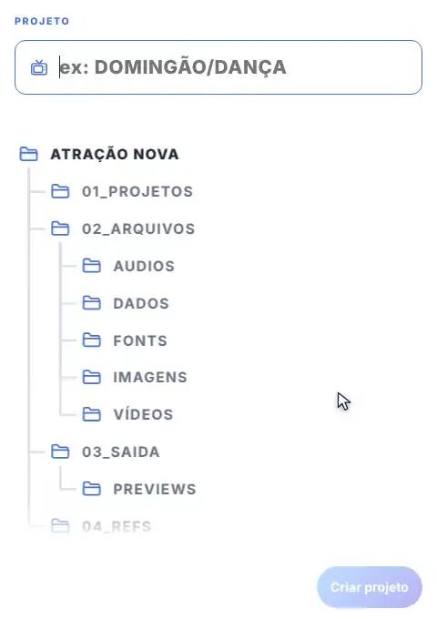
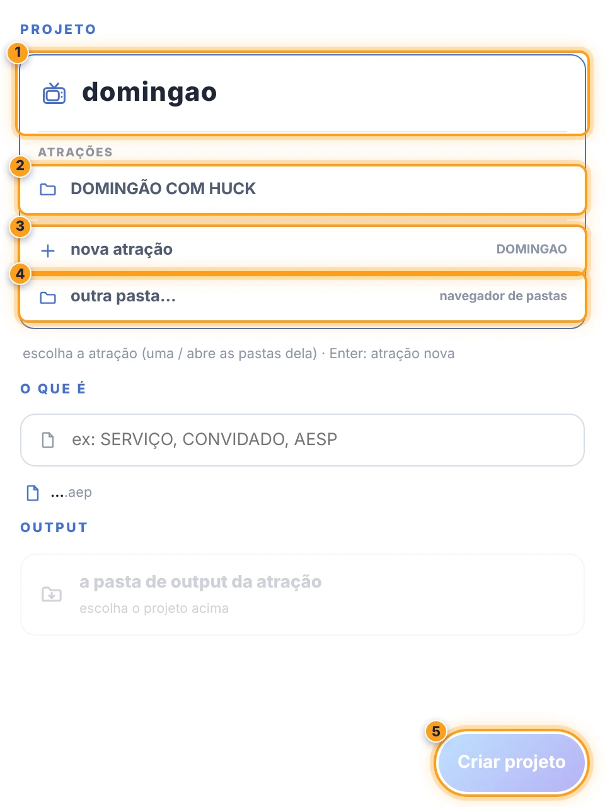
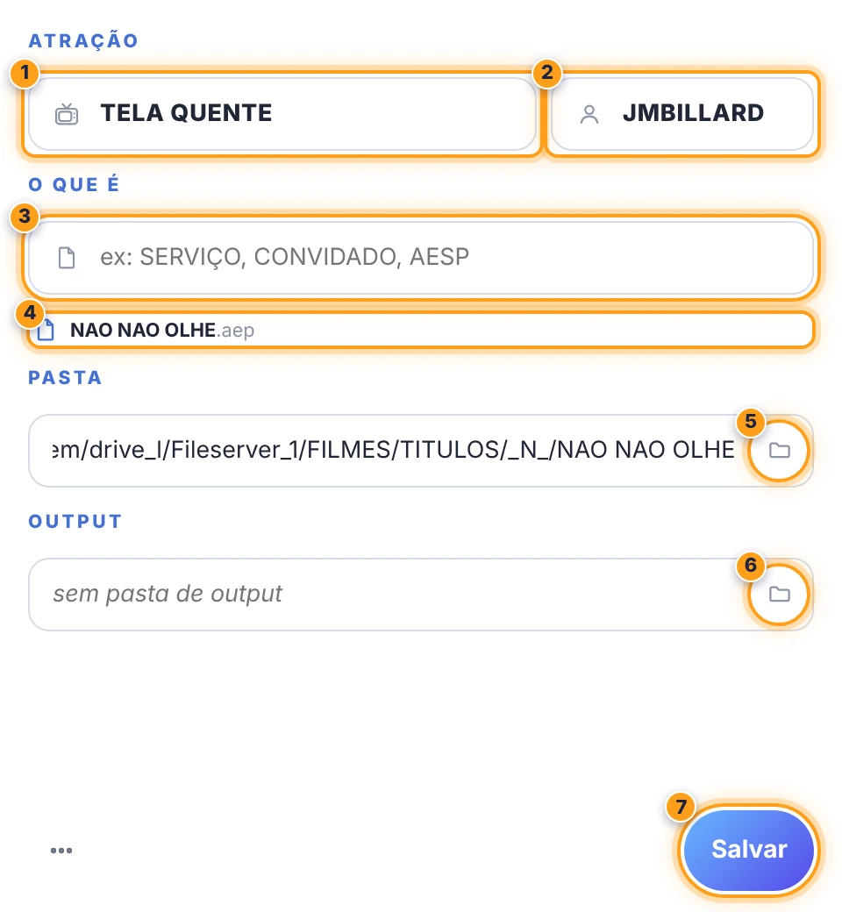

# 🎬 A CLAQUETE · projeto

[← O PADEIRO](../README.md)

a janela **A CLAQUETE** cria um projeto novo a partir da **atração**: acha a atração e a pasta dela, cria a estrutura (`01_PROJETOS`, `02_ARQUIVOS`, `03_SAIDA`, `04_REFS`) e salva o `.aep` com o nome padronizado. depois de criado, a mesma janela vira um **editor** simples da atração, do o que é, do designer e das pastas.

> 🚩 *o collect dos arquivos é do botão **coletar** da barra ([abaixo](#-coletar-os-arquivos)).*

abra pelo botão **projeto** da barra (`◖`). o `◗ clique direito` no mesmo botão salva o projeto (se ainda não foi criado pela janela, abre a janela).

<table><tr><td></td><td></td></tr></table>

| | projeto novo | | o editor (projeto já criado) |
| :---: | --- | :---: | --- |
| ❶ | **o caminho**: a atração e, com barras, as pastas dela | ❶ | **atração** (com a mesma busca e as barras) |
| ❷ | uma **atração achada** (pasta e output já conhecidos) | ❷ | **designer** (a sigla) |
| ❸ | **nova atração**: o nome e a categoria abrem embaixo | ❸ | **o que é** (ex: SERVIÇO, CONVIDADO, AESP) |
| ❹ | **outra pasta…**: o navegador de pastas | ❹ | o **nome do .aep** (o último nível + o que é) |
| ❺ | **Criar projeto** | ❺ | **trocar a pasta**: leva o .aep e a estrutura |
| | | ❻ | **pasta de output** |
| | | ❼ | **Salvar** |

## 📍 projeto novo, numa tela

tudo numa tela só: o **caminho** do projeto, o **o que é** e o **output**. quem acha a atração faz: digitar → `Tab` (completa com a primeira) → (as pastas, se quiser) → `Enter` → digitar o que é → `Enter`. a janela fica do tamanho que você deixar: o que não cabe rola, e o botão fica no rodapé.

> 🚩 *teclado:* nas listas, `↓` / `↑` andam pelas opções e `Enter` escolhe a marcada; `Tab` completa com a marcada ou, sem nenhuma, com a primeira (a atração, ou a pasta do nível).

1. **PROJETO** → o caminho, digitado como uma pasta: `ATRAÇÃO/PASTA/PASTA…`.
   - **a atração** → digite (ex: `DOMINGÃO`). enquanto você digita, o padeiro procura no índice da [busca](acessorista.md) (o mesmo do acessorista, na memória) e lista as atrações (até 4; com mais, continue digitando). **clique na atração (ou `Tab`) para entrar nela**: o campo ganha o nome e a barra, e a lista mostra as pastas dela. `Enter` sem barra entra na atração de nome igual ou, sem nenhuma, fica com o **nome digitado**, como **nova atração**.
   - **as pastas** → a cada barra, a lista mostra as **pastas daquele nível** (quadros, especiais, semanas, o que tiver), lidas na hora; o texto depois da barra filtra. clique numa pasta para descer nela. no fim da lista, **nova pasta** com o nome digitado. `Enter` fica com o caminho como está escrito: o que já existe é usado (sem diferenciar acentos e maiúsculas) e o resto é **novo**, criado junto com o projeto. ficam de fora as da estrutura (`01_PROJETOS`, `02_ARQUIVOS`…), as de autosave e logs, as sem nome (`New Folder`, `untitled folder`…) e as `OLD`, `NÃO VALE` e `NÃO USAR`.
   - embaixo do campo, a linha do **destino**: a pasta do projeto com os níveis em destaque e a de projetos dentro dela.
   - **como acha** → pelo nome completo (o nome ou um *pattern* da atração é o começo do que foi digitado: *MAIS VOCE* para `MAIS VOCE 30 10`) ou pelo nome em parte, palavra a palavra (cada palavra digitada é uma palavra do nome, na ordem; só a última, ou a que vem antes de um número, pode estar pela metade: `la na minha` → *Lá na Minha Terra*; `GREP 6 11` → *G REPORTER*), a partir de 3 letras. quando a completa acha, as parciais ficam de fora.
   - **nova atração** (no fim da lista) → o campo vira o do **nome** da atração nova e a **categoria** aparece logo abaixo. os dois são um campo só: o mesmo jeito e o mesmo texto (o que se digita num vale no outro); a **seta de voltar** no campo (ou `Esc`, ou apagar tudo) volta para a busca, com o cursor no fim. as categorias são as da [configuração > projeto](producoes.md#-projeto), cada uma com o seu ícone e o caminho com tokens (ex: `…/SHOWS/{atracao}/{ano}`); o caminho aparece na linha do destino. a **última categoria usada** vem escolhida (neste computador). **nenhuma destas: escolher a pasta…** (no fim das categorias) é a saída livre; sem categorias na configuração, o **escolher a pasta…** fica no lugar da lista. a pasta da atração nova é criada ao criar o projeto.
   - **outra pasta…** → o navegador de pastas: a pasta escolhida vira o começo do caminho, como uma atração (`2026/`), e a barra mostra as pastas dela.
   - **filmes** → a busca também acha os filmes do índice (o nome e o ano, com o ícone da categoria de filmes). a pasta do projeto vem da categoria de filmes da [configuração > projeto](producoes.md#-projeto) (a que se chama FILME ou FILMES), com a pasta da letra pelo token `{letra}` (`…/FILMES/TITULOS/_{letra}_/{atracao}` → `…/_M_/O MENTIROSO`); o output é o do índice. sem essa categoria, os filmes ficam de fora da lista. um filme que não está no índice é uma atração nova na categoria de filmes.
   - se a pasta da categoria não pode ser acessada (rede fora ou modo local), o projeto vai para a **pasta dos projetos** deste computador (`{categoria}/{atracao}`), com o aviso na prévia.
2. **O QUE É** → ex: `SERVIÇO`, `ELENCO`, `AESP`. o `.aep` é o **último nível do caminho** (ou a atração, sem pastas) + o que é, sem acentos e caracteres especiais, em maiúsculas: `DOMINGÃO/DANÇA DOS FAMOSOS` + `ABERTURA` → `DANCA DOS FAMOSOS ABERTURA.aep`; `MAIS VOCÊ` + `SERVIÇO` → `MAIS VOCE SERVICO.aep`. o nome muda enquanto você digita.
   - **já na pasta** → uma linha com o último `.aep` alterado da pasta de projetos (`hoje 14:32 · +2`).
   - **nome repetido** → o aviso e as duas saídas ali mesmo: **abrir o existente** ou **salvar como … 2** (o padrão).
3. **OUTPUT** → embaixo, logo acima do rodapé (separado das pastas do projeto), um cartão com a pasta escolhida: a pasta de output da atração (do caminho de output da categoria, ou a do índice) em destaque e o caminho embaixo. **mudar** (ou o clique no cartão) abre o campo, que funciona como o do projeto: a lista mostra as subpastas, a barra desce, **nova pasta** cria uma no fim. de um clique: **pasta com o o que é** (`…/2026/SERVICO`), **outra pasta…** (o navegador de pastas) e **sem output** (não cria nem grava nada; dá para escolher depois, no editor). `Enter`, `Esc` ou sair do campo voltam para o cartão, com o escolhido (as pastas em negrito).
4. **Criar projeto** (ou `Enter` no o que é) cria as pastas novas, a estrutura (`01_PROJETOS` com o `.aep`, `02_ARQUIVOS`, `03_SAIDA`, `04_REFS`…) e salva o `.aep`. no macOS, se o volume da rede do caminho (ex: `/Volumes/VFX`) não estiver montado, o padeiro monta antes, como o acessorista faz ao abrir uma pasta. `AUDIOS` e `DADOS` o [coletar](#-coletar-os-arquivos) cria quando o projeto usar áudio ou dados.

> 🚩 *obs:* se a pasta da atração já tem uma pasta de projetos (`01 PROJETOS`, `01PROJETOS`, `PROJETOS`…), ela é usada.

## 📍 dados gravados no projeto

os dados do padeiro ficam **no próprio projeto**, num grupo próprio dos metadados (XMP `padeiro:`):

| campo | exemplo | quem grava |
|---|---|---|
| `padeiro:atracao` | LÁ NA MINHA TERRA | janela projeto |
| `padeiro:quadro` | DANÇA DOS FAMOSOS/FINAL | janela projeto (opcional: as pastas abaixo da atração; o `.aep` é o último nível + o que é) |
| `padeiro:oQueE` | SERVIÇO | janela projeto |
| `padeiro:designer` | JBILLARD | janela projeto; o template grava se faltar |
| `padeiro:pasta` | a raiz da estrutura | janela projeto |
| `padeiro:output` | a pasta de output | janela projeto; o template grava se faltar |
| `padeiro:producao` | DIA-A-DIA | template (a do último preenchido) |
| `padeiro:templates` | os templates usados (nome e pasta), um por linha | template (acumula) |
| `padeiro:criado` | 2026-11-05 | o primeiro que gravar |
| `padeiro:versao` | 1 | todos |

o nome do `.aep` (`dc:title`), o designer (`dc:creator`) e a data (`dc:date`) também ficam nos campos comuns, que aparecem nas informações do arquivo. o projeto **com os dados do padeiro** (bolinha verde) é o que tem a atração e está salvo na pasta dele.

ao **preencher** ou **importar** um template, o padeiro registra o template e a produção e grava o que ainda faltar (o designer, a data e a pasta de output do template). o que a janela projeto gravou não muda. as fontes: o [coletar](#-coletar-os-arquivos) junta as do projeto na pasta de fontes da estrutura, e o botão **fontes** da barra instala as de lá (ou, sem ela, as da pasta `FONTS` de cada template usado).

projeto de antes desta versão: os campos antigos (`dc:coverage`, `dc:relation`, `dc:publisher`, `dc:source`, `dc:identifier`) são lidos e, na próxima gravação, passam para os novos.

## 📍 editor

ao abrir a janela com um projeto criado por ela:

- **atração** e **designer** (bonequinho) → a atração é buscada como no projeto novo: digitar mostra as atrações logo abaixo, e a escolhida fica com o nome oficial e a pasta dela. o designer vazio vale o da [configuração > meu usuário](producoes.md#-meu-usuário) (por padrão, o usuário do computador, completo).
- **o que é** → embaixo, o nome do `.aep` (a atração + o que é) e, quando muda, o nome de hoje. um projeto antigo com o nome fora desse padrão fica com o nome dele até a atração ou o o que é mudarem.
- **pasta** → o caminho do projeto. o botão de pasta dentro do campo escolhe outra pasta.
- **output** → a pasta de output do projeto. o botão de pasta dentro do campo escolhe outra.
- **Salvar** → grava os campos e salva o `.aep` **na pasta de projetos da estrutura, com o nome de baixo** (cria a pasta de projetos se faltar; as outras pastas da estrutura o [coletar](#-coletar-os-arquivos) cria quando precisar). com outro nome ou em outro lugar, o arquivo antigo continua onde estava e a janela avisa onde; senão, ela fecha.

**a estrutura do projeto** → com o campo do projeto vazio, a tela mostra, animada, as pastas que o projeto novo vai ter: as da [configuração > coletar](producoes.md). digitando, ela sai e o resto da tela (o que é e output) entra no lugar.

**pastas abaixo da atração no editor** → o campo da atração aceita o caminho, como no projeto novo: `DOMINGÃO/DANÇA DOS FAMOSOS/FINAL`. a lista mostra as pastas de cada nível; `Enter` (ou Salvar) fica com o caminho digitado e troca a pasta do projeto e o nome do `.aep` (o último nível + o que é). as pastas ficam gravadas no projeto (`padeiro:quadro`).

**não achou a atração no editor?** → digitando a atração, a lista termina em '*começar projeto novo*': abre o fluxo do projeto novo com o nome digitado (a nova atração, a categoria e a pasta, como num projeto do zero). o botão redondo de **voltar** (a seta, no rodapé) volta para o editor sem mudar nada.

no editor, `Enter` na atração com a lista aberta fica com o **nome digitado** (para usar uma atração da lista, clique nela); `Enter` de novo salva.

**projeto já salvo, mas sem os dados do padeiro** (um `.aep` antigo, por exemplo) → a janela abre direto no editor. a busca roda sozinha com o nome do arquivo: a primeira atração achada já vem marcada (com a pasta dela) e o resto do nome vai para o **o que é**. sem nenhuma, fica o nome do arquivo e o aviso. confira e **Salvar**.

abrir outro projeto troca os dados da janela.

### bolinha na barra

o botão **projeto** da barra mostra uma bolinha:

- 🟢 **verde** → o projeto aberto está salvo com os dados do padeiro, dentro da pasta dele.
- 🟠 **laranja** → o projeto aberto não tem os dados (ainda não foi salvo, ou foi salvo sem a janela projeto) ou está salvo fora da pasta dele (ex: um "salvar como" na Área de Trabalho). nesse caso, o editor avisa e o **Salvar** leva o `.aep` de volta para a pasta.
- sem bolinha → projeto vazio (sem arquivo e sem itens).

## 📍 coletar os arquivos

o botão **coletar** da barra varre o projeto, copia as mídias usadas (vídeos, sequências de imagens, imagens, áudio, dados e fontes) para a estrutura do projeto, troca os caminhos para as cópias e salva o projeto. detalhes na [barra](../README.md#coletar).

## 📍 menu ⋯

- **novo projeto** → abre o projeto novo de novo.
- **abrir a pasta** → no Explorer / Finder.
- **ajuda / documentação** → esta página.
- **recarregar painel**
