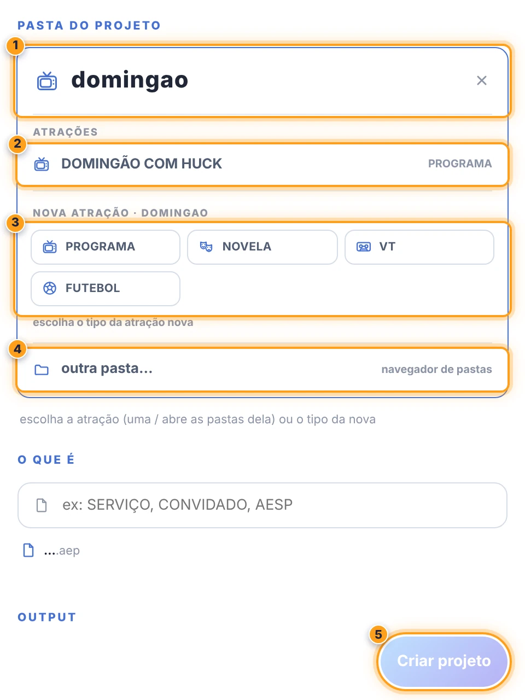

# 🎬 A CLAQUETE · projeto

[← O PADEIRO](../README.md)

a janela **A CLAQUETE** cria um projeto novo a partir da **atração**: acha a atração e a pasta dela, cria a estrutura (`01_PROJETOS`, `02_ARQUIVOS`, `03_SAIDA`, `04_REFS`) e salva o `.aep` com o nome padronizado. depois de criado, a mesma janela vira um **editor** simples da atração, do o que é, do designer e das pastas, e mostra **quem criou e quem salvou** o projeto.

> 🚩 *o collect dos arquivos é do botão **coletar** da barra ([abaixo](#-coletar-os-arquivos)).*

abra pela gaveta **projeto** da barra, no botão **criar** (`◖`); quando o projeto aberto já tem os dados do padeiro, o botão se chama **alterar** e abre o editor. o `◗ clique direito` no mesmo botão salva o projeto (se ainda não foi criado pela janela, abre a janela).

<table><tr><td align="center"> atração nova: o texto digitado é o nome; o tipo no começo só marca o chip</td><td align="center"> os dados do projeto: quem criou, quem salvou e as pastas</td></tr></table>

<table><tr><td></td><td></td></tr></table>

| | projeto novo | | o editor (projeto já criado) |
| :---: | --- | :---: | --- |
| ❶ | **o caminho**: a atração e, com barras, as pastas dela | ❶ | **atração** (com a mesma busca e as barras) |
| ❷ | uma **atração achada** (pasta e output já conhecidos) | ❷ | **designer** (a sigla) |
| ❸ | **nova atração**: os chips dos tipos (um clique cria nela, com o nome digitado) | ❸ | **o que é** (ex: SERVIÇO, CONVIDADO, AESP) |
| ❹ | **outra pasta…**: o navegador de pastas | ❹ | o **nome do .aep** (o último nível + o que é) |
| ❺ | **Criar projeto** | ❺ | **trocar a pasta**: leva o .aep e a estrutura |
| | | ❻ | **pasta de output** |
| | | ❼ | **Salvar** |

## 📍 projeto novo, numa tela

tudo numa tela só: o **caminho** do projeto, o **o que é** e o **output**. quem acha a atração faz: digitar → `Tab` (completa com a primeira) → (as pastas, se quiser) → `Enter` → digitar o que é → `Enter`. a janela abre com 440 × 780 px (cabe a tela inteira, com a lista do output aberta) e não encolhe abaixo de 380 × 580 (o caminho, o o que é e o output sempre à vista); o que não couber rola, e o botão fica no rodapé. *(os tamanhos vêm do manifest: valem depois de rodar o instalador de novo.)*

> 🚩 *teclado:* nas listas, `↓` / `↑` andam pelas opções e `Enter` escolhe a marcada; `Tab` completa com a marcada ou, sem nenhuma, com a primeira (a atração, ou a pasta do nível). o `Tab` logo depois de digitar espera a busca responder antes de completar; sem nenhuma atração achada, vai para a primeira opção da lista (**nova atração**). a opção marcada pelas setas sobe quando fica atrás do rodapé.

1. **PASTA DO PROJETO** → o caminho, digitado como uma pasta: `ATRAÇÃO/PASTA/PASTA…`.
   - **a atração** → digite (ex: `DOMINGÃO`). enquanto você digita, o padeiro procura no índice da [busca](acessorista.md) (o mesmo do acessorista, na memória) e lista as atrações (até 4; com mais, continue digitando). **clique na atração (ou `Tab`) para entrar nela**: o campo ganha o nome e a barra, e a lista mostra as pastas dela. sem pastas dentro (um filme novo, por exemplo), a barra sai e o campo recolhe. `Enter` sem barra entra na atração de nome igual ou, sem nenhuma, fica com o **nome digitado**, como **nova atração**.
   - **as pastas** → a cada barra, a lista mostra as **pastas daquele nível** (quadros, especiais, semanas, o que tiver), lidas na hora; o texto depois da barra filtra. **clicar na própria atração (a primeira linha, em destaque) fica só com ela**, sem pasta abaixo, e segue para o o que é; para trocar de atração, o **×** do campo. com o mouse numa linha, o caminho dela aparece na linha do destino, embaixo da lista. clique numa pasta para descer nela; numa pasta sem pastas dentro, a barra sai e o campo recolhe (segue para o o que é). clicar fora do campo também recolhe. no fim da lista, **nova pasta** com o nome digitado. `Enter` fica com o caminho como está escrito: o que já existe é usado (sem diferenciar acentos e maiúsculas) e o resto é **novo**, criado junto com o projeto. ficam de fora as da estrutura (`01_PROJETOS`, `02_ARQUIVOS`…), as de autosave e logs, as sem nome (`New Folder`, `untitled folder`…) e as `OLD`, `NÃO VALE` e `NÃO USAR`.
   - **a pasta da atração achada** → a atração que já tem pasta de projeto no índice fica **na pasta dela**, como está (`BBB/BBB 2026`), no **ano do projeto** (abaixo); o tipo só dá o ícone e, quando o índice não traz output, a pasta de output. a atração do índice **sem** pasta de projeto vai para o **caminho do tipo** ([configuração > projeto](producoes.md#-projeto)): `DOMINGÃO COM HUCK` → `…/PROGRAMAS/DOMINGAO COM HUCK/2027`. o tipo sai das pastas da atração (`…/ESPORTES/FUTEBOL/…` → FUTEBOL); sem um que sirva, escolher a atração abre a **nova atração** com o nome dela, para escolher o tipo. a pasta que é a própria pasta de um tipo (`INSTITUCIONAL/VTs`, onde os VTs ficavam juntos) não aparece como atração.
   - **o ano do projeto** → o botão do **ano** (o calendário, ao lado do campo) troca o ano com um clique: o de agora, o que vem, o anterior. vale para o `{ano}` dos tipos e para o ano das pastas que já existem (`BBB 2026` → `BBB 2027`): é para o que começa antes da virada, como o BBB. fora do ano de agora, o botão fica em destaque.
   - **data na claquete** → a barra entre dois números não separa pastas: `QUEM AMA 17/11` fica junto, como uma atração só.
   - **quadros** → logo abaixo da atração (`DOMINGÃO COM HUCK/`), a lista mostra os **quadros** que já existem e, em cinza, **exemplos do que já existe**: os quadros que o padeiro já criou na mesma atração em outros anos (as pastas com a estrutura dele dentro, como `01_PROJETOS`), sem repetir. escolher um exemplo cria o quadro com o mesmo nome. as pastas antigas da atração ficam de fora.
   - embaixo do campo, a linha do **destino**: a pasta do projeto com os níveis em destaque e a de projetos dentro dela.
   - **como acha** → pelo nome completo (o nome ou um *pattern* da atração é o começo do que foi digitado: *MAIS VOCE* para `MAIS VOCE 30 10`) ou pelo nome em parte, palavra a palavra (cada palavra digitada é uma palavra do nome, na ordem; só a última, ou a que vem antes de um número, pode estar pela metade: `la na minha` → *Lá na Minha Terra*; `GREP 6 11` → *G REPORTER*), a partir de 3 letras. quando a completa acha, as parciais ficam de fora.
   - **nova atração** → embaixo da lista, os **tipos de projeto** da [configuração > projeto](producoes.md#-projeto) aparecem como **chips**, cada uma com o seu ícone: um clique cria a atração nova **direto no tipo**, com o texto digitado como nome. com o mouse num chip, a linha embaixo mostra o caminho que ele dá (ex: `…/SHOWS/{atracao}/{ano}` já preenchido).
     - **o nome é sempre o texto digitado**, inteiro. o tipo escrito no começo (o nome dele ou o plural, com mais alguma palavra depois) só **marca o chip**, que vem primeiro: `vt reunião` → a atração `VT REUNIAO` no tipo VT; `novela guerreiros` → `NOVELA GUERREIROS` em NOVELA. `Enter` cria no tipo marcado.
     - **tipo fixo** → o tipo sem `{atracao}` no caminho é a própria atração: digitar o nome dela (`mood`) leva direto para a pasta que o caminho dá (MOOD MENSAL: a do próximo mês; CARNAVAL: `CARNAVAL {ano}`). o `.aep` segue o campo **arquivo** do tipo, quando tem (`DEZEMBRO NA GLOBO.aep`).
     - **a pasta livre** → sem tipo que sirva, **outra pasta…** (abaixo); sem tipos de projeto na configuração, a janela pede a pasta da atração nova.
     - a pasta da atração nova é criada ao criar o projeto. se a pasta do tipo não pode ser acessada, o chip avisa na dica e o projeto vai para a pasta deste computador.
   - **outra pasta…** → o navegador de pastas: a pasta escolhida vira o começo do caminho, como uma atração (`2026/`), e a barra mostra as pastas dela.
   - **filmes** → a busca também acha os filmes do índice (o nome e o ano, com o ícone do tipo de filmes). a pasta do projeto vem do tipo de filmes da [configuração > projeto](producoes.md#-projeto) (o que se chama FILME ou FILMES), com a pasta da letra pelo token `{letra}` (`…/FILMES/TITULOS/_{letra}_/{atracao}` → `…/_M_/O MENTIROSO`); o output é o do índice. sem esse tipo, os filmes ficam de fora da lista. um filme que não está no índice é uma atração nova no tipo de filmes.
   - se a pasta do tipo não pode ser acessada (rede fora ou modo local), o projeto vai para a **pasta dos projetos** deste computador (`{tipo}/{atracao}`), com o aviso na prévia.
2. **O QUE É** → ex: `SERVIÇO`, `ELENCO`, `AESP`. o `.aep` é o **último nível do caminho** (ou a atração, sem pastas) + o que é, sem acentos e caracteres especiais, em maiúsculas: `DOMINGÃO/DANÇA DOS FAMOSOS` + `ABERTURA` → `DANCA DOS FAMOSOS ABERTURA.aep`; `MAIS VOCÊ` + `SERVIÇO` → `MAIS VOCE SERVICO.aep`. o nome muda enquanto você digita.
   - **tipo com `{o_que_e}`** → se o tipo de projeto usa o token no **arquivo** ou no **output** ([configuração > projeto](producoes.md#-projeto)), o o que é entra no lugar dele: o nome do `.aep` e a pasta de output mudam enquanto você digita.
   - **já na pasta** → uma linha com o último `.aep` alterado da pasta de projetos (`hoje 14:32 · +2`).
   - **nome repetido** → o aviso e as duas saídas ali mesmo: **abrir o existente** ou **salvar como … 2** (o padrão).
3. **OUTPUT** → embaixo, logo acima do rodapé (separado das pastas do projeto), um cartão com a pasta escolhida: a pasta de output da atração (do caminho de output do tipo, ou a do índice) em destaque e o caminho embaixo. **mudar** (ou o clique no cartão) abre o campo, que funciona como o do projeto: a lista mostra as subpastas, a barra desce, **nova pasta** cria uma no fim. de um clique: **pasta com o o que é** (`…/2026/SERVICO`), **outra pasta…** (o navegador de pastas) e **sem output** (não cria nem grava nada; dá para escolher depois, no editor). `Enter`, `Esc` ou sair do campo voltam para o cartão, com o escolhido (as pastas em negrito).
4. **Criar projeto** (ou `Enter` no o que é; o **o que é** é opcional) cria as pastas novas, a estrutura (`01_PROJETOS` com o `.aep`, `02_ARQUIVOS`, `03_SAIDA`, `04_REFS`…) e salva o `.aep`. no macOS, se o volume da rede do caminho (ex: `/Volumes/VFX`) não estiver montado, o padeiro monta antes, como o acessorista faz ao abrir uma pasta. `AUDIOS` e `DADOS` o [coletar](#-coletar-os-arquivos) cria quando o projeto usar áudio ou dados. criado o projeto, o botão vira **Criado**, a linha de baixo confirma o nome do `.aep` e a janela fecha sozinha (para editar depois, abra a janela de novo: ela vira o editor).

> 🚩 *obs:* se a pasta da atração já tem uma pasta de projetos (`01 PROJETOS`, `01PROJETOS`, `PROJETOS`…), ela é usada.

## 📍 dados gravados no projeto

os dados do padeiro ficam **no próprio projeto**, num grupo próprio dos metadados (XMP `padeiro:`):

| campo | exemplo | quem grava |
|---|---|---|
| `padeiro:atracao` | LÁ NA MINHA TERRA | janela projeto |
| `padeiro:quadro` | DANÇA DOS FAMOSOS/FINAL | janela projeto (opcional: as pastas abaixo da atração; o `.aep` é o último nível + o que é) |
| `padeiro:oQueE` | SERVIÇO | janela projeto |
| `padeiro:designer` | JBILLARD | janela projeto (quem criou) |
| `padeiro:pasta` | a raiz da estrutura | janela projeto |
| `padeiro:output` | a pasta de output | janela projeto; o template grava se faltar |
| `padeiro:criado` | 2026-11-05 | o primeiro que gravar |
| `padeiro:editores` | quem já salvou o projeto e o último dia de cada um (`USUARIO` e `2026-11-16`, um por linha) | cada salvamento (abaixo) |
| `padeiro:salvo` | o dia do último salvamento | cada salvamento |
| `padeiro:versao` | 1 | todos |

o nome do `.aep` (`dc:title`), o designer (`dc:creator`) e a data (`dc:date`) também ficam nos campos comuns, que aparecem nas informações do arquivo. o projeto **com os dados do padeiro** (bolinha verde) é o que tem a atração e está salvo na pasta dele.

**quem salvou** → todo projeto **com atração** guarda quem salvou e em que dia, uma linha por pessoa, com o último dia dela (o registro é por dia, não por salvamento):

- o **Criar projeto** e o **Salvar** da janela gravam na hora;
- o `Ctrl+S` e o salvamento que o After faz sozinho ao iniciar o render são notados pela barra logo depois (ela vê que o arquivo mudou) e entram no arquivo no salvamento seguinte;
- projeto sem atração (um `.aep` qualquer) não recebe nada.

**templates** → preencher ou importar um template **não** registra mais o template nem a produção no projeto (o projeto preenchido quase nunca é salvo; o uso dos templates vai para o [registro de uso](producoes.md#registro-de-uso-equipe)). só a pasta de output do template é gravada, quando o projeto ainda não tem uma. as fontes: o [coletar](#-coletar-os-arquivos) junta as do projeto na pasta de fontes da estrutura, e o botão **fontes** da barra instala as de lá ou as do [banco de fontes](fontes.md).

projeto de antes desta versão: os campos antigos (`dc:coverage`, `dc:relation`, `dc:publisher`, `dc:source`, `dc:identifier`) são lidos e, na próxima gravação, passam para os novos.

## 📍 editor

ao abrir a janela com um projeto criado por ela:

- **atração** e **designer** (bonequinho) → a atração é buscada como no projeto novo: digitar mostra as atrações logo abaixo, e a escolhida fica com o nome oficial e a pasta dela. o designer vazio vale o da [configuração > meu usuário](producoes.md#-meu-usuário) (por padrão, o usuário do computador, completo).
- **o que é** → embaixo, o nome do `.aep` (a atração + o que é) e, quando muda, o nome de hoje. um projeto antigo com o nome fora desse padrão fica com o nome dele até a atração ou o o que é mudarem.
- **pasta do projeto** → o caminho do projeto. o botão de pasta dentro do campo escolhe outra pasta.
- **salvo por** → embaixo, quem já salvou o projeto, o mais recente primeiro (`salvo por: TMARTA 16/11 · JMBILLARD 14/11`).
- **output** → embaixo, logo acima do rodapé (como no projeto novo): a pasta de output do projeto. o botão de pasta dentro do campo escolhe outra.
- **os dados do projeto** (o botão redondo com o **i**, no rodapé, antes do **⋯**) → uma tela só de leitura: o arquivo e onde está, a situação (**na pasta dele**, **fora da pasta** ou **sem os dados**), a atração, o o que é, quem criou e quando, quem salvou, a pasta do projeto e a de output. **copiar** leva tudo em texto (para colar no Teams); a seta volta para o editor.
- **Salvar** → grava os campos e salva o `.aep` **na pasta de projetos da estrutura, com o nome de baixo** (cria a pasta de projetos se faltar; as outras pastas da estrutura o [coletar](#-coletar-os-arquivos) cria quando precisar). com outro nome ou em outro lugar, o arquivo antigo continua onde estava e a janela avisa onde; senão, ela fecha.

**a estrutura do projeto** → com o campo do projeto vazio, a tela mostra, animada, as pastas que o projeto novo vai ter (as da [configuração > coletar](producoes.md)), num desenho decorativo: as pastas cheias, sem nada para clicar. digitando, ela sai e o resto da tela (o que é e output) entra no lugar.

**pastas abaixo da atração no editor** → o campo da atração aceita o caminho, como no projeto novo: `DOMINGÃO/DANÇA DOS FAMOSOS/FINAL`. a lista mostra as pastas de cada nível; `Enter` (ou Salvar) fica com o caminho digitado e troca a pasta do projeto e o nome do `.aep` (o último nível + o que é). as pastas ficam gravadas no projeto (`padeiro:quadro`).

**não achou a atração no editor?** → digitando a atração, a lista termina em '*começar projeto novo*': abre o fluxo do projeto novo com o nome digitado (a nova atração, o tipo e a pasta, como num projeto do zero). o botão redondo de **voltar** (a seta, no rodapé) volta para o editor sem mudar nada.

no editor, `Enter` na atração com a lista aberta fica com o **nome digitado** (para usar uma atração da lista, clique nela); `Enter` de novo salva.

**projeto já salvo, mas sem os dados do padeiro** (um `.aep` antigo, por exemplo) → a janela abre direto no editor. a busca roda sozinha com o nome do arquivo: a primeira atração achada já vem marcada (com a pasta dela) e o resto do nome vai para o **o que é**. sem nenhuma, fica o nome do arquivo e o aviso. confira e **Salvar**.

abrir outro projeto troca os dados da janela.

### bolinha na barra

o botão **criar / alterar** (na gaveta **projeto**) mostra uma bolinha; com a gaveta fechada, o botão **projeto** mostra a pior das bolinhas de dentro (projeto, fontes e coletar):

- 🟢 **verde** → o projeto aberto está salvo com os dados do padeiro, dentro da pasta dele.
- 🟠 **laranja** → falta algo, e a dica do botão diz o quê: **ainda sem atração** (o projeto não foi criado pela janela: clique para criar) ou **salvo fora da pasta dele** (ex: um "salvar como" na Área de Trabalho: o editor avisa e o **Salvar** leva o `.aep` de volta para a pasta).
- sem bolinha → projeto vazio (sem arquivo e sem itens).

## 📍 coletar os arquivos

o botão **coletar** da barra varre o projeto, copia as mídias usadas (vídeos, sequências de imagens, imagens, áudio, dados e fontes) para a estrutura do projeto, troca os caminhos para as cópias e salva o projeto. detalhes na [barra](../README.md#coletar).

## 📍 menu ⋯

- **novo projeto** → abre o fluxo do projeto novo, vazio (o botão de voltar, no rodapé, retorna ao editor).
- **abrir a pasta** → no Explorer / Finder.
- **ajuda / documentação** → esta página.
- **recarregar painel**
