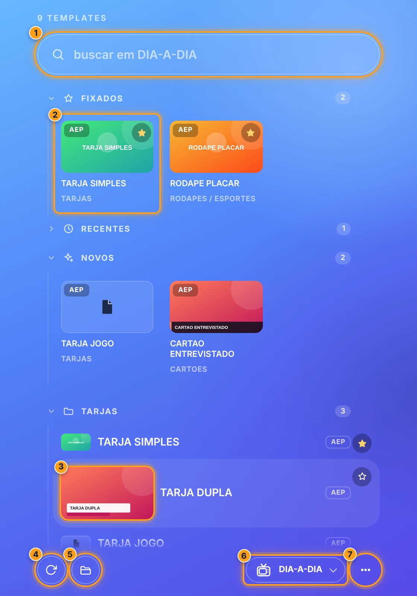
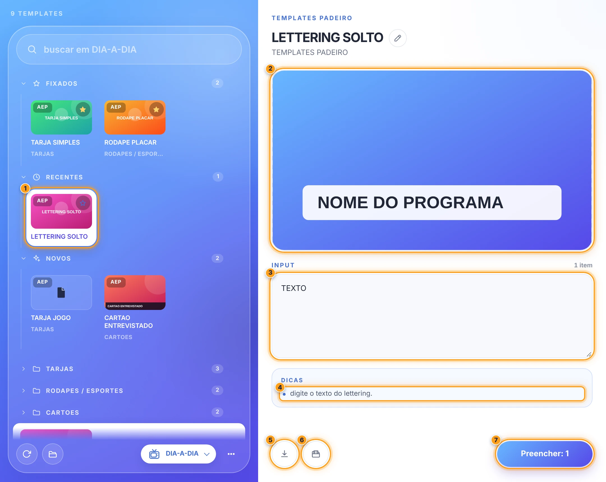
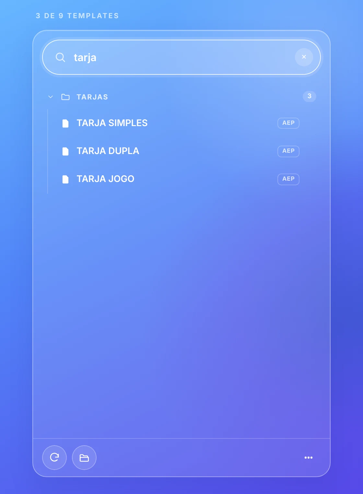
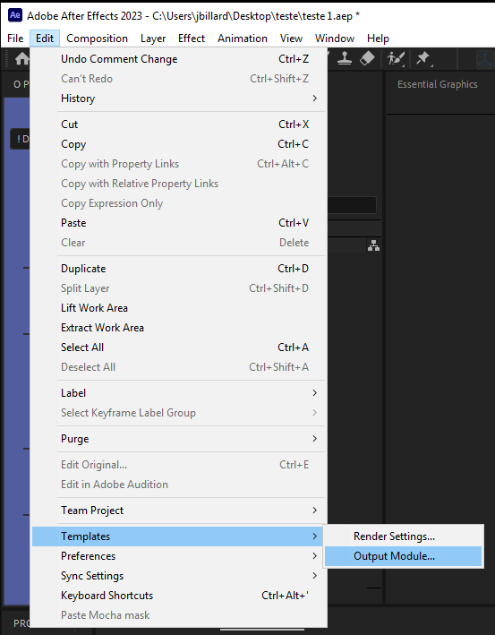
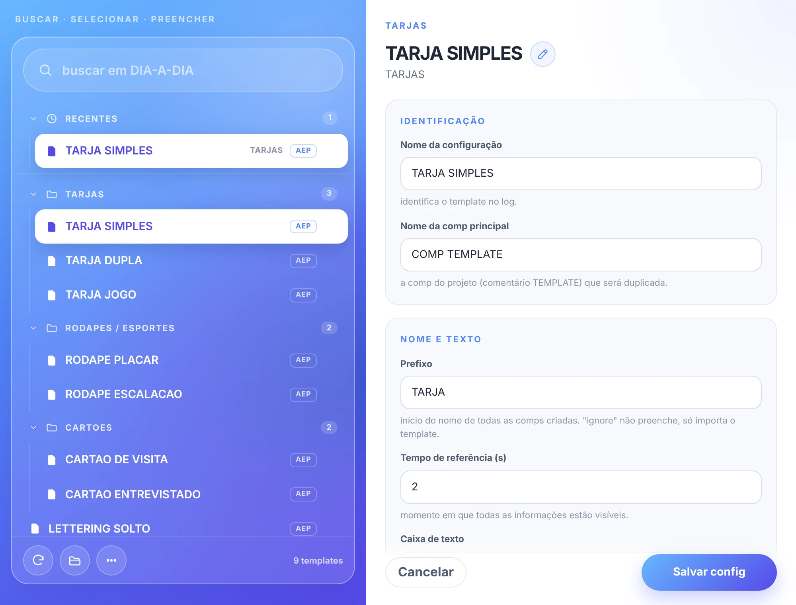

# 📄 O FORNINHO · templates

[← O PADEIRO](../README.md)

o painel **O FORNINHO**: buscar, selecionar e preencher templates, e criar a fila de render.

o painel de templates mostra os templates da produção escolhida no rodapé dele (à esquerda do **⋯**). a janela abre estreita, só com a busca, e se alarga sozinha em duas colunas quando você escolhe um template (e volta a estreitar quando a seleção é desfeita).

<p align="center"></p>

<table><tr><td width="40%"></td><td></td></tr></table>

| | a lista | | o template |
| :---: | --- | :---: | --- |
| ❶ | **busca**: filtra enquanto você digita | ❶ | o template **selecionado** |
| ❷ | **fixados e recentes** em cartões, com a prévia grande (a ★ fixa) | ❷ | **preview** (imagem ou vídeo) |
| ❸ | na lista, a **miniatura** cresce no template escolhido e ao passar o mouse | ❸ | **input**: uma linha por informação, linha vazia separa as versões |
| ❹ | **atualizar**: lê a pasta de novo | ❹ | **dicas** de preenchimento |
| ❺ | **abrir a pasta** de templates | ❺ | **importar** sem preencher |
| ❻ | **produção**: a pasta de templates mostrada | ❻ | **pasta de output** do template |
| ❼ | **⋯**: configuração, ajuda e recarregar | ❼ | **Preencher** (`Ctrl/Cmd+Enter`) |

**as prévias na lista** → cada template mostra a prévia dele, o `<template>_preview.png` que [A FORMA](criador.md) grava ao lado do `.aep` / `.aet`: na lista, uma miniatura pequena que cresce no template escolhido e ao passar o mouse; nos fixados e recentes, cartões em duas colunas, com a prévia grande. sem prévia, fica o ícone de arquivo. as imagens carregam só quando aparecem na lista e ficam guardadas pelo painel: a lista continua abrindo na hora.

1. `◖ clique esquerdo` em **templates**, na barra.
2. busque ou navegue pelas pastas.
3. selecione o template.
4. preencha o **input** seguindo as **dicas**.
5. clique em '*Preencher*' (ou `Ctrl/Cmd+Enter`).
6. escolha o template de output e clique em '*Criar fila de render*'.

### a lista

- **busca** → filtra enquanto você digita, sem diferenciar maiúsculas e acentos. `Enter` seleciona o primeiro template encontrado.
- **★ fixados / recentes** → atalhos no topo da lista (veja [fixados e recentes](#fixados-e-recentes)).
- **atualizar** → lê a pasta de templates de novo (com o loader).
- **lista na hora** → a janela guarda a última lista lida de cada produção (na pasta temp do computador). ao abrir, a lista aparece na hora e a pasta é relida em segundo plano (o ícone de atualizar gira): se algo mudou, a lista se atualiza sozinha.
- **abrir pasta** → abre a pasta do template selecionado (sem seleção, a pasta de templates da produção).
- **produção** (no rodapé, à esquerda do **⋯**) → escolhe a produção: a pasta de templates mostrada. a escolha vale para os outros painéis (e para o log). no meio de um preenchimento a troca espera.
- **⋯** (canto direito, embaixo) → configuração (produções, logs e drives), ajuda (esta página) e recarregar o painel.
- **total** (acima da busca) → quantos templates a produção tem (com uma busca, quantos foram encontrados).
- `◖ clique` no template selecionado (ou no fundo da lista, ou `Esc`) → desmarca o template.
- `◖ clique DUPLO` no template → importa o template para o projeto, sem preencher.

>  

> 🚩 *obs:*\
> • a lista mostra só os arquivos `.aep` / `.aet` e as pastas que têm templates. uma pasta com uma única subpasta aparece como `PASTA / SUBPASTA`.\
> • pastas de rede podem demorar: enquanto a lista é lida, o forninho mostra quantas pastas já foram lidas.\
> • fixados e recentes são de cada computador e de cada produção.

### fixados e recentes

no topo da lista, antes das pastas, ficam dois atalhos:

- **★ fixados** → passe o mouse em um template e clique na estrela para fixá-lo; clique de novo para desafixar. não há limite de fixados.
- **recentes** → os templates usados por último.
  - um template entra nos recentes quando você **preenche** (ao clicar em '*Preencher*', quando o template começa a ser importado) ou **importa** (duplo clique na lista ou o botão de importar, no rodapé). só selecionar não conta.
  - o último usado vai para o topo; se ele já estava na lista, só sobe (não repete).
  - o limite é de **5 templates**: quando entra o 6º, o mais antigo sai.
  - um template fixado não aparece nos recentes (não repete), então a seção pode mostrar menos de 5.
- **preset de render** → fixados e recentes lembram o último template de output usado em cada um: na próxima vez, ele já vem escolhido na fila de render (passe o mouse no template para ver qual). templates sem preset guardado usam o último preset usado em geral.
  - templates apagados ou renomeados na rede somem da seção.

> 🚩 *obs:*\
> • fixados e recentes são **de cada computador e de cada produção**: ficam em `O PADEIRO script/temp/template_lists.json`, na pasta de dados do usuário. a lista nunca zera sozinha; só some se esse arquivo for apagado.\
> • as duas seções começam abertas e podem ser recolhidas no título; as pastas da produção começam recolhidas.\
> • a busca fica sempre no topo e não é empurrada para baixo: fixados e recentes ficam abaixo dela. ao digitar, as duas seções somem e aparecem só os resultados.

### o template

- **preview** → a imagem `_preview.png` do template (transparências aparecem sobre um fundo xadrez). se existir um vídeo `_preview.webm` (ou `.mp4`), ele toca em loop e o mouse passa pelos quadros, como o thumbnail do Premiere.
- **input** → o texto que preenche o template. cada bloco separado por uma **linha vazia** vira uma comp (o contador mostra quantos itens o texto tem).
- **dicas** → como preencher esse template.
- **abrir output** (o botão redondo com a pastinha, no rodapé) → abre as pastas de output do template.
- **avisos** → com o template à vista, os avisos (erros de output, config salva, fontes) aparecem logo abaixo do preview, sem repetir mensagens iguais, e fecham no ×.
- **importar** (o botão redondo com a seta para baixo, no rodapé, antes do de output) → importa o template para o projeto, sem preencher.
- **✎ editar config** → abre o editor do arquivo de configuração (veja [editor de config](#editor-de-config)).

### fontes do template

ao selecionar um template, o padeiro confere se as fontes da pasta `FONTS` dele estão instaladas. se faltar alguma, um aviso aparece acima do input.

> 

- **instalar** (no aviso) → instala as fontes que faltam, ali mesmo. o resultado aparece no próprio aviso, que se fecha no ×.
- **preencher** (ou importar) com fontes faltando → segue normalmente, sem a janela '*Resolve Fonts*' do After Effects (as fontes que faltam são trocadas pela padrão).

> 🚩 *obs:*\
> • no macOS as fontes são copiadas para `~/Library/Fonts`; no Windows, instaladas por um script de PowerShell.\
> • se o After Effects ainda não mostrar uma fonte recém-instalada, reinicie-o.

### fila de render

> 

depois de preencher, o padeiro mostra cada comp criada e pede o **template de output** (os presets do After Effects). as saídas vão para as pastas de output do template: no volume montado (`VFX`, `VFX-1` … `VFX-5`; sem nenhum, o padeiro monta o compartilhamento), e a pasta que ainda não existe é criada no servidor. sem acesso (rede fora, sem permissão), a saída vai para a pasta de saída deste computador ([configuração > meu usuário](producoes.md)) e aparece o aviso `#PAD_019`. o preset já vem escolhido: o último usado neste template (se ele estiver nos fixados ou recentes), o último usado em geral ou, na primeira vez, o **H.264 de 15 Mbps** (o padrão do After Effects, em qualquer idioma).

- **criar fila de render** → adiciona as comps à fila com o output certo. com tudo certo, o painel de templates **fecha sozinho**.
- **concluir sem fila** → termina sem criar a fila. com tudo certo, o painel também **fecha sozinho**.

> 🚩 *obs:* com algum erro (um template que não preencheu, uma saída que não entrou na fila ou um erro no script do template), o painel fica aberto para mostrar o que aconteceu.

para criar um novo preset de output, acesse:\
`Edit` > `Templates` > `Output Module...`

> 

o padeiro executa as seguintes tarefas, em ordem:

1. importar o projeto do template.
2. duplicar a comp principal para cada item do input.
3. preencher os textos.
4. renomear as comps a partir do conteúdo (ou pelo layer [`script_template_name`](#o-nome-da-comp-pelo-layer-script_template_name)).
5. organizar o projeto no padrão da PROMO.
6. adicionar as comps à fila de render.
7. definir os caminhos de output.
8. rodar o script do template (`_script.js`), se existir ([abaixo](#script-do-template-_scriptjs)).

### o nome da comp pelo layer `script_template_name`

sem script nenhum, o template também pode decidir o nome das comps: o **último layer** da comp principal sendo um layer de **texto** chamado `script_template_name`, o texto dele vira o nome da comp. sem esse layer, o nome segue o padrão (`PREFIXO - INFORMAÇÕES SUFIXO`).

- o nome sai em maiúsculas e sem acentos.
- o padeiro lê o texto depois de preencher os layers editáveis: com uma **expressão** no texto do layer, o nome pode juntar as informações do jeito que o template quiser.
- vale também para o **renomear** da barra: as comps (`◖`) e as saídas de render (`◗`) com esse layer recebem o nome dele.
- deixe o layer como **guide layer** (ou com o olho desligado): ele está lá só para o nome, não aparece no render.
- com o nome vindo do layer, o sufixo das [variações de layout](criador.md#variações-de-layout) **não** entra sozinho: se precisar, a expressão monta (exemplo 3).

**exemplos** (a expressão vai no *Source Text* do layer `script_template_name`):

**1 · o nome com as informações em outra ordem**: o cargo antes do nome.

```js
"RDP - " + thisComp.layer("CARGO").text.sourceText + " " + thisComp.layer("NOME").text.sourceText
```
→ `RDP - APRESENTADORA ANA MARIA`

**2 · só a primeira linha de um texto de várias linhas**

```js
"VINHETA - " + thisComp.layer("TITULO").text.sourceText.split("\r")[0]
```
→ `VINHETA - PROXIMA` (de `PRÓXIMA` / `SEGUNDA`)

**3 · o lado da variação de layout no nome** (o menu `layout`, opção 1 = esquerda)

```js
var lado = thisComp.layer("CTRL").effect("layout")("Menu").value == 1 ? "ESQ" : "DIR";

"TARJA - " + thisComp.layer("NOME").text.sourceText + " " + lado
```
→ `TARJA - JOAO BOSCO ESQ` e `TARJA - JOAO BOSCO DIR`

**4 · um nome fixo com a informação que varia**: o mesmo nome para todas as versões, mudando só o número.

```js
"PLACAR RODADA " + thisComp.layer("RODADA").text.sourceText
```
→ `PLACAR RODADA 12`

### script do template (`_script.js`)

um template pode ter um script ao lado dele, com o mesmo nome: `RODAPE CONVIDADO.aet` → `RODAPE CONVIDADO_script.js`. o padeiro roda esse script **no fim do preenchimento**, depois de criar e organizar as comps e montar a fila de render (ou de concluir sem fila). serve para o que é específico de um template: mexer num efeito a partir do texto, mudar a cor de um label, ajustar a saída de render, ou fazer o preenchimento inteiro de um jeito próprio.

- o script roda dentro do After Effects, em **ExtendScript** (JavaScript antigo, ES3: `var`, `function`, sem `let`, `const`, arrow functions ou template strings), com acesso a tudo do After Effects (`app`, `app.project`…).
- um erro no script aparece no painel com o código `#PAD_021`; o preenchimento fica feito, e o painel fica aberto para mostrar o erro.
- o padeiro avisa no painel quando o script rodou: '*script do template executado: …*'.

#### as variáveis

| variável | o que tem | exemplo |
| --- | --- | --- |
| `templateData` | a configuração do template (o `_config.json`, já com os valores padrão do que faltar) | `templateData.configName` → `'CONVIDADO'` |
| `inputTextArray` | o input do painel, uma posição por **versão** (separadas por linha vazia), já na caixa do template | `['ANA MARIA\nAPRESENTADORA', 'JOÃO\nCONVIDADO']` |
| `newCompsArray` | as comps criadas, na ordem do preenchimento (cada versão × cada variação de layout) | `newCompsArray[0].name` → `'RDP - ANA MARIA APRESENTADORA'` |
| `newOutputsArray` | os módulos de output criados na fila de render (um por comp e pasta de output). **vazio** quando o preenchimento termina sem fila | `newOutputsArray[0].file` |

**`templateData`** tem os campos do `_config.json`:

| campo | o que é |
| --- | --- |
| `configName` | o que é (ex: `'CONVIDADO'`) |
| `atracao` | a atração: `{ name, path, out }` |
| `compName` | o nome da comp principal do template |
| `prefix` | o prefixo do nome das comps (ex: `'RDP'`); com `ignore` no prefixo, o padeiro não duplica nem preenche nada (veja o exemplo 5) |
| `refTime` | o tempo de referência, em segundos (o frame do preview) |
| `textCase` | a caixa: `'upperCase'`, `'lowerCase'`, `'titleCase'` ou `'freeCase'` |
| `separator` | o separador de informações (`'\n'` = quebra de linha) |
| `inputLayers` | os layers editáveis: `[{ layerIndex, method }]` (`method`: `'textContent'` ou `'layerName'`) |
| `inputFx` | as variações de layout, se houver: `{ layerIndex, fxName, optionIndex, options, kind }` |
| `exemple` / `tip` | o exemplo de preenchimento e as dicas |
| `importPath` / `outputPath` | a pasta de mídias e as pastas de output (`outputPath` é uma lista) |

> 🚩 *obs:*\
> • para separar as informações de uma versão, use o mesmo separador do template: `inputTextArray[0].split(templateData.separator == '\n' ? /[\n\r]/ : templateData.separator)`.\
> • com variações de layout, `newCompsArray` tem uma comp por versão **e** por opção: com 2 versões e as opções `E` e `D`, são 4 comps (versão 1 E, versão 1 D, versão 2 E, versão 2 D).\
> • as variáveis são as mesmas do padeiro antigo (v1): os scripts que já existem continuam funcionando.

#### exemplos

**1 · a cor do label e um comentário nas comps criadas**

```js
for (var i = 0; i < newCompsArray.length; i++) {
	newCompsArray[i].label = 9; // verde
	newCompsArray[i].comment = 'EXPORTAR · ' + templateData.configName;
}
```

**2 · desligar o fundo quando a 2ª informação vem vazia** (ex: só o nome, sem o cargo)

```js
var sep = templateData.separator == '\n' ? /[\n\r]/ : templateData.separator;
var porVersao = newCompsArray.length / inputTextArray.length; // as variações de layout

for (var i = 0; i < newCompsArray.length; i++) {
	var infos = inputTextArray[Math.floor(i / porVersao)].split(sep);
	var fundo = newCompsArray[i].layer('FUNDO CARGO');

	if (fundo && (infos.length < 2 || infos[1].replace(/\s/g, '') == '')) fundo.enabled = false;
}
```

**3 · o tamanho do texto pelo número de letras** (nome longo fica menor)

```js
for (var i = 0; i < newCompsArray.length; i++) {
	var layer = newCompsArray[i].layer(templateData.inputLayers[0].layerIndex);
	var doc = layer.property('ADBE Text Properties').property('ADBE Text Document').value;

	if (doc.text.length > 24) {
		doc.fontSize = doc.fontSize * 0.8;
		layer.property('ADBE Text Properties').property('ADBE Text Document').setValue(doc);
	}
}
```

**4 · a saída de render com a data no nome do arquivo**

```js
var d = new Date();
var data = d.getFullYear() + ('0' + (d.getMonth() + 1)).slice(-2) + ('0' + d.getDate()).slice(-2);

for (var i = 0; i < newOutputsArray.length; i++) {
	var om = newOutputsArray[i];
	var nome = om.file.name.replace(/(\.[^.]+)$/, '_' + data + '$1');

	om.file = new File(om.file.parent.fsName + '/' + nome);
}
```

**5 · um template que se preenche sozinho** (prefixo com `ignore`)

com `ignore` no prefixo, o padeiro importa o template e roda o script, sem duplicar nem preencher: o script faz tudo, com o input do painel. nesse caso, `newCompsArray` tem só a comp principal do template (é ela que entra na fila de render, se houver fila).

```js
var base = newCompsArray[0]; // a comp principal do template

for (var v = 0; v < inputTextArray.length; v++) {
	var comp = base.duplicate();
	var linhas = inputTextArray[v].split(/[\n\r]/);

	comp.name = 'PLACAR - ' + linhas.join(' ');
	comp.layer('TIME A').property('ADBE Text Properties').property('ADBE Text Document').setValue(linhas[0]);
	comp.layer('TIME B').property('ADBE Text Properties').property('ADBE Text Document').setValue(linhas[1] || '');
}
```

### editor de config

> 

o lápis ao lado do nome do template abre um formulário para o `_config.json`: atração (a mesma busca do [criador](criador.md), obrigatória), o que é, comp principal, prefixo, tempo de referência, caixa de texto, separador, exemplo, dicas, layers editáveis (com a ordem), variações de layout (`inputFx`) e pastas de import e output. em um template sem config, o mesmo botão cria o arquivo.

> 🚩 *obs:*\
> • o formulário mostra o nome final da comp com o exemplo e confere tudo antes de salvar.\
> • chaves do arquivo que o formulário não conhece são preservadas.\
> • ao salvar, o aviso aparece acima do input (no mesmo lugar do aviso das fontes), com o caminho do arquivo relativo à pasta de templates.

<br>

---

<br>

## 📍 teclado

| tecla | o que faz |
| --- | --- |
| `↓` (na busca) | vai para o primeiro item da lista |
| `↑` `↓` | andam na lista; `↑` no primeiro item volta para a busca |
| `←` `→` | fecham e abrem as pastas (na pasta aberta, `→` entra nela) |
| `Enter` | seleciona o template e leva para o input; na busca, seleciona o primeiro encontrado |
| `Ctrl/Cmd+Enter` | preenche |
| `Ctrl/Cmd+Z` (no texto) | desfaz (inclusive o exemplo do template que substituiu o texto) |
| `Ctrl/Cmd+Shift+Z` ou `Ctrl+Y` (no texto) | refaz |
| `Esc` | no input, volta para a lista; na lista, desmarca o template; na busca, limpa |
| `Ctrl/Cmd+F` | foca a busca |
| letras | com a lista em foco, vão para a busca |

<br>

---

<br>

## 🚨 atenção!

`CONFIRA SEMPRE AS COMPOSIÇÕES CRIADAS, SEU CONTEÚDO E O CAMINHO DO OUTPUT!`

os layouts dos templates podem variar para exibir ou omitir informações, então o resultado final pode ficar diferente do preview.

> 📋 *exemplo:*\
> as comps criadas podem ter layers omitidos por falta de conteúdo ou elementos com cores diferentes das do preview.

cada template deve ter uma imagem com o **mesmo nome exato** do template seguido de '*_preview.png*' e um arquivo de configuração '*_config.json*'.

> 📋 *exemplo:*\
> um template *"FOTO_CONVIDADO.aet"* deve estar acompanhado de *"FOTO_CONVIDADO_preview.png"* e *"FOTO_CONVIDADO_config.json"*.

sem um caminho de output (ou se a pasta não existir) e sem separador, valem os padrões internos:

> • **output padrão** → '*~/Desktop*'.\
> • **separador padrão** → '*---*'.

a quebra de linha '*\n*' também pode ser o separador: útil para dividir a mesma informação em layers com formatações diferentes.

> 📋 *exemplo:*\
> o nome *"Lima\nDuarte"*, em duas linhas, com *"Lima"* em uma fonte light e *"Duarte"* em uma fonte bold.

<br>

---

<br>

## ✨ dicas

a menos que o template use a caixa de texto '**livre**', não se preocupe com **maiúsculas** e **minúsculas**: o padeiro converte o texto.

> 📋 *exemplo:*\
> "*cauã raymond*", "*CAUà RAYMOND*" ou "*cAuà raYMOnd*" viram "*Cauã Raymond*" em um template com '*titleCase*'.

um `◖ clique DUPLO` em qualquer template da lista importa o template na hora, para editar manualmente.

templates sem config (ou sem layers editáveis) não podem ser preenchidos pelo input, mas ainda podem ser **importados** e **preenchidos manualmente** no After Effects.
