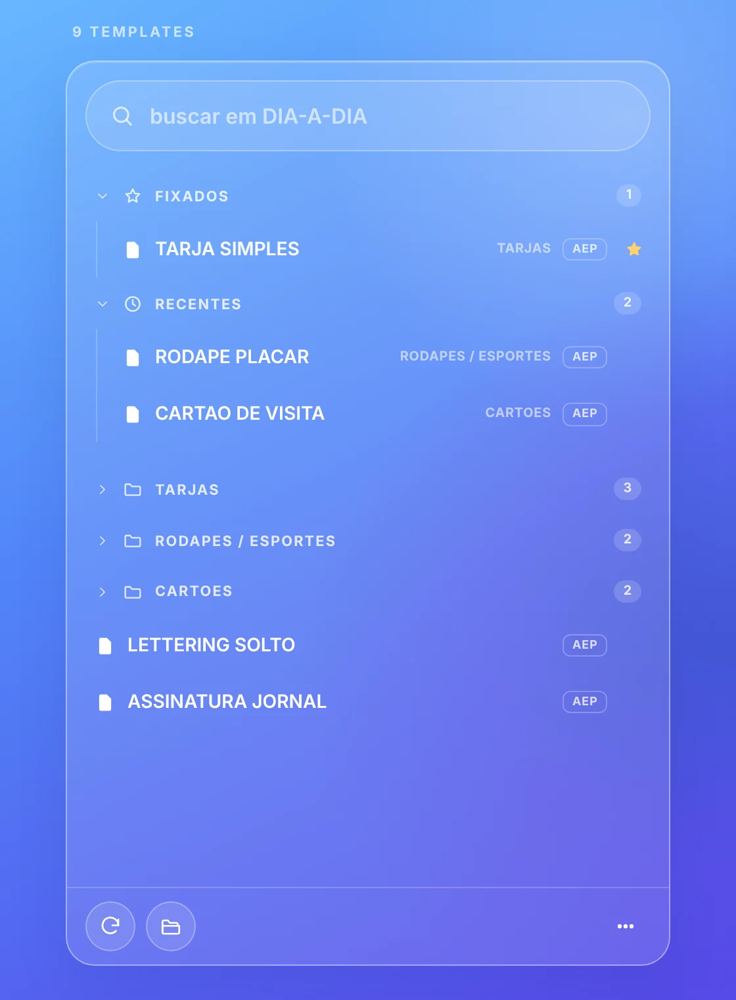
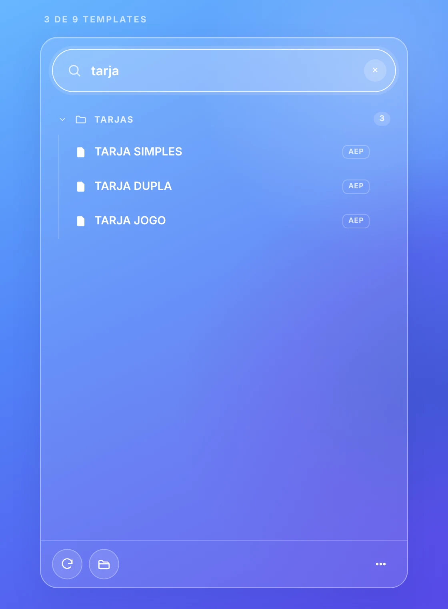
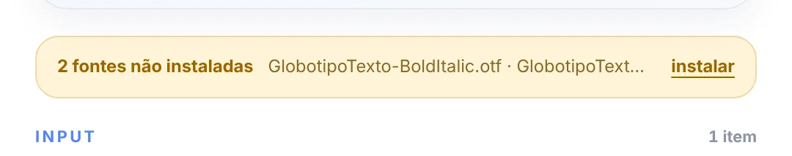
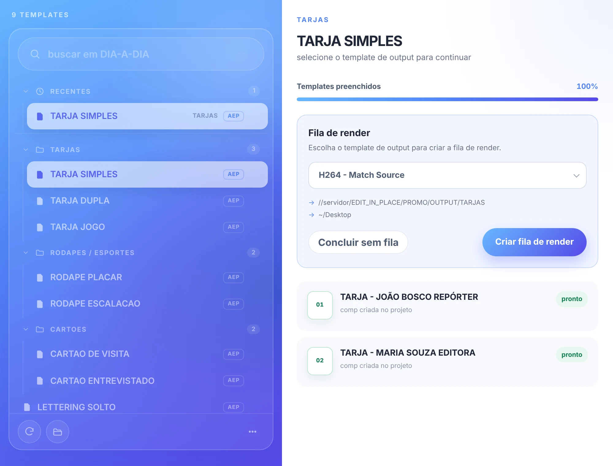
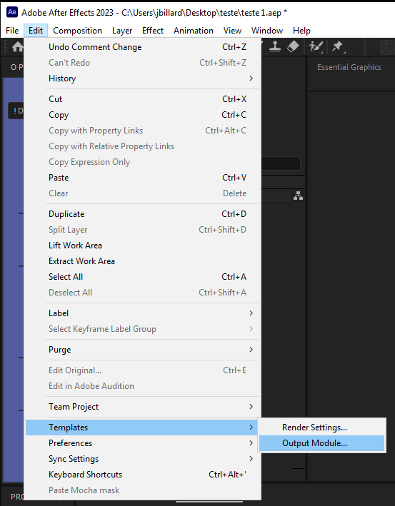
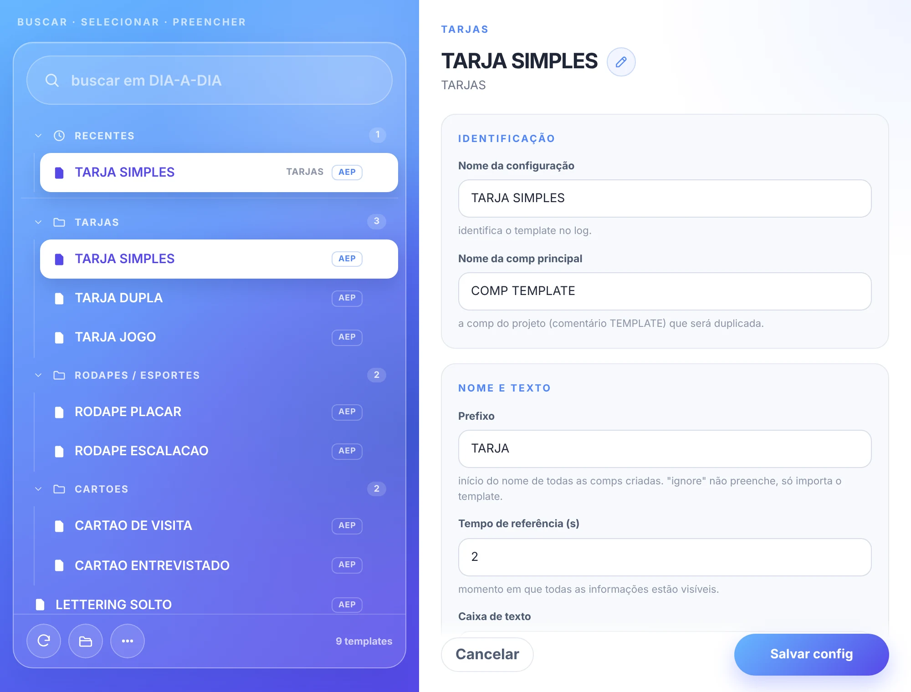

# 📄 templates

[← O PADEIRO](../README.md)

o painel **O PADEIRO templates**: buscar, selecionar e preencher templates, e criar a fila de render.

o painel de templates mostra os templates da produção escolhida na barra. a janela abre estreita, só com a busca, e se alarga sozinha em duas colunas quando você escolhe um template (e volta a estreitar quando a seleção é desfeita).

> 📟 *lista de templates:*
>
> 

1. `◖ clique esquerdo` em **templates**, na barra.
2. busque ou navegue pelas pastas.
3. selecione o template.
4. preencha o **input** seguindo as **dicas**.
5. clique em '*Preencher*' (ou `Ctrl/Cmd+Enter`).
6. escolha o template de output e clique em '*Criar fila de render*'.

> 📟 *template selecionado:*
>
> 

### a lista

- **busca** → filtra enquanto você digita, sem diferenciar maiúsculas e acentos. `Enter` seleciona o primeiro template encontrado.
- **★ fixados / recentes** → atalhos no topo da lista (veja [fixados e recentes](#fixados-e-recentes)).
- **atualizar** → lê a pasta de templates de novo.
- **abrir pasta** → abre a pasta do template selecionado (sem seleção, a pasta de templates da produção).
- **⋯** (canto direito, embaixo) → ajuda (esta página) e recarregar o painel.
- **total** (acima da busca) → quantos templates a produção tem (com uma busca, quantos foram encontrados).
- `◖ clique` no template selecionado (ou no fundo da lista, ou `Esc`) → desmarca o template.
- `◖ clique DUPLO` no template → importa o template para o projeto, sem preencher.

>  

> 🚩 *obs:*\
> • a lista mostra só os arquivos `.aep` / `.aet` e as pastas que têm templates. uma pasta com uma única subpasta aparece como `PASTA / SUBPASTA`.\
> • pastas de rede podem demorar: enquanto a lista é lida, o forninho mostra quantas pastas já foram lidas.\
> • fixados e recentes são de cada computador e de cada produção.

### fixados e recentes

no topo da lista, antes das pastas, ficam dois atalhos:

- **★ fixados** → passe o mouse em um template e clique na estrela para fixá-lo; clique de novo para desafixar. não há limite de fixados.
- **recentes** → os templates usados por último.
  - um template entra nos recentes quando você **preenche** (ao clicar em '*Preencher*', quando o template começa a ser importado) ou **importa** (duplo clique na lista ou '*Importar template*'). só selecionar não conta.
  - o último usado vai para o topo; se ele já estava na lista, só sobe (não repete).
  - o limite é de **5 templates**: quando entra o 6º, o mais antigo sai.
  - um template fixado não aparece nos recentes (não repete), então a seção pode mostrar menos de 5.
  - templates apagados ou renomeados na rede somem da seção.

> 🚩 *obs:*\
> • fixados e recentes são **de cada computador e de cada produção**: ficam em `O PADEIRO script/temp/template_lists.json`, na pasta de dados do usuário. a lista nunca zera sozinha; só some se esse arquivo for apagado.\
> • as duas seções começam abertas e podem ser recolhidas no título; as pastas da produção começam recolhidas.\
> • a busca fica sempre no topo e não é empurrada para baixo: fixados e recentes ficam abaixo dela. ao digitar, as duas seções somem e aparecem só os resultados.

### o template

- **preview** → a imagem `_preview.png` do template (transparências aparecem sobre um fundo xadrez). se existir um vídeo `_preview.webm` (ou `.mp4`), ele toca em loop e o mouse passa pelos quadros, como o thumbnail do Premiere.
- **input** → o texto que preenche o template. cada bloco separado por uma **linha vazia** vira uma comp (o contador mostra quantos itens o texto tem).
- **dicas** → como preencher esse template.
- **abrir output** → abre as pastas de output do template.
- **avisos** → com o template à vista, os avisos (erros de output, config salva, fontes) aparecem logo abaixo do preview, sem repetir mensagens iguais, e fecham no ×.
- **importar template** → importa o template para o projeto, sem preencher.
- **✎ editar config** → abre o editor do arquivo de configuração (veja [editor de config](#editor-de-config)).

### fontes do template

ao selecionar um template, o padeiro confere se as fontes da pasta `FONTS` dele estão instaladas. se faltar alguma, um aviso aparece acima do input.

> 

- **instalar** (no aviso) → instala as fontes que faltam, ali mesmo. o resultado aparece no próprio aviso, que se fecha no ×.
- **preencher** (ou importar) com fontes faltando → segue normalmente, sem a janela '*Resolve Fonts*' do After Effects (as fontes que faltam são trocadas pela padrão).

> 🚩 *obs:*\
> • no macOS as fontes são copiadas para `~/Library/Fonts`; no Windows, instaladas por um script de PowerShell.\
> • se o After Effects ainda não mostrar uma fonte recém-instalada, reinicie-o.

### fila de render

> 

depois de preencher, o padeiro mostra cada comp criada e pede o **template de output** (os presets do After Effects). as saídas vão para as pastas de output do template.

- **criar fila de render** → adiciona as comps à fila com o output certo. com tudo certo, o painel de templates **fecha sozinho**.
- **concluir sem fila** → termina sem criar a fila.

para criar um novo preset de output, acesse:\
`Edit` > `Templates` > `Output Module...`

> 

o padeiro executa as seguintes tarefas, em ordem:

1. importar o projeto do template.
2. duplicar a comp principal para cada item do input.
3. preencher os textos.
4. renomear as comps a partir do conteúdo.
5. organizar o projeto no padrão da PROMO.
6. adicionar as comps à fila de render.
7. definir os caminhos de output.
8. rodar o script do template (`_script.js`), se existir.

### editor de config

> 

o lápis ao lado do nome do template abre um formulário para o `_config.json`: nome, comp principal, prefixo, tempo de referência, caixa de texto, separador, exemplo, dicas, layers editáveis (com a ordem), variações de layout (`inputFx`) e pastas de import e output. em um template sem config, o mesmo botão cria o arquivo.

> 🚩 *obs:*\
> • o formulário mostra o nome final da comp com o exemplo e confere tudo antes de salvar.\
> • chaves do arquivo que o formulário não conhece são preservadas.\
> • ao salvar, o aviso aparece acima do input (no mesmo lugar do aviso das fontes), com o caminho do arquivo relativo à pasta de templates.

 

---

 

## 📍 teclado

| tecla | o que faz |
| --- | --- |
| `↓` (na busca) | vai para o primeiro item da lista |
| `↑` `↓` | andam na lista; `↑` no primeiro item volta para a busca |
| `←` `→` | fecham e abrem as pastas (na pasta aberta, `→` entra nela) |
| `Enter` | seleciona o template e leva para o input; na busca, seleciona o primeiro encontrado |
| `Ctrl/Cmd+Enter` | preenche |
| `Esc` | no input, volta para a lista; na lista, desmarca o template; na busca, limpa |
| `Ctrl/Cmd+F` | foca a busca |
| letras | com a lista em foco, vão para a busca |

 

---

 

## 🚨 atenção!

`CONFIRA SEMPRE AS COMPOSIÇÕES CRIADAS, SEU CONTEÚDO E O CAMINHO DO OUTPUT!`

os layouts dos templates podem variar para exibir ou omitir informações, então o resultado final pode ficar diferente do preview.

> 📋 *exemplo:*\
> as comps criadas podem ter layers omitidos por falta de conteúdo ou elementos com cores diferentes das do preview.

cada template deve ter uma imagem com o **mesmo nome exato** do template seguido de '*_preview.png*' e um arquivo de configuração '*_config.json*'.

> 📋 *exemplo:*\
> um template *"FOTO_CONVIDADO.aet"* deve estar acompanhado de *"FOTO_CONVIDADO_preview.png"* e *"FOTO_CONVIDADO_config.json"*.

sem um caminho de output (ou se a pasta não existir) e sem separador, valem os padrões internos:

> • **output padrão** → '*~/Desktop*'.\
> • **separador padrão** → '*---*'.

a quebra de linha '*\n*' também pode ser o separador: útil para dividir a mesma informação em layers com formatações diferentes.

> 📋 *exemplo:*\
> o nome *"Lima\nDuarte"*, em duas linhas, com *"Lima"* em uma fonte light e *"Duarte"* em uma fonte bold.

 

---

 

## ✨ dicas

a menos que o template use a caixa de texto '**livre**', não se preocupe com **maiúsculas** e **minúsculas**: o padeiro converte o texto.

> 📋 *exemplo:*\
> "*cauã raymond*", "*CAUà RAYMOND*" ou "*cAuà raYMOnd*" viram "*Cauã Raymond*" em um template com '*titleCase*'.

um `◖ clique DUPLO` em qualquer template da lista importa o template na hora, para editar manualmente.

templates sem config (ou sem layers editáveis) não podem ser preenchidos pelo input, mas ainda podem ser **importados** e **preenchidos manualmente** no After Effects.
