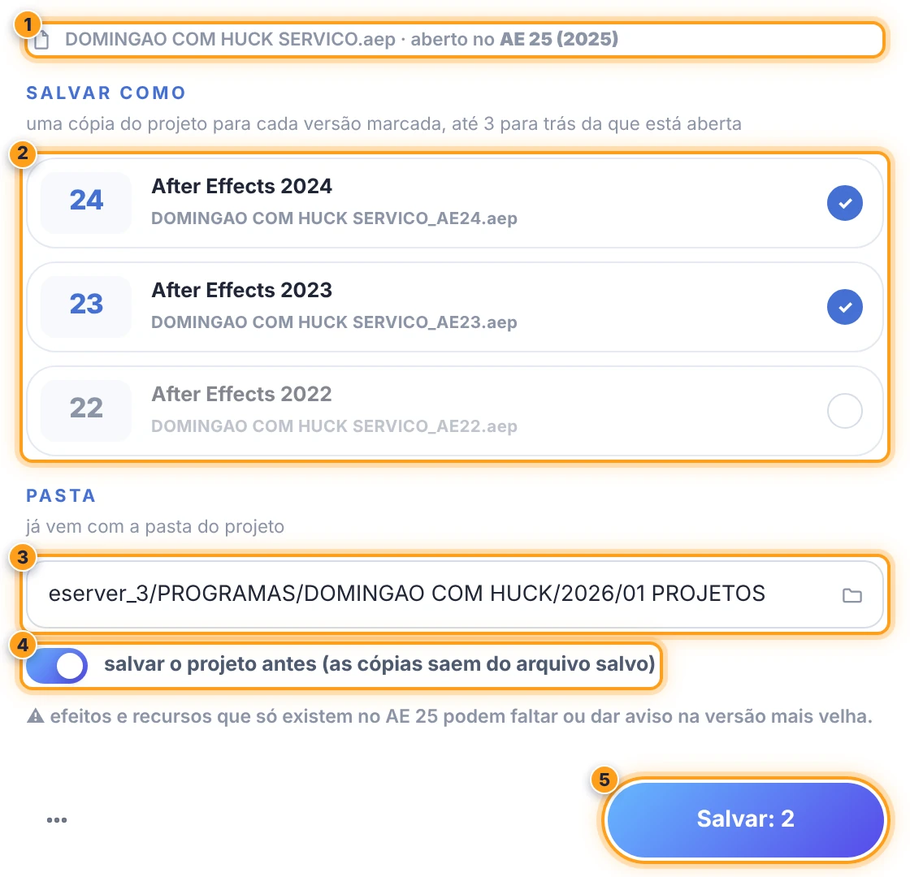

# 🕰️ O VERSIONADOR · versões do After

[← O PADEIRO](../README.md)

a ferramenta **importar** da barra: traz um projeto do After de qualquer versão para o projeto aberto e salva o projeto aberto em versões mais velhas do After.

| | |
| --- | --- |
| `◖ clique esquerdo` em **importar** | escolha um projeto do After (`.aep` ou `.aet`): ele é importado no projeto aberto, **de qualquer versão** |
| `◗ clique direito` em **importar** | abre a janela **O VERSIONADOR**: salvar o projeto aberto em versões mais velhas do After |

 

## 📍 importar de qualquer versão

`◖ clique esquerdo` em **importar** → escolha o arquivo. se ele é de uma versão mais nova do After (ex.: salvo no 2026 e você está no 2025), o padeiro faz antes uma cópia na versão que está rodando, na pasta temporária, e importa a cópia. da mesma versão ou mais velho, importa direto. a pasta que a importação cria no painel Project leva o nome do arquivo original.

 

## 📍 salvar em versões mais velhas (a janela)

| | | |
| :---: | --- | --- |
| ❶ | **o projeto aberto** | o nome e a versão do After em que ele está aberto. |
| ❷ | **as versões** | as 3 anteriores à que está aberta (no AE 25: 24, 23 e 22; no AE 26: 25, 24 e 23). clique para marcar e desmarcar: cada versão marcada vira uma cópia. |
| ❸ | **a pasta** | já vem com a pasta do projeto. troque digitando ou pela pasta do campo. |
| ❹ | **salvar antes** | as cópias saem do arquivo salvo: ligado, o projeto é salvo antes (com as mudanças que estiverem abertas). |
| ❺ | **Salvar** | cria as cópias e conta quantas são. |

- **o nome** → o do projeto com o sufixo da versão: `DOMINGAO COM HUCK SERVICO_AE24.aep` (um `.aet` continua `.aet`). já existindo, a cópia é substituída.
- **as versões marcadas** ficam guardadas neste computador como "1, 2 ou 3 para trás": abrindo o After de outra versão, a escolha acompanha.
- **projeto nunca salvo** → salve uma vez (Arquivo > Salvar) antes de criar as cópias.
- **⋯** (rodapé) → abrir a pasta das cópias, ajuda (esta página) e recarregar.

 

> 🚩 *obs:*\
> • a conversão troca só o número da versão no cabeçalho do arquivo (como o [AEP-Downgrader](https://github.com/itsAnchorpoint/AEP-Downgrader) e o [AESHIFT](https://github.com/mason-reed24/aeshift-after-effects-tool)): efeitos, expressões e recursos que só existem na versão nova podem faltar ou dar aviso ao abrir na mais velha. **confira antes de usar em produção**.\
> • o original nunca é alterado.\
> • vai até o After Effects 2020 (AE 20).
